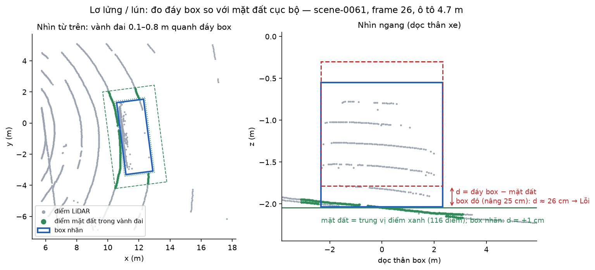
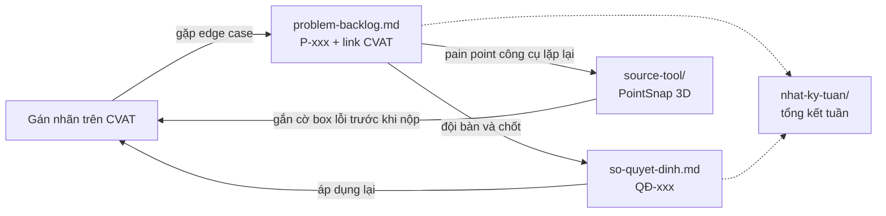

# P-029 · Cohort 4A — Gán nhãn 3D và PointSnap 3D

Repo làm việc của đội P-029: nhật ký gán nhãn, backlog edge case, sổ quyết định, và **PointSnap 3D** — công cụ đội tự
viết để phát hiện sớm lỗi nhãn 3D cuboid trên CVAT.

<p align="center">
  
</p>

## PointSnap 3D trong một phút

PointSnap đọc job 3D cuboid qua API của CVAT, đối chiếu từng box với point cloud LiDAR, các frame khác của track, ảnh
camera và spec gán nhãn, rồi **gắn cờ lên đúng box lỗi** để annotator sửa trước khi nộp. Tool chỉ cảnh báo, không tự sửa
box.

- **Bắt:** lơ lửng / lún, sai kích thước / sai class, đứt track (nhảy, tách ID, đổi nhầm ID), sai hướng, box lệch khỏi
  vật, sót đối tượng, sai thuộc tính và điều khoản spec gán nhãn VN.
- **Dùng:** giao diện web, extension ngay trong CVAT, hoặc dòng lệnh (`scan`, `gate` cho CI).
- **Kết quả** trên 5 cảnh nuScenes để kiểm tra: bắt 100% sai class, nhảy ≥ 2 m, lơ lửng 20 – 40 cm (khi có điểm mặt đất);
  lỗi lớn báo đúng mức Lỗi 30/30; quét một cảnh 7 – 20 giây.

👉 [README của PointSnap](source-tool/pointsnap-3d/README.md) · [Báo cáo dự án](source-tool/pointsnap-3d/docs/bao-cao-du-an.md) ·
[Cài từ máy trắng](source-tool/pointsnap-3d/CAI-DAT.md)

## Có gì trong repo

| Đường dẫn | Dùng để | Cập nhật khi nào |
|---|---|---|
| [`nhat-ky-tuan/`](nhat-ky-tuan/) | Ai giữ vị trí nào, được phân công gì, xong tới đâu (`_mau-tuan.md` là mẫu) | Đầu tuần phân công, cuối tuần chốt |
| [`problem-backlog.md`](problem-backlog.md) | Edge case gặp khi gán nhãn mà guideline chưa trả lời được, kèm link CVAT | **Ngay khi gặp** |
| [`so-quyet-dinh.md`](so-quyet-dinh.md) | Những gì đội đã chốt, và vì sao | Mỗi lần chốt một vấn đề |
| [`source-tool/`](source-tool/) | Công cụ đội tự viết để gỡ pain point khi gán nhãn | Khi đã xác định được pain point đáng làm tool |
| [`source-tool/pointsnap-3d/`](source-tool/pointsnap-3d/) | **PointSnap 3D**: code, extension, tài liệu, quản lý dự án | Theo PR |

```
.
├── nhat-ky-tuan/              nhật ký từng tuần
├── problem-backlog.md         P-xxx: edge case, pain point
├── so-quyet-dinh.md           QĐ-xxx: quyết định đã chốt
└── source-tool/
    ├── README.md              danh sách tool
    └── pointsnap-3d/
        ├── README.md          ← bắt đầu từ đây
        ├── CAI-DAT.md         cài toàn bộ: CVAT, nuScenes, PointSnap, extension
        ├── pointsnap/         code Python (luật, adapter CVAT / nuScenes, web, eval)
        ├── extension/         extension Chrome / Edge cho CVAT
        ├── tests/  scripts/
        ├── docs/              báo cáo, thiết kế, hướng dẫn, kết quả, hình
        └── quan-ly/           bảng việc, giao việc, bàn giao
```

## Các file nối với nhau thế nào



## Đội

| Người | Vị trí trong dự án PointSnap |
|---|---|
| Khúc Việt Anh | Sản phẩm: CVAT, adapter, web, extension, Box Verifier |
| Đặng Văn Huy | Sản phẩm: mặt đất, bộ phát hiện, đánh giá |
| Vũ Bảo Khánh | Báo cáo, slide |
| Nhữ Đình Chiến | Test quy trình, video demo |
| Nguyễn Văn Hân | Xem tay cảnh báo, bảng chỉ số |

## Vị trí khi gán nhãn

| Vị trí | Việc chính |
|---|---|
| **Lead** | Chia job, điều phối, đưa edge case ra bàn và chốt, giữ sổ quyết định |
| **Annotator** | Gán nhãn theo guideline; gặp chỗ guideline không trả lời được thì ghi vào backlog thay vì tự đoán |
| **Reviewer** | Kiểm job đã gán, trả lại chỗ sai kèm lý do |

Một người có thể giữ nhiều vị trí, nhưng **không review job do chính mình gán**.

## Quy ước

- **Mã**: `P-001`, `QĐ-001`, đánh số tăng dần. Không dùng lại số của mục đã bỏ.
- **Nhắc người**: bằng handle GitHub, ví dụ `@thanh-vien-a`.
- **Link CVAT**: trỏ tới đúng job và frame (`.../jobs/<id>?frame=<n>`), không trỏ tới cả task —
  người đọc phải mở ra là thấy ngay chỗ có vấn đề.
- **Mục guideline**: ghi số mục (`§3.2`) để ai cũng tra lại được.
- **Thay đổi repo**: mọi thay đổi, kể cả tài liệu, làm trên nhánh riêng rồi mở Pull Request; không push thẳng `main`.
