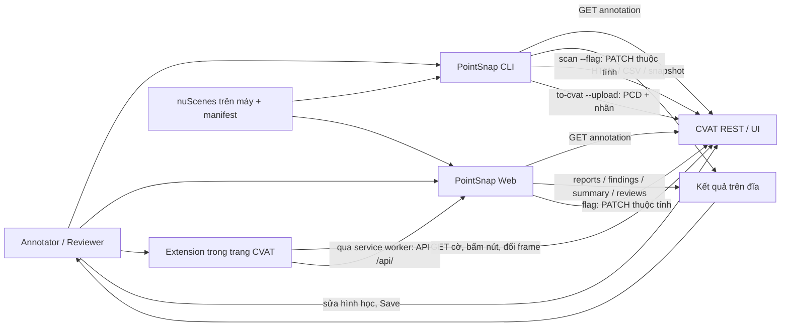
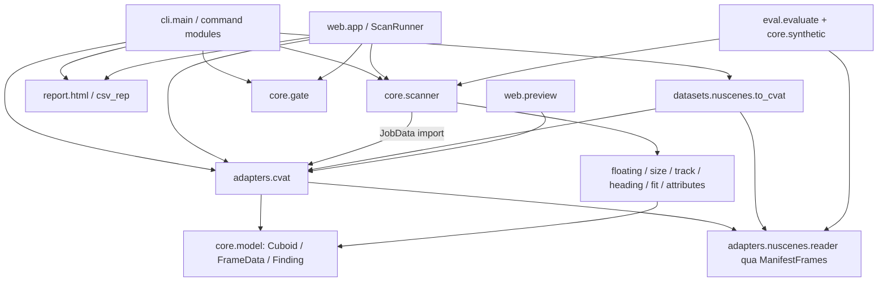
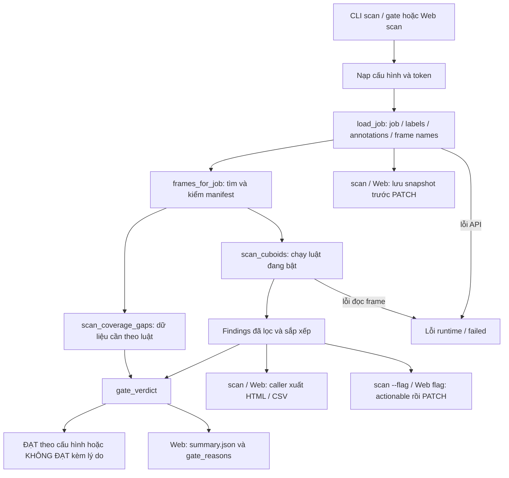

# Hiện trạng kiến trúc PointSnap — review 01, 11/10/2026

Mốc nguồn `5dcc97f1ffc1751d022e2474c0b50745e348af86`, cộng bản sửa review 01 trên nhánh `review/01-overview-architecture`. Đường dẫn trong bảng tính từ `source-tool/pointsnap-3d`. Đây là sơ đồ được đối chiếu với code; các bản `ARCHITECTURE*.md` chưa theo dõi trong working tree là bản nháp cục bộ.

## 1. Bối cảnh hệ thống

CVAT cung cấp annotation, còn point cloud/pose dùng để scan đến từ nuScenes trên máy. Extension đọc cờ, điều hướng và gửi yêu cầu quét qua Web. Người dùng sửa nhãn; tool chỉ ghi thuộc tính lỗi. Report API `/pointsnap/jobs/<id>/report` trong `pointsnap/api.py` chưa được theo dõi, không thuộc sơ đồ runtime công bố trên GitHub.

## 2. Module và hướng dependency

`scanner` trả `list[Finding]`; CLI/runner/API gọi các hàm xuất báo cáo và writer. Không có cạnh scanner → report hoặc scanner → PATCH. `core.scanner` thực sự import `JobData` từ CVAT reader; đây là coupling hiện hữu, không phải core hoàn toàn độc lập với adapter. Chưa cần tách thêm interface trong phần 01 vì scanner đã nhận được iterable cuboid và detector qua `FrameSource`.

## 3. Luồng scan và gate

- Không có manifest/manifest hỏng/không khớp tên frame: vẫn scan phần có thể chạy, cảnh báo rõ; gate dùng coverage để chặn kết luận ĐẠT khi thiếu dữ liệu cho luật bật.
- FrameSource tồn tại nhưng thiếu pose của một frame thuộc track: gate bị chặn. Thiếu file LiDAR khi scan: CLI gate mã 3; Web trạng thái `failed`.
- Mặt đất thưa: detector phát `floating.no_evidence` mức Thông tin; gate chặn vì thiếu bằng chứng, writer không gắn mục này như lỗi hình học.
- `gate` CLI không ghi snapshot/report/PATCH; `scan` không tự gọi gate. Web scan làm cả báo cáo và gate.
- Web: `queued → running → done` hoặc `failed`; `done` nghĩa hoàn tất tác vụ, không đồng nghĩa gate ĐẠT.
- `max_workers=1` mặc định; active run và ExtensionLink ở memory, lịch sử hoàn tất ở file. Khởi động lại mất trạng thái tiến trình đang chạy/focus, không mất các kết quả đã ghi đầy đủ.

## 4. Ledger quan hệ

| Mã | Nguồn → đích | Quan hệ | Bằng chứng code |
|---|---|---|---|
| L01 | console / `python -m pointsnap` → CLI | entry point | `pyproject.toml`, `pointsnap/__main__.py`, `cli/main.py:main` |
| L02 | CLI `ui` → uvicorn → FastAPI | khởi chạy Web | `cli/ui_cmd.py:run`, `web/app.py:create_app` |
| L03 | CLI/Web → CVAT reader/client | đọc annotation | `cli/scan_cmd.py:run`, `cli/gate_cmd.py:run`, `web/runner.py:_execute_scan`, `adapters/cvat/reader.py:load_job` |
| L04 | frames_for_job → ManifestFrames → NuScenesReader | kiểm manifest, tải LiDAR/pose | `cli/common.py:frames_for_job`, `adapters/cvat/reader.py:ManifestFrames` |
| L05 | scanner → detector | điều phối và lọc luật | `core/scanner.py:scan_cuboids`, `is_rule_enabled`, sáu hàm `check_*` |
| L06 | scanner → CVAT reader | import JobData | đầu `core/scanner.py` |
| L07 | CLI/Web → scanner coverage → gate | dữ liệu kiểm tra và verdict | `cli/gate_cmd.py:run`, `web/runner.py:_execute_scan`, `core/gate.py:gate_verdict` |
| L08 | scan/Web → snapshot/report | caller ghi file | `cli/scan_cmd.py:run`, `web/runner.py:_execute_scan`, `adapters/cvat/writer.py:save_snapshot` |
| L09 | scan/Web → writer → CVAT PATCH | chỉ theo tùy chọn flag | `adapters/cvat/writer.py:flag_job_errors`, `adapters/cvat/client.py` |
| L10 | converter → reader → PCD/manifest/ground_truth | xuất cảnh local | `datasets/nuscenes/to_cvat.py:export_scene` |
| L11 | converter → client → CVAT | tạo task, upload ZIP, PUT annotation | `datasets/nuscenes/to_cvat.py:upload_scene`, `build_annotations` |
| L12 | eval → synthetic/scanner | chèn lỗi và đo luật, không huấn luyện | `eval/evaluate.py:evaluate_scene`, `run_evaluation`, `core/synthetic.py` |
| L13 | Web → ProjectManager → file | lưu config/guideline/token/kết quả | `web/projects.py:ProjectManager`, `web/runner.py` |
| L14 | Web → preview/reviews | xem cloud và lưu verdict xem tay | `web/app.py` routes preview/reviews, `web/preview.py` |
| L15 | Web → ExtensionLink | focus/poll trong memory | `web/app.py` routes extension, `web/link.py` |
| L16 | extension → PointSnap | chrome messaging và HTTP từ service worker | `extension/background.js:callPointSnap`, `extension/src/content.js` |
| L17 | extension → CVAT DOM/API | đọc nhãn/cờ và điều hướng | `extension/src/cvat-api.js`, `cvat-dom.js`, `seed.js`, `manifest.json` |

## 5. Hợp đồng và dữ liệu lưu

| Biên | Invariant / persistence | Chỗ kiểm sâu tiếp theo |
|---|---|---|
| Cuboid | mét, `(length,width,height)`, length theo x local, yaw radian `[-π,π)`, z lên, tâm hình học | 02/03: geometry/model/shapes |
| nuScenes → CVAT | theo LIDAR_TO_EGO_ROT: `(x,y,z) → (y,-x,z)`, yaw − π/2 (−90°); manifest giữ transform, sample token và tên frame | 03: vòng chuyển/đọc lại trên dữ liệu thật |
| CVAT points | 16 số, center/rotation/scale; roll/pitch giữ trong attrs khi ghi ngược | 03: bảo toàn nhãn/PATCH trên task thử |
| Frame/ID | zero based, tên PCD sắp lexicographical, thứ tự task phải khớp manifest; PATCH có thể tạo lại ID | 03/05: đọc lại/quét lại trước link tới box |
| outside/occluded | outside kết thúc đoạn; occluded không kiểm hình học; gap theo `add_track_markers`, spec 4.4 | 02/03: từng luật và case biên |
| Cấu hình | default → env → --config; Web ưu tiên URL dự án; rules lọc finding | 06: validation/secrets; 02: ngưỡng/class applicability |
| Gate | counts + coverage; missing ground evidence chặn; rule tắt không được chứng nhận | 04/05/07: dùng cùng hợp đồng |
| CLI | `out/` hoặc --out: snapshot/report; `data/cvat/` hoặc --out: bản xuất | 04/08: lỗi đĩa, backup, cài đặt |
| Web | `POINTSNAP_HOME` hoặc `~/.pointsnap`: projects/slug/{project,secret,guideline,runs}; run chứa snapshot/findings/summary/reports/reviews | 04/06: isolation, concurrency, token handling |
| Runtime | `_scans` / executor / ExtensionLink ở memory; `reviews.json` và history trên đĩa | 04/05: restart/multiple processes |

Sơ đồ là bằng chứng đọc code. Test mock và Node không chứng nhận giao diện CVAT thật, dataset thật hoặc khả năng triển khai đa người dùng.
