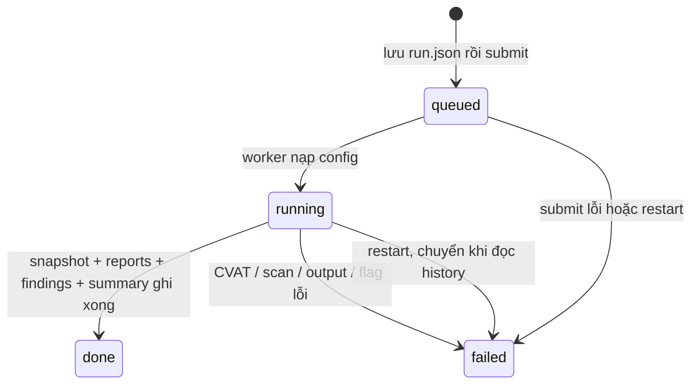

# Phần 04 — Hợp đồng API/CLI và trạng thái scan

Code `83832f9`, ngày 11/10/2026. Đường dẫn code tính từ tool root. Schema Web là Pydantic; tham khảo `/openapi.json` của đúng commit. Lỗi validation request mặc định 422. File JSON hỏng 409; lỗi I/O được handler 503. Không có cơ chế login/tenant mới trong phần 04.

## 1. Web API

| Method | Path đầy đủ | Input / output chính | Status và ca lỗi chính |
|---|---|---|---|
| GET | `/api/projects` | list project: name/slug/url/data paths/has_token/runs_count; không token | 200; project hỏng có thể bị list bỏ qua, cần GET trực tiếp để chẩn đoán |
| POST | `/api/projects` | CreateProjectRequest: name, slug?, description, cvat_url, cvat_token?, nuscenes_root, export_dirs, preset_slug? → project | 201; 400 duplicate/slug/name/preset; 503 I/O |
| GET | `/api/projects/{slug}` | project public metadata | 200; 404 không tồn tại/slug sai; 409 JSON hỏng |
| PUT | `/api/projects/{slug}` | UpdateProjectRequest; null field bỏ qua, token rỗng xóa token → project | 200; 400 thiếu project/name rỗng; 409 JSON hỏng |
| DELETE | `/api/projects/{slug}` | xóa project và runs → ok/message; idempotent khi đã vắng | 200; 400 slug/path sai; 409 có queued/running |
| GET | `/api/projects/{slug}/guideline` | config + YAML đã bỏ token; YAML được serialize lại | 200; 404 thiếu guideline; 400 YAML hỏng |
| PUT | `/api/projects/{slug}/guideline` | config dict hoặc yaml string; yaml ưu tiên nếu cả hai → ok/config | 200; 400 YAML/schema/dynamic map sai; 404 project thiếu |
| POST | `/api/projects/{slug}/guideline/reset` | default schema sạch env → ok/config | 200; 404 project thiếu |
| GET | `/api/projects/{slug}/cvat/check` | connected, url, version? hoặc error | 200 kể cả kết nối lỗi/thiếu token; 404 project thiếu |
| GET | `/api/projects/{slug}/cvat/tasks` | tasks[id,name,jobs[id,status,stage]]; phân trang qua client | 200; 400 thiếu token/lỗi CVAT/config; 404 project thiếu |
| POST | `/api/projects/{slug}/scans` | job_id>0, flag=false → run_id | 202; 422 job sai; 404 project; 429 đầy queue; 503 lưu queue lỗi |
| GET | `/api/projects/{slug}/scans` | list run, mới nhất trước; failed có error | 200; 404 project thiếu; run hỏng thể hiện failed |
| GET | `/api/projects/{slug}/scans/{run_id}` | RunInfo; done kèm summary/findings/reviews | 200; 400 ID sai; 404 run/project; 409 thiếu/hỏng output |
| GET | `/api/projects/{slug}/scans/{run_id}/findings/{index}/preview` | frame/exact_frame/label/distance/track_id/box/points | 200; 400 ID; 404 project; 422 snapshot/manifest/box/index thiếu; 409 findings hỏng |
| PUT | `/api/projects/{slug}/scans/{run_id}/reviews/{index}` | verdict ok/fp/null → reviews dict | 200; 404 run/index; 422 verdict sai; 409 dữ liệu hỏng |
| GET | `/api/projects/{slug}/scans/{run_id}/reviews` | reviews + rev | 200; 404 run/project; 409 reviews hỏng |
| POST | `/api/projects/{slug}/scans/{run_id}/flag` | tạo scan fresh cùng job, flag=true → run_id/message | 202; 404 run/project; 409 chưa done/server đổi/thiếu source URL; 429 queue đầy |
| POST | `/api/extension/focus` | job_id>0, frame>=0, cvat_url, label/message/run_id/index/bring → seq/extension_online | 200; 400 scope URL thiếu/sai; 422 schema |
| GET | `/api/extension/poll` | job_id, after=-1, cvat_url → seq/command/reviews_rev | 200; 400 scope URL; after<0 bỏ lệnh cũ |
| GET | `/api/extension/status` | job_id,cvat_url → extension_online/reviews_rev | 200; 400 scope URL |
| GET | `/api/extension/jobs/{job_id}` | cvat_url → project public name/slug, latest done run, latest active run | 200, project=null nếu không có match; 400 URL/scope; 409 run hỏng |
| GET | `/api/projects/{slug}/scans/{run_id}/report.html` | HTML UTF-8 inline, active box count và gate/coverage | 200; 400 ID; 404 project/file; 409 run dở/hỏng |
| GET | `/api/projects/{slug}/scans/{run_id}/report.csv` | CSV UTF-8 BOM, attachment report_<run_id>.csv | 200; 400 ID; 404 project/file; 409 run dở/hỏng |

Ngoài 23 method nghiệp vụ: `GET /`, `/static/*`, `/docs`, `/redoc`, `/openapi.json` theo FastAPI/static. Static/index no-cache; chưa có policy cache bí mật toàn Web, chuyển 06.

Project public fields là metadata cho local app. `has_token` không phải chứng nhận token còn dùng được. Scope project là đường dẫn chọn project, chưa phải authorization cho nhiều người dùng LAN.

## 2. Scan lifecycle và persistence

- Một worker; tối đa 16 queued/running. Run ID dạng `YYYYMMDD-HHMMSS-<12 chữ số>-job<id>`; vẫn đọc ID cũ không suffix hoặc suffix millisecond. Timestamp ID theo giờ máy; started_at/finished_at và summary timestamp là UTC ISO.
- `run.json` giữ state/job/project/flag/progress/time/error/summary. Progress chi tiết đang chạy nằm trong RAM; disk có transition queued/running/done/failed, không lưu từng bước progress.
- `snapshot.json` giữ nhãn trước flag; `findings.json` là JSON records; `summary.json` có counts, gate, coverage, URL/task và config đã che token.
- `report.html`, `report.csv` được tạo trước flag, giữ snapshot kết quả quét. Nếu flag lỗi, run failed; endpoint không tải report dở dù file đã có.
- Sau restart không tự resume/ghi CVAT lại. Run queued/running không có trong memory được đổi failed khi đọc; history đã done/failed vẫn đọc được.
- `secret.json` riêng project; guideline không token. JSON/YAML ghi qua file tạm unique + os.replace; lock reviews và update project chỉ trong một process/manager.
- Bridge command/seq/heartbeat/reviews revision chỉ memory; hết 4 giây không poll coi offline. Scope chuẩn hóa URL (loopback aliases, default port, path) + job ID.
- Caller cũ không gửi cvat_url chỉ dùng được khi một URL project; nhiều server phải cập nhật cả Web/extension để tránh lẫn scope. Run legacy chưa lưu URL lịch sử cần xem snapshot hoặc quét mới.

## 3. CLI

| Lệnh | Input chính | Output / exit |
|---|---|---|
| `pointsnap --version` | không | version / 0 |
| `pointsnap --config FILE config` | config global đứng trước subcommand | YAML hiệu lực, token *** / 0; schema/file lỗi 3 |
| `pointsnap scan` | --job bắt buộc, --out, --manifest, --flag | snapshot_job_ID.json + report_job_ID.html/csv; hoàn thành 0, runtime 3; 0 không có nghĩa gate đạt |
| `pointsnap gate` | --job bắt buộc, --manifest | verdict/count/reasons; đạt 0, không đạt/coverage thiếu 1, runtime 3 |
| `pointsnap diff OLD NEW` | --out | **chưa triển khai A8**, stderr + 3 |
| `pointsnap nuscenes` | --dataroot/--version/--taxonomy rồi scenes/to-cvat/scan | scenes, export/upload hoặc report; 0/3, thiếu action/arg 2 |
| `pointsnap eval` | --dataroot/--scenes/--rounds/--seed/--errors/--out | metrics output / 0 hoặc 3; chất lượng metrics review ở 07 |
| `pointsnap ui` | --host/--port/--no-browser | uvicorn Web / 0 hoặc 3; bind default loopback |

Argparse thiếu/sai cú pháp exit 2; lỗi runtime được main quy về 3. CLI dotenv không ghi đè env có sẵn. Default config → CVAT_URL env → file config; CVAT_TOKEN chỉ từ env. Web dùng default schema + guideline project; URL/token project ghi đè, không tự chia sẻ file --config của CLI.

## 4. Report API bổ sung

API dùng ThreadingHTTPServer, **process riêng** với Web FastAPI. Không quản lý project CRUD; không dùng secret project hoặc cache report từ caller trước.

| Method / path | Input | Output/status |
|---|---|---|
| GET `/pointsnap/health` | không cần PAT | 200 status=ok; chỉ xác nhận process sống, không kiểm CVAT/dataset |
| GET `/pointsnap/jobs/{job_id}/report` | Authorization: Bearer CVAT_PAT; job_id dương; format=json/html/csv, default json | 200; 400 format; 401 PAT thiếu/sai; 403 không quyền; 404 job thiếu; 422 non-3D; 429 hết 2 slots; 502 upstream; 500 lỗi nội bộ |
| POST bất kỳ path | không | 405, Allow GET; các method khác chưa có handler trả mặc định HTTP server |

Response `private, no-store`, `Vary: Authorization`, `nosniff`; formats HTML/CSV có attachment. Một client CVAT/token cho từng request, đóng session và trả slot cả khi lỗi. Redirect/foreign origin bị chặn. Backend URL đến CVAT khác với CVAT_WEB_URL cho link người dùng.

JSON: job_id/task_id, boxes active, errors/warnings/info, passed, gate_reasons, coverage_gaps, enabled_checks, checks, point_cloud_available/note/pose_available, findings. `enabled_checks` là switches hiệu lực; `checks` là các luật đủ điều kiện ở cấp nguồn dữ liệu, **không chứng nhận từng box có đủ bằng chứng**. `floating.no_evidence` vẫn chặn gate. HTML có cùng verdict/coverage; CSV chỉ các finding.

`python -m pointsnap.api` dùng env/default config, không tự nạp .env như CLI; đọc env CVAT_URL/NUSCENES_ROOT/POINTSNAP_EXPORT_DIR/CVAT_WEB_URL. Entrypoint hiện bind 0.0.0.0:8081, cần review deployment ở 06/08 trước khi expose. Docker/Compose vẫn local, không suy ra clone nhánh này có stack Docker đã nghiệm thu.

## 5. Get-Report.ps1

- JobId dương, Format json/html/csv, OutFile tùy chọn, ApiUrl tùy chọn (default route qua localhost:8080).
- Token env trước, rồi .env cạnh script nếu có; không đưa token vào URL/argument.
- ApiUrl phải HTTP(S), không userinfo/query/fragment. URL API direct khi chạy standalone có thể là `http://127.0.0.1:8081`.
- UTF-8 BOM để PowerShell 5.1 đọc source Việt; PowerShell 7 đã smoke tải bằng PAT chỉ đọc.
- Máy review Windows PowerShell 5.1 Restricted chặn thực thi file; không đổi policy máy. Parse 5.1 vẫn được kiểm.

## 6. Kiểm chứng

Tất cả catalog được đối chiếu code/routes của `83832f9`. Ca backend trong `test_web*`, `test_cli.py`, `test_gate_coverage.py`, `test_backend_review_regressions.py`, `test_report_api.py`; kết quả và thực thi live ở [evidence](evidence/04/test-results.md). Chưa mở rộng thành nghiệm thu mọi UI route, browser extension hoặc deploy nhiều process.
