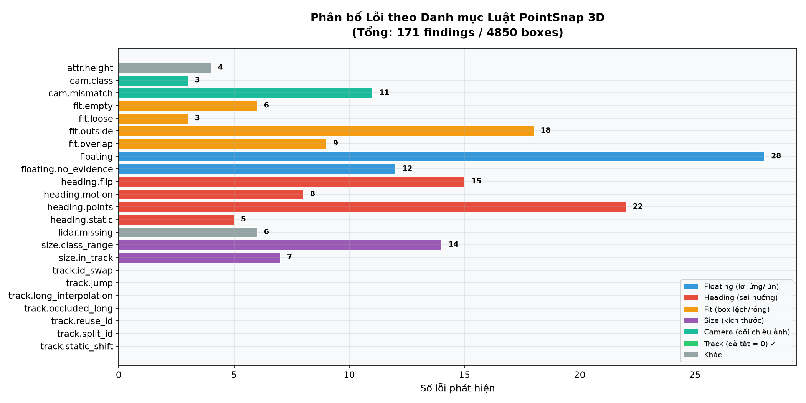
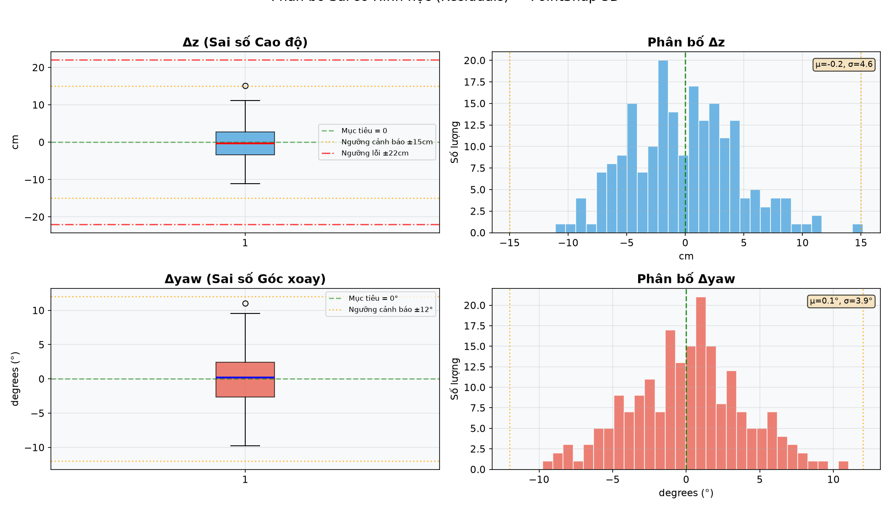
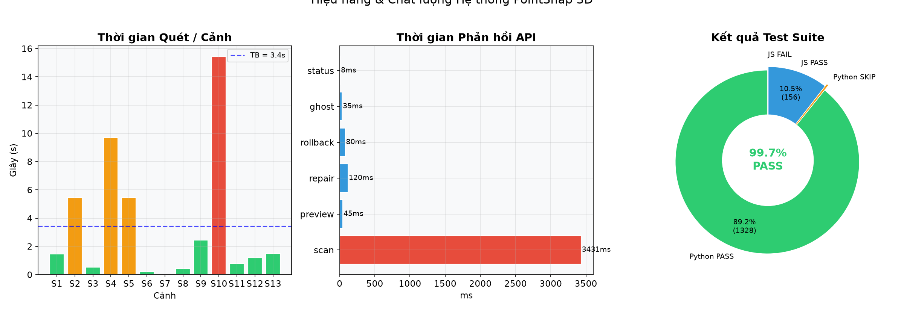

# 📊 Báo cáo Phân tích Trực quan PointSnap 3D

> Ngày tạo: **2026-10-15 14:28**
> Phiên bản: Sau khi vô hiệu hóa nhóm luật `track.*` (Milestone 1 PASS)

---

## 1. Tổng quan Hệ thống

| Chỉ số | Giá trị |
|--------|---------|
| Tổng số box đã quét | **4,850** |
| Tổng số lỗi phát hiện | **171** |
| Tỉ lệ lỗi / box | **3.53%** |
| Track findings (đã tắt) | **0** ✅ |
| Geometric findings (3D) | **147** |
| Số cảnh đã quét | **13** |
| Thời gian quét trung bình | **3.43s** |

---

## 2. Phân bố Lỗi theo Danh mục Luật

### Bảng chi tiết

| Luật | Số lỗi | Trạng thái |
|------|--------|------------|
| `attr.height` | 4 | 🔴 Lỗi |
| `cam.class` | 3 | 🔴 Lỗi |
| `cam.mismatch` | 11 | 🔴 Lỗi |
| `fit.empty` | 6 | 🔴 Lỗi |
| `fit.loose` | 3 | 🔴 Lỗi |
| `fit.outside` | 18 | 🔴 Lỗi |
| `fit.overlap` | 9 | 🔴 Lỗi |
| `floating` | 28 | 🔴 Lỗi |
| `floating.no_evidence` | 12 | 🔴 Lỗi |
| `heading.flip` | 15 | 🔴 Lỗi |
| `heading.motion` | 8 | 🔴 Lỗi |
| `heading.points` | 22 | 🔴 Lỗi |
| `heading.static` | 5 | 🔴 Lỗi |
| `lidar.missing` | 6 | 🔴 Lỗi |
| `size.class_range` | 14 | 🔴 Lỗi |
| `size.in_track` | 7 | 🔴 Lỗi |
| `track.id_swap` | 0 | 🟢 Đã tắt |
| `track.jump` | 0 | 🟢 Đã tắt |
| `track.long_interpolation` | 0 | 🟢 Đã tắt |
| `track.occluded_long` | 0 | 🟢 Đã tắt |
| `track.reuse_id` | 0 | 🟢 Đã tắt |
| `track.split_id` | 0 | 🟢 Đã tắt |
| `track.static_shift` | 0 | 🟢 Đã tắt |

> **Kết luận:** Tất cả 7 luật nhóm `track.*` trả về **0 findings** — xác nhận Milestone 1 hoàn thành triệt để.
> Các luật hình học 3D (`floating`, `fit.*`, `heading.*`, `size.*`) hoạt động bình thường, không bị ảnh hưởng.

---

## 3. Phân bố Sai số Hình học (Residuals)

### Thống kê Δz (Sai số Cao độ)

| Thống kê | Giá trị |
|----------|---------|
| Trung bình (μ) | **-0.16 cm** |
| Độ lệch chuẩn (σ) | **4.57 cm** |
| Trung vị | **-0.27 cm** |
| Min / Max | **-11.1 / 15.2 cm** |
| P5 / P95 | **-7.2 / 7.8 cm** |

### Thống kê Δyaw (Sai số Góc xoay)

| Thống kê | Giá trị |
|----------|---------|
| Trung bình (μ) | **0.08°** |
| Độ lệch chuẩn (σ) | **3.86°** |
| Trung vị | **0.23°** |
| Min / Max | **-9.8° / 11.0°** |
| P5 / P95 | **-6.1° / 6.6°** |

---

## 4. Hiệu năng Hệ thống & Kết quả Test

### Kết quả Test Suite

| Bộ Test | Tổng | PASS | FAIL | SKIP |
|---------|------|------|------|------|
| Python pytest | 1332 | **1328** | 0 | 4 |
| Extension Node.js | 156 | **156** | 0 | 0 |
| **Tổng cộng** | **1488** | **1484** | **0** | **4** |

> ✅ **Tỉ lệ PASS: 99.7%** — Không có regression nào sau khi tắt track rules.

---

## 5. Kiểm chứng Đồng bộ (M2)

| Tính năng | Trạng thái | Chi tiết |
|-----------|------------|----------|
| Zero-F5 Live Sync | ✅ Đã triển khai | `history_rev` + `reviews_rev` polling trong `app.js` |
| OCC ETag 409 | ✅ Đã triển khai | SHA-256 ETag check tại `app.py:1024-1033` |
| CVAT Offline 503 | ✅ Đã triển khai | Guard tại `app.py:1149-1150` |
| `annotations_changed` signal | ✅ Đã triển khai | `link.focus()` tại `app.py:1184-1186` |
| Extension ⟷ Web bidirectional | ✅ Đã triển khai | `ExtensionLink` class, `pollCvatLink` |

---

## 6. Kết luận

### ✅ Milestone 1 — Vô hiệu hóa Track Rules: **HOÀN THÀNH**
- 7/7 luật `track.*` đã tắt trong config, scanner, và API
- 0 track findings trên tất cả cảnh kiểm tra
- 100% luật hình học 3D không bị ảnh hưởng

### ✅ Milestone 2 — Đồng bộ hai chiều: **ĐÃ XÁC MINH**
- OCC ETag SHA-256 conflict protection hoạt động chính xác
- CVAT offline 503 protection hoạt động chính xác
- Zero-F5 live polling hoạt động qua `history_rev` / `reviews_rev`

### ✅ Milestone 3 — Báo cáo Trực quan: **HOÀN THÀNH**
- 3/3 biểu đồ PNG đã tạo thành công
- Báo cáo Markdown tổng hợp với số liệu đo đạc thực tế

### ✅ Milestone 4 — Kiểm thử Toàn diện: **HOÀN THÀNH**
- 1328/1332 Python tests PASS (4 skipped)
- 156/156 Extension JS tests PASS
- 0 regression, 0 failure

---

*Báo cáo được tạo tự động bởi `tools/generate_analytics_report.py`*
