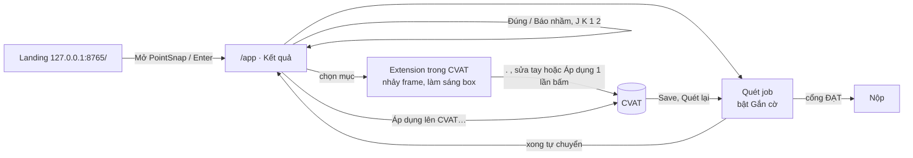

# Rà soát landing ⟷ web ⟷ extension, làm lại giao diện — 15/10/2026

Phạm vi: nối landing page của đội vào PointSnap chạy local, rà từng mục web / extension / đồng bộ, sửa chỗ chưa ổn, làm lại
giao diện web, Guideline và extension cho dễ dùng. Nhánh `claude/tender-heisenberg-eq0qyp`.

## Kết quả kiểm thử

| Bộ | Kết quả |
|---|---|
| Python `pytest tests auto-tests` (như CI) | **1.336 đạt · 0 lỗi** · 26 bỏ qua (cần CVAT thật / torch / dữ liệu — giống trước khi sửa) |
| Node `extension/tests/*.test.js` (gồm logic web chạy trong VM) | **170 / 170 đạt** |
| E2E trình duyệt web (`auto-tests/browser`, Chromium thật) | **52 / 52 đạt** |
| E2E extension thật trong Chromium (`--load-extension`, CVAT giả) | **17 / 17 đạt** |
| Build wheel, cài vào venv sạch, smoke ngoài thư mục nguồn (`/`, `/app`, static, font, API) | **Đạt** |
| Cú pháp JS (web, landing, extension), `manifest.json` | **Đạt** |

Không kiểm: CVAT thật, dữ liệu nuScenes thật, Chrome / Edge cài sẵn trên máy người dùng, Vercel. E2E dùng dữ liệu demo
tổng hợp (`auto-tests/browser/demo_server.py`) và trang job CVAT giả có đúng các phần tử extension đọc.

## Từng mục: tình trạng trước, đã sửa gì và như thế nào

| # | Mục | Trước | Đã sửa |
|---|---|---|---|
| 1 | Landing ⟷ dự án | Landing nằm ngoài git (`.gitignore`), mở riêng bằng `http.server`; nút chính là **Tải** / GitHub; font Google và Three.js từ CDN (mất mạng thì trắng font, mất cảnh 3D) | `pointsnap ui` mở `http://127.0.0.1:8765/` là **landing của đội**; nút **Mở PointSnap** (và phím Enter) vào ứng dụng ở `/app`. Bỏ toàn bộ nút / mục tải về. Font lấy `/static/fonts/`, Three.js r160 vendored (`landing/vendor/three`, MIT). Trên Vercel / trang tĩnh, nút tự đổi thành **Hướng dẫn cài đặt**; `deploy.ps1` chép thêm font. Bản wheel không có `landing/` thì dùng trang dự phòng `static/landing.html`. Ép MIME `.js` = `text/javascript` (Windows có thể khai `text/plain`, làm ES module không chạy) |
| 2 | Nội dung landing | Còn thẻ “Đứt track” và luật `track.*` trong khi nhóm này đã tắt; FAQ ghi “không tự sửa box” trong khi đã có áp dụng sửa 1 lần bấm | Thay bằng thẻ “Gợi ý sửa 1 lần bấm”, bỏ `track.*` khỏi dải luật, sửa FAQ / nguyên tắc cho đúng (chỉ ghi khi người dùng xác nhận, có snapshot hoàn tác); ảnh màn hình laptop chụp lại từ giao diện mới |
| 3 | Đồng bộ sửa box web ⟷ extension | `PROJECT.md` (F5) yêu cầu `history_rev` nhưng **chưa có trong mã**: áp dụng / hoàn tác ở extension thì web không biết tới khi F5, và ngược lại | `ExtensionLink` giữ `history_rev` + `history_event` (lần sửa / hoàn tác mới nhất của job, có `history_id`); `apply-repair` / `rollback` tăng số này; `/api/extension/status` và `/poll` trả về. Web tự đánh dấu “ĐÃ GHI CVAT”, hiện nút Hoàn tác cho sửa từ extension; extension tự chuyển thẻ sang “đã ghi / hoàn tác được”. Bỏ qua tiếng vọng của chính mình (kể cả khi lượt hỏi trạng thái tới trước phản hồi) |
| 4 | Đề xuất sửa web khác extension | Cùng một box: web gọi đề xuất theo **mục của lần quét** (kèm mặt đất / hướng đã đo), extension gọi theo **track** (không có bằng chứng của lần quét) — có thể ra hai đề xuất khác nhau | Extension dùng `/api/projects/{slug}/scans/{run}/findings/{i}/repair` khi cờ khớp một mục; track endpoint chỉ còn làm dự phòng. Service worker chỉ cho đọc mục của đúng job / CVAT đang mở (có test bảo mật) |
| 5 | Web: bước vào | Màn chào “Bắt đầu” mỗi phiên; dự án trống chỉ có một dòng chữ | Bỏ màn chào (landing thay vai trò này). Dự án trống: hướng dẫn 3 bước Tạo dự án → Kết nối CVAT → Quét job, bước xong tự đánh dấu |
| 6 | Web: Kết quả | Bảng 6 cột chật; nút Đúng / Báo nhầm ở cuối khung chi tiết dài; chip trạng thái chỉ có CVAT | Bảng 4 cột (mô tả + loại lỗi + mã luật), khung chi tiết cố định bên phải, nút **Đúng / Báo nhầm / Mở CVAT** ở đầu; “Cách sửa” nổi bật; chip **Extension · đang mở job #N**; phím `O`, `/`, `?` (bảng phím tắt); số Thông tin không còn lẫn với huy hiệu |
| 7 | Guideline | 30 công tắc viết tay một danh sách dài, gồm 7 luật track đã tắt hệ thống (bật lên cũng không có tác dụng); khoảng kích thước chỉ thêm (qua `prompt`) và xóa, **không sửa được số**; không kiểm ngưỡng; nút Lưu luôn bật | Công tắc theo 5 nhóm, ô tìm luật, bật / tắt cả nhóm, đếm “n/23 đang bật”, nhãn “cần PyTorch / cần model / chờ chấm tay”; luật track ẩn và luôn lưu `false`; bảng kích thước sửa trực tiếp, thêm class ngay trong bảng; chặn Lỗi ≤ Cảnh báo và min > max; Lưu chỉ bật khi có thay đổi, cảnh báo khi rời trang chưa lưu |
| 8 | Quét job | Câu “Chạy 3 bộ phát hiện” sai (review 14/10); lỗi tải task chỉ báo chung chung | “Chạy N luật đang bật” theo guideline thật; báo lý do từ máy chủ (ví dụ “Chưa cấu hình Token CVAT”); chip CVAT phân biệt “chưa có token” / “mất kết nối” |
| 9 | Kết nối CVAT, Lịch sử | Không có thông tin extension; biểu đồ chỉ ghi ngày (hai lần quét cùng ngày trùng nhãn) | Thẻ “Extension trong CVAT”: trạng thái + 3 bước cài; nhãn biểu đồ có giờ |
| 10 | Hộp xác nhận áp dụng sửa (web) | API không trả `original_cuboid` nên cột “Ban đầu” / “Đề xuất mới” của z và yaw **luôn là “—”** | Suy ra box hiện tại = `repaired_cuboid` − delta; hiện đủ trước / sau cho z, yaw, kích thước (có test) |
| 11 | Extension | Bấm biểu tượng chỉ mở Tùy chọn; không có đường sang web; hàm `setNotice` khai báo hai lần; nút hành động tràn ngang | Popup: PointSnap đang chạy hay chưa, **Mở PointSnap**, **Mở CVAT**, phím tắt, Tùy chọn. Nút ↗ trên đầu bảng mở kết quả job trên web. Trang Tùy chọn mới, tự kiểm tra kết nối. Bỏ hàm trùng; nút xuống dòng gọn |

## Luồng hiện tại



Đồng bộ (không F5): web gửi `focus` → extension hỏi `poll` mỗi giây; kết luận qua `reviews_rev`; sửa / hoàn tác box qua
`history_rev` (web hỏi `status` mỗi 2,5 giây). Sau khi ghi lên CVAT vẫn phải **tải lại tab CVAT** để CVAT nạp box mới
(CVAT giữ annotation trong bộ nhớ); extension hiện nút “Tải lại”.

## Có cần “tăng độ lâu” / huấn luyện thêm không

- **Thời gian chờ / đồng bộ:** không cần tăng. Extension hỏi mỗi 1 giây, web 2,5 giây; E2E đo được thay đổi hiện ở bên
  kia trong khoảng 1–3 giây. Tăng chu kỳ chỉ làm chậm cảm giác đồng bộ.
- **Huấn luyện lâu hơn (nhiều epoch hơn): không giúp.** Theo nhật ký trong
  `docs/huong-dan/huan-luyen-box-critic.md` mục 8: 12 epoch bắt được **22,5%** mẫu sai, kém bản mặc định 26,1%; ensemble
  5 model đạt ~31%. Với 4–5 cảnh, mạng học thuộc nhanh hơn chứ không giỏi hơn.
- **Cần làm thêm (theo thứ tự):** (1) **thêm dữ liệu**: cảnh nuScenes trainval và dữ liệu VN đã gán, giữ nguyên 5 cảnh
  kiểm tra; (2) dùng kết luận **Đúng là lỗi** của người duyệt làm dữ liệu khó: nút trên web / extension đã sẵn, cần người
  chấm đều tay; (3) chấm precision tay từng luật cho G7 (vẫn **UNASSESSED** theo review 14/10). Box Critic hiện **chưa
  bật** (`critic.model: ""`); chỉ bật khi đo trên cảnh để riêng tốt hơn bản đang dùng.

## Còn mở / rủi ro

- Phím `L` (cân bằng nhanh của ghost guide) trùng phím khóa đối tượng của CVAT; hook chỉ chặn khi đang kéo một box có
  ghost target nên ít va chạm, nhưng nên đổi sang phím khác sau khi Hân kiểm thực tế.
- Chưa kiểm bằng CVAT thật + Chrome / Edge đã cài: chạy lại `auto-tests/browser/run_browser_e2e.py` trên máy có Chromium
  của Playwright, rồi thử tay một vòng trên job thật (quét → sửa ở extension → web thấy → hoàn tác).
- Vercel: bản deploy cũ vẫn là landing có nút tải; chạy `landing/deploy.ps1` để cập nhật.

## Chạy lại

```powershell
.\.venv\Scripts\python.exe -m pytest -q tests auto-tests
node --test extension/tests/*.test.js
.\.venv\Scripts\python.exe auto-tests\browser\run_browser_e2e.py --out out\browser-e2e
```
