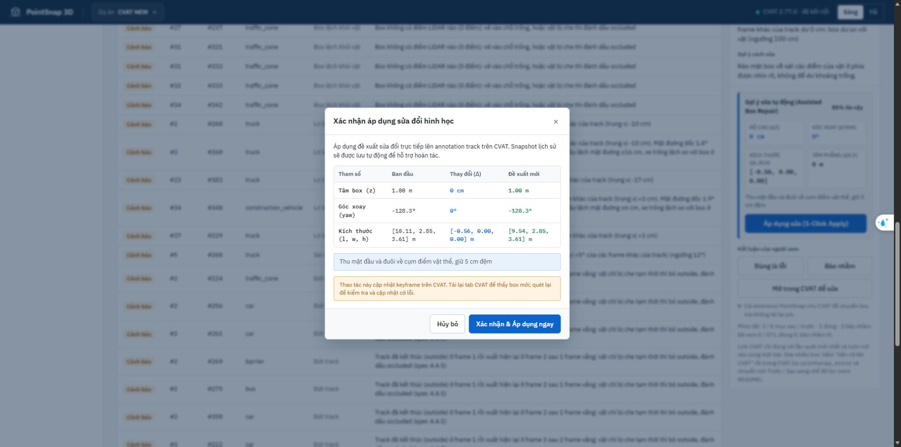
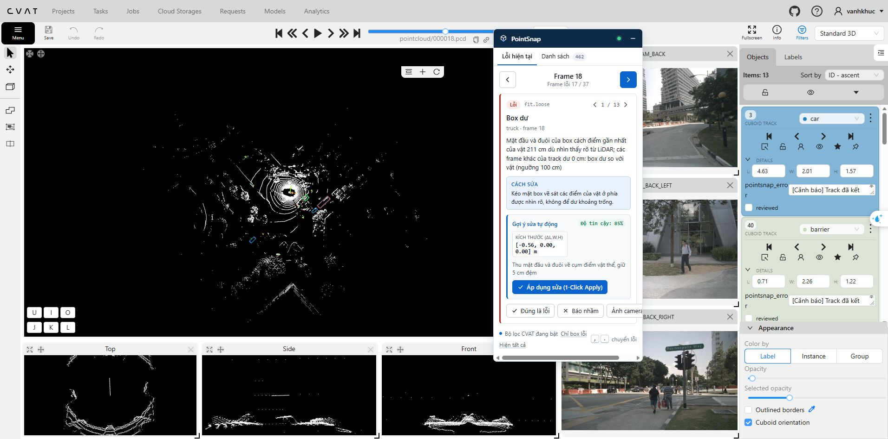

# Kiểm tra sửa box, đồng bộ CVAT và bộ nhớ hướng — 15/10/2026

Đã sửa các lỗi tìm được trong bản làm việc và khởi động lại PointSnap tại http://127.0.0.1:8765. Lần kiểm thử cuối: **1.317 test Python + 79 test JavaScript đạt; 0 fail, 0 skip**. Các test ghi lên CVAT dùng task thử riêng và xóa task do test tạo sau khi chạy. Job #2 được đọc và kiểm tra đề xuất trong bộ nhớ; đợt kiểm tra này không áp dụng các đề xuất lên job của người gán nhãn.

## Vì sao trước đây bấm sửa nhưng không thấy thay đổi

| Lỗi tìm được | Thay đổi đã làm |
|---|---|
| `fit.loose` dùng kích thước trung vị của track, có thể trả delta bằng 0 nhưng vẫn báo tin cậy cao và PASS | Thu đúng mặt dư có bằng chứng điểm LiDAR; chặn đề xuất không thay đổi hình học ở cả API, web và extension |
| Backend bắt lỗi PATCH CVAT rồi vẫn trả thành công | Đọc nhãn mới trước ghi, gửi phiên bản annotation, ghi và đọc lại xác nhận geometry/thuộc tính; lỗi kết nối hoặc dữ liệu không khớp trả lỗi |
| Hoàn tác chỉ lấy `application.state.cvat_client`, bỏ qua kết nối của dự án | Hoàn tác kết nối lại đúng dự án và đối chiếu track hiện tại; không đè lên sửa đổi mới |
| Mọi lần sửa đều được gắn `new_scan_verdict=PASS` dù chưa quét | Trả `NOT_RUN`; giao diện ghi “ĐÃ GHI CVAT” sau xác nhận, hướng dẫn quét lại |
| Payload cuboid mới mặc định roll/pitch bằng 0 | Giữ góc nghiêng và các trường points khác của box gốc khi chỉ sửa tâm/kích thước/yaw |
| `confidence=0` bị `|| 0.95` biến thành 95% | Hiển thị đúng 0%; không cho áp dụng khi thiếu bằng chứng |
| Web lấy lịch sử khỏi stack trước khi hoàn tác thành công | Chỉ bỏ lịch sử sau phản hồi xác nhận; giữ slug của lần sửa gốc và chặn nhấp đồng thời |
| Đổi mục trong lúc Apply đang chạy có thể làm đổi badge của mục khác | Chỉ cập nhật drawer/preview của đúng mục được sửa |
| Hộp xác nhận hiển thị z/yaw ban đầu là 0, kích thước từ snapshot cũ | Lấy geometry hiện tại từ CVAT và hiển thị giá trị trước–sau thực |
| Tab CVAT giữ annotation và content script cũ trong bộ nhớ | Thông báo cần tải lại tab để nạp nhãn; extension mới nhận thông báo thay đổi từ web |

Mục người dùng đang xem, job #2, track #383, frame 18: bản cũ hiển thị các delta bằng 0 và “PASS”. Bản mới đề xuất giảm chiều dài **10,11 → 9,54 m**, delta **−0,56 m**, giữ yaw **−128,3°**, tâm z **1,00 m**, chiều rộng và chiều cao. Quét thử candidate làm hết `fit.loose` tại mục này.

## Nhận biết hướng, chỉnh hướng và nhớ qua frame

- Các detector hiện có nhận biết lật box, lệch hướng chuyển động, lệch trục điểm LiDAR và hướng không nhất quán của vật đứng yên.
- Bổ sung `HeadingMemory`: tối đa **5 quan sát mỗi vật thể**, **128 track mỗi instance**; bộ nhớ riêng theo phiên kiểm tra, không trộn các job. Khoảng gián đoạn quá **3 giây**, frame/timestamp đi ngược hoặc vật kết thúc thì reset. Dự báo mặc định **0,5 giây**, không cho ngoại suy quá tuổi thọ bộ nhớ.
- Bộ nhớ giữ vị trí, yaw, frame và timestamp. Vận tốc dùng đoạn dịch chuyển gần nhất để theo kịp rẽ; lịch sử ngắn được đính kèm làm bằng chứng. Khi vật dừng hoặc chuyển động quá nhỏ thì không ngoại suy vận tốc.
- Pose cảm biến đưa vị trí/hướng về hệ toàn cục. Detector cung cấp yaw đích đã đổi lại về hệ cảm biến để sửa đúng box. Thêm sửa `heading.static`, trước đây luật này có detector nhưng repair chưa hỗ trợ.
- Bỏ tự xoay 180° khi không có peer hoặc không đủ chuyển động. Trường hợp có thể xe đang lùi cần người xem xác nhận.
- API đề xuất trả `heading_prediction`: các frame đã dùng, hướng/vận tốc toàn cục, vị trí dự báo và trạng thái di chuyển. Web hiển thị hướng ước lượng khi đủ bằng chứng chuyển động.

Bộ nhớ này theo **ID track đã có trong CVAT** và ngoại suy hình học ngắn hạn. Nó chưa tự nhận dạng lại một vật mất ID, chưa suy ra loại vật bằng một mô hình học máy và chưa chứng minh độ chính xác cho che khuất dài. Hướng chuyển động của vật đang lùi cũng không mặc nhiên là hướng đầu xe.

## Kết quả kiểm thử

| Phạm vi | Kết quả cuối |
|---|---|
| `pytest tests e2e_tests auto-tests`, bật `POINTSNAP_LIVE_CVAT=1` | **1.317 passed**, 0 failed, 0 skipped; 120,35 giây |
| `node --test extension/tests/*.test.js` | **79 passed**, 0 failed |
| Bộ kiểm tra tập trung cuối cho API/preview/safety | **84 passed**; là tập con, không cộng lặp vào tổng |
| Hồi quy mới cho sync/memory | **49 trường hợp**: no-op, ghi lỗi, ghi không có tác dụng, rollback lỗi/xung đột, tilt, dữ liệu JSON lỗi, serialization NumPy, 25 hướng chuyển động, rẽ/dừng/reset/LRU, tọa độ cảm biến, hướng đứng yên, thu mặt dư |
| CVAT thật qua kết nối dự án | **30 vòng Apply → GET xác nhận → Rollback → GET xác nhận**, giữ roll/pitch, thuộc tính, keyframe khác và track khác |
| Job #2 thực tế, chỉ đọc, candidate quét trong bộ nhớ | **8/8** candidate làm hết luật mục tiêu: 2 box dư, 2 box lệch, 2 độ cao, 1 hướng đứng yên, 1 hướng LiDAR |
| Web trong Edge | Đề xuất −0,56 m, hộp trước–sau đúng số liệu; không có lỗi/warning console trong kiểm tra |
| Extension MV3 trong tab CVAT mới | Nạp bản mới, kết nối PointSnap và hiện đúng đề xuất −0,56 m; không có lỗi console trong kiểm tra |
| Hiển thị hướng CVAT | Kiểm tra bật/tắt `Cuboid orientation`; khôi phục giá trị ban đầu sau thử |

8/8 candidate hết luật mục tiêu **không có nghĩa toàn job đã đạt gate** hoặc mọi nhãn đúng. Kết quả quét gốc vẫn có các lỗi khác và thiếu bằng chứng ở một số box. Phần trăm tin cậy của repair/memory là mức đánh giá theo thuật toán, chưa phải xác suất chính xác đã hiệu chuẩn bằng nhãn tay.

Các test cũ từng yêu cầu PASS khi chưa quét, chấp nhận delta 0, tự lật box khi đứng yên hoặc hoàn tác đè các lần sửa mới đã được sửa lại để kiểm tra hành vi đúng. Không xóa các bộ test cũ.

## Chạy lại và bằng chứng

Từ `source-tool/pointsnap-3d`, trong PowerShell:

```powershell
$env:POINTSNAP_LIVE_CVAT='1'
.venv/Scripts/python.exe -m pytest tests e2e_tests auto-tests -q --tb=short -r a --junitxml=out/repair-audit-final-junit.xml
node --test extension/tests/*.test.js
.venv/Scripts/python.exe scripts/audit_repair_readonly.py --slug cvat-new --job 2 --out out/repair-audit-job2.json
```

Test live mới dùng kết nối dự án `cvat-new`; cần CVAT local đang chạy. Chạy audit readonly cần dữ liệu nuScenes và manifest đã cấu hình cho dự án.

- [Log Python cuối](../../source-tool/pointsnap-3d/out/repair-audit-final-python.txt)
- [JUnit XML](../../source-tool/pointsnap-3d/out/repair-audit-final-junit.xml)
- [Log JavaScript](../../source-tool/pointsnap-3d/out/repair-audit-node.txt)
- [8 candidate job #2](../../source-tool/pointsnap-3d/out/repair-audit-job2.json)
- [Test CVAT 30 vòng](../../source-tool/pointsnap-3d/tests/test_repair_live_roundtrip.py)
- [Hồi quy sync và memory](../../source-tool/pointsnap-3d/tests/test_repair_sync_heading_memory.py)





## Sử dụng bản đã sửa

PointSnap web đã được nạp lại bản mới. Với tab CVAT đang mở từ trước, lưu việc đang làm rồi tải lại trang để nạp content script và annotation mới. Muốn thấy đầu box/hướng trong CVAT, bật **Appearance → Cuboid orientation**. Sau Apply hoặc Rollback, tải lại nhãn trong CVAT; chạy quét lại để cập nhật phát hiện và cờ lỗi. Sửa thành công chỉ được báo sau khi CVAT xác nhận dữ liệu.
