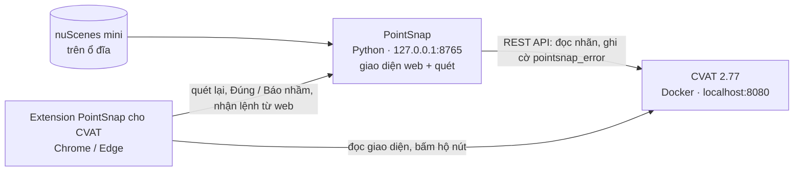

# Cài đặt toàn bộ PointSnap 3D

> Cập nhật 13/10/2026: review 01–11 đã vào main. Các sửa tiếp theo nằm trong PR riêng; xem [bàn giao hiện hành](../../review/2026-10-13/handoff-final-report.md) trước khi chọn bản để cài. Môi trường vừa kiểm: Windows Python 3.11.9/CVAT 2.77.0 và Linux base Python 3.11; không đồng nhất với [ma trận lịch sử ngày 12/10](../../review/2026-10-10/08-compatibility.md). Extension sau sửa vẫn cần reload và kiểm lại MV3 thật. [Bàn giao 01–08](../../review/2026-10-10/08-handoff.md) giữ các giới hạn lịch sử.

Hướng dẫn cài và các bước tự kiểm tới luồng sửa nhãn bằng extension. Ca MV3 cuối luồng cần người vận hành kiểm trên trình duyệt của mình. Viết cho **Windows 10 / 11**; Linux / macOS xem ghi chú ở từng bước.

Làm lần lượt từ bước 1 tới bước 8. Mỗi bước có mục **Kiểm tra**: đạt rồi mới sang bước sau. Tổng thời gian khoảng 1 giờ, phần lớn là chờ tải CVAT và dữ liệu.

## Hệ thống gồm những gì



| Thành phần | Chạy ở đâu | Dùng để |
|---|---|---|
| **CVAT 2.77** | Docker trên máy, `http://localhost:8080` | Gán nhãn 3D (nơi annotator sửa box) |
| **nuScenes v1.0-mini** | Thư mục trên ổ đĩa | Point cloud + nhãn chuẩn để demo và đánh giá |
| **PointSnap** | Python, `http://127.0.0.1:8765` | Quét lỗi, gắn cờ lên CVAT, báo cáo, duyệt nhanh |
| **Extension** | Chrome / Edge | Trên trang CVAT: lọc box lỗi, chuyển lỗi không tải lại trang, thông báo lỗi |

## 1. Chuẩn bị máy

- Ổ trống **≥ 20 GB**, RAM **≥ 8 GB** (khuyên 16 GB, CVAT chạy nhiều container).
- **Git**: https://git-scm.com
- **Python 3.11** (đúng bản 3.11): https://www.python.org/downloads/ — khi cài tích **Add python.exe to PATH**.
- **Docker Desktop**: https://www.docker.com/products/docker-desktop/ — cài xong mở Docker Desktop, chờ chữ **Engine running**.
- **Google Chrome** hoặc **Microsoft Edge** (bản mới) cho extension.
- *(Không bắt buộc)* **Node.js 22**: chỉ cần nếu muốn chạy test của extension.

**Kiểm tra** (mở PowerShell):

```powershell
git --version
py -3.11 --version
docker --version
```

Cả ba lệnh đều in ra số phiên bản.

## 2. Chạy CVAT 2.77 bằng Docker

```powershell
git clone https://github.com/cvat-ai/cvat D:\Work\cvat
cd D:\Work\cvat
git checkout v2.77.0
$env:CVAT_VERSION = "v2.77.0"
docker compose up -d
```

Lần đầu tải image mất 10–20 phút. Lỗi mạng khi tải thì chạy lại `docker compose up -d`.

Tạo tài khoản quản trị (nhập tên, email, mật khẩu theo lời nhắc):

```powershell
docker exec -it cvat_server bash -ic "python3 ~/manage.py createsuperuser"
```

Mở http://localhost:8080 và đăng nhập. Tạo **Access token**: bấm tên tài khoản (góc phải trên) → **Profile / Settings** → **Access tokens** → tạo token mới, **chép lại ngay** (chỉ hiện một lần). **Bỏ chọn ô *Read only*** khi tạo: token chỉ đọc làm `nuscenes to-cvat` (tạo task) và gắn cờ báo
HTTP 403 *You do not have permission to perform this action*.

> Hướng dẫn gốc dùng **CVAT 2.77.0**, ghi chú adapter 2.77.1; review hiện hành đã chạy API thật trên **2.78.1**. Chưa chứng nhận mọi version hoặc MV3 thật trên 2.78.1. Nút bấm hộ của extension phụ thuộc DOM CVAT; kiểm trên job thử trước khi dùng.

**Kiểm tra:** http://localhost:8080 mở được, đăng nhập được, đã có token.

## 3. Tải dữ liệu nuScenes v1.0-mini (~4 GB)

1. Tải `v1.0-mini.tgz` (4,2 GB): https://www.nuscenes.org/data/v1.0-mini.tgz. Link không tải được thì đăng ký tài khoản tại https://www.nuscenes.org/nuscenes#download rồi tải bản **Mini**.
2. Giải nén vào một thư mục, ví dụ `D:\data\nuscenes`.

**Kiểm tra:** trong `D:\data\nuscenes` có đủ `samples\`, `sweeps\`, `maps\`, `v1.0-mini\`.

## 4. Cài PointSnap

```powershell
git clone https://github.com/AI20K-Build-Phase-Cohort-4A/P-029 D:\Work\P-029
cd D:\Work\P-029
git checkout main
git pull --ff-only
cd source-tool\pointsnap-3d
py -3.11 -m venv .venv
.venv\Scripts\activate
pip install -e ".[dev]"
```

> PowerShell chặn `activate`: dùng `.venv\Scripts\python.exe -m pip install -e ".[dev]"`, rồi `.venv\Scripts\python.exe -m pointsnap ...`. Không cần đổi execution policy để chạy Python.

**Không bắt buộc: đối chiếu ảnh camera** (luật `cam.*`, lớp 2 của Box Verifier). Cần PyTorch; máy có GPU NVIDIA cài bản
CUDA (khoảng 2,5 GB), không có GPU thì bỏ qua bước này, các luật còn lại vẫn chạy:

```powershell
pip install torch torchvision --index-url https://download.pytorch.org/whl/cu124
pip install -e ".[vision]"
```

Lần quét đầu tải model Mask R-CNN (~180 MB) và chạy khoảng 1 phút cho một cảnh 40 frame × 6 ảnh (RTX 3050); kết quả được lưu
đệm ở `~/.pointsnap/cache/det2d`, các lần quét sau chỉ đọc lại.

Máy có GPU nên đặt `camera.model: hybrid` trong guideline: thêm Grounding DINO + SAM 2.1 để đối chiếu cả cọc tiêu (Mask
R-CNN không có). Lần đầu tải ~1 GB từ Hugging Face, chạy thêm ~0,8 s / ảnh. Số liệu:
`docs/ket-qua/ket-qua-box-verifier.md` mục 3.1.

> Linux / macOS: `python3.11 -m venv .venv` và `source .venv/bin/activate`.

Tạo file **`.env`** trong `source-tool\pointsnap-3d\` (thay giá trị của mình; file này đã nằm trong `.gitignore`, **không commit**):

```
CVAT_URL=http://localhost:8080
CVAT_TOKEN=<token tạo ở bước 2>
NUSCENES_ROOT=D:/data/nuscenes
POINTSNAP_EXPORT_DIR=D:/data/cvat
```

Từ đây mọi lệnh `pointsnap` chạy **trong thư mục `source-tool\pointsnap-3d`** với venv đã bật (`.venv\Scripts\activate`), vì `.env` được đọc từ thư mục đang đứng.

**Kiểm tra:**

| Lệnh | Mong đợi |
|---|---|
| `python -m pytest -q` | Dòng cuối `... passed`, không có `failed` |
| `pointsnap --help` | Có các lệnh `scan`, `gate`, `nuscenes`, `eval`, `ui` |
| `pointsnap config` | In cấu hình, URL CVAT đúng, token hiện dạng ẩn |

## 5. Đưa một cảnh nuScenes vào CVAT

```powershell
pointsnap nuscenes to-cvat --scene scene-0061 --out D:/data/cvat --upload
```

Lệnh này tạo task 3D trên CVAT gồm point cloud, nhãn chuẩn dạng track, ảnh 6 camera làm ảnh ngữ cảnh, và sẵn 2 thuộc tính PointSnap cần cho mọi nhãn: `pointsnap_error` (văn bản) và `reviewed` (checkbox). Bản xuất (có `manifest.json`) nằm trong `D:\data\cvat`.

> Dùng task CVAT có sẵn của mình thay vì nuScenes: thêm vào **mọi label** thuộc tính văn bản `pointsnap_error` (mutable) và checkbox `reviewed`. Luật lơ lửng / lún cần point cloud, nên cần manifest/frame mapping và cloud đúng job; task tạo bằng lệnh trên có sẵn bản xuất để kiểm.

**Kiểm tra:** trong CVAT → **Tasks** có task *PointSnap scene-0061*; mở job thấy point cloud, box và ảnh camera bên cạnh. Ghi lại **id job** (số cuối trong URL `/tasks/<t>/jobs/<j>`).

### 5b. Task theo spec gán nhãn giao thông VN (tùy chọn)

Muốn demo các luật bám spec (`attr.*`, `spec.inside`, `spec.rider_double`, `attr.rider_state`), tạo thêm một task với
bộ class spec-vn (5 class Vehicle, Two-wheels, Pedestrian, Animal, Obstacle, chi tiết ở thuộc tính):

```powershell
pointsnap nuscenes --taxonomy spec-vn to-cvat --scene scene-0061 --out D:/data/cvat-vn --upload
```

Task spec-vn dùng guideline riêng, nên ở bước 6 **tạo một dự án PointSnap riêng** cho nó (guideline lưu theo dự án):
tab **Kết nối CVAT** điền thư mục bản xuất `D:/data/cvat-vn`; tab **Guideline** → **YAML**, dán nội dung
`pointsnap-3d/pointsnap/guidelines/spec-vn.yaml` rồi lưu. Dùng dòng lệnh thì thêm
`--config pointsnap/guidelines/spec-vn.yaml` trước lệnh `scan` / `gate`.

**Kiểm tra:** task mới có label Vehicle / Two-wheels / Pedestrian / Animal / Obstacle; quét job của task này không có
mục `attr.missing` trên nhãn chuẩn.

## 6. Chạy giao diện web PointSnap

```powershell
pointsnap ui
```

Trình duyệt tự mở `http://127.0.0.1:8765` → bấm **Bắt đầu**.

1. **Tạo dự án** (lần đầu): tên dự án, URL CVAT `http://localhost:8080`, token CVAT.
2. Tab **Kết nối CVAT**: điền **Thư mục nuScenes** (`D:/data/nuscenes`) và **Thư mục bản xuất to-cvat** (`D:/data/cvat`), bấm **Kiểm tra kết nối**.
3. Tab **Quét job**: chọn task / job của bước 5 → **Bắt đầu quét**. Benchmark12/10 trên hai cảnh nuScenes,39–40frame: khoảng3–10giây không sweeps và8–25giây với4sweeps; thời gian khác theo scene/máy. Xem [review07](../../review/2026-10-10/07-report.md).
4. Màn **Kết quả**: bảng lỗi, khung chi tiết, **Duyệt nhanh** (point cloud quanh box; `J` / `K` chuyển mục, `1` đúng, `2` báo nhầm).
5. Bấm **Gắn cờ lên CVAT**: PointSnap ghi nội dung lỗi vào thuộc tính `pointsnap_error` của từng box lỗi (không sửa box).

**Kiểm tra:** kết quả có số Lỗi / Cảnh báo và không có dòng báo thiếu `manifest.json`; sau khi gắn cờ, mở một box lỗi trên CVAT thấy `pointsnap_error` có nội dung.

> Muốn chạy PointSnap ở cổng khác: `pointsnap ui --port 8800` (nhớ đổi địa chỉ PointSnap trong trang Tùy chọn của extension).

## 7. Cài extension PointSnap cho CVAT

1. Mở `chrome://extensions` (Edge: `edge://extensions`).
2. Bật **Developer mode** (Chế độ nhà phát triển).
3. Bấm **Load unpacked** → chọn thư mục `D:\Work\P-029\source-tool\pointsnap-3d\extension`.
4. Mở job ở bước 5 trên CVAT (đã đăng nhập). Bảng **PointSnap** hiện ở góc trái khung 3D.
5. **Lần đầu** mở một task, bảng có thể báo *"CVAT cần tải lại trang một lần"* → bấm **Tải lại trang**. Từ đó extension tự bật bộ lọc chỉ hiện box có cờ.

Dùng:

- Phím **`.`** / **`,`** (hoặc nút **›** / **‹**): sang frame có lỗi kế tiếp / trước, **không tải lại trang**.
- Thẻ lỗi: mức lỗi, loại lỗi, box, mô tả, **Cách sửa**, nút **Đúng là lỗi / Báo nhầm**. Frame có nhiều box lỗi: bấm `1 / 2 ›` trên thẻ.
- Tab **Danh sách**: mọi lỗi của job, bấm dòng để nhảy tới; **Quét lại / Quét + gắn cờ** ở cuối tab.
- CVAT ở địa chỉ khác `localhost:8080`: bấm biểu tượng extension → **Tùy chọn** → thêm địa chỉ CVAT → **Lưu**.

Chi tiết: [extension/README.md](extension/README.md).

**Kiểm tra:** bảng PointSnap hiện chấm xanh (PointSnap đang chạy); bấm `.` thì CVAT chuyển frame và box lỗi sáng lên.

## 8. Liên kết web PointSnap với extension

Mở cùng lúc web PointSnap (bước 6) và tab CVAT đang mở job (bước 7).

- Ở màn Kết quả của web, nút đổi thành **Chuyển CVAT tới box này** kèm chấm xanh *"CVAT đang mở job này"*.
- Bấm nút hoặc chọn dòng / `J` / `K` trên web → tab CVAT tự chuyển tới đúng frame và làm sáng đúng box, **không tải lại trang**.
- **Đúng / Báo nhầm** ghi ở bên nào cũng hiện ở bên kia sau khoảng 2 giây.

Nếu nhiều box cùng nhãn và cùng cờ, extension không đoán serverID từ sidebar: dùng link ID trong báo cáo. Các đường quét/review được giới hạn theo origin/project/job. Khi đổi server hoặc đường dẫn CVAT trên Web, nhập PAT mới; token cũ bị xóa trước khi đổi destination.

**Kiểm tra:** chọn một lỗi trên web → chuyển sang tab CVAT thấy đúng frame và đúng box đang sáng.

## Luồng làm việc hằng ngày

1. Bật **Docker Desktop** (CVAT có thể tự chạy lại theo cấu hình restart; nếu không: `cd D:\Work\cvat` rồi `docker compose up -d`).
2. `cd D:\Work\P-029\source-tool\pointsnap-3d` → `.venv\Scripts\activate` → `pointsnap ui`.
3. Web: quét job → **Gắn cờ lên CVAT**.
4. CVAT (có extension): mở job → bấm `.` đi qua từng lỗi → sửa box → **Save** (Ctrl+S).
5. Xong job: **Quét + gắn cờ** lại (ở tab Danh sách của extension hoặc trên web) → tải lại trang CVAT để thấy cờ mới → kiểm gate/coverage và để reviewer xác nhận phần tool không kiểm trước khi nộp.

> Khi đang có người mở job trên CVAT, chỉ gắn cờ sau khi họ đã **Save**; gắn cờ xong họ phải tải lại trang trước khi sửa tiếp.

## Cập nhật bản mới

```powershell
cd D:\Work\P-029
git pull
cd source-tool\pointsnap-3d
.venv\Scripts\activate
pip install -e ".[dev]"
```

Rồi tắt và chạy lại `pointsnap ui`; ở `chrome://extensions` bấm **↻** của *PointSnap cho CVAT* và tải lại trang CVAT.

## Lỗi thường gặp

| Hiện tượng | Cách xử lý |
|---|---|
| `docker` báo *cannot find the file specified* / *daemon is not running* | Mở Docker Desktop, chờ **Engine running** |
| `localhost:8080` không mở được | Chờ 1–2 phút sau khi Docker chạy; vẫn không được thì `docker compose up -d` trong thư mục CVAT |
| PointSnap báo 401 / *Authentication* | Token sai hoặc hết hạn: tạo token mới ở CVAT, sửa `.env` và token của dự án trên web |
| Tạo task / gắn cờ báo 403 *You do not have permission* | Token tạo với *Read only*: tạo token mới, bỏ chọn *Read only* |
| Kết quả quét ghi *"Không tìm thấy manifest.json"*, không có lỗi lơ lửng / lún | Điền **Thư mục bản xuất to-cvat** ở tab Kết nối CVAT (hoặc `POINTSNAP_EXPORT_DIR` trong `.env`) đúng thư mục `--out` của bước 5 |
| `pointsnap` không chạy được hoặc không đọc `.env` | Bật venv và đứng trong `source-tool\pointsnap-3d`; hoặc chạy `.venv\Scripts\python -m pointsnap ...` |
| Extension không hiện bảng | Extension đang bật ở `chrome://extensions`; đang ở trang job (`/tasks/<t>/jobs/<j>`); CVAT không ở `localhost:8080` thì thêm địa chỉ trong **Tùy chọn** |
| Bảng báo "CVAT cần tải lại trang một lần" | Bấm **Tải lại trang** (chỉ lần đầu mở mỗi task) |
| Bảng ghi "PointSnap tắt" | Chạy `pointsnap ui`; lọc / chuyển lỗi / thông báo lỗi vẫn dùng được khi PointSnap tắt |
| Web không hiện "Chuyển CVAT tới box này" | Tab CVAT phải đang mở **đúng job** của lần quét và extension đang chạy; chờ vài giây |
| Gắn cờ xong không thấy cờ mới trên CVAT | CVAT chỉ đọc nhãn khi mở job: **Save** rồi tải lại trang |
| Phím `[` `]` gõ ra `ư` `ơ` | Bộ gõ tiếng Việt kiểu Telex: dùng phím `,` `.` |

## Tài liệu liên quan

- [Docker CLI và ReportAPI](README-Docker.md): build CLI trước API, map URL backend/web vàmount dataset/export.
- [Vận hành, backup vàrollback](docs/operations.md), [bảo mật local](docs/local-security.md).
- `pointsnap-3d/Start-PointSnap.ps1` chỉ bật Web, nhận port/PythonPath/ProjectHome; CVAT là dependency cài riêng. Launcher trong thư mục cha máy tác giả không nằm trong checkout GitHub.

- [README công cụ](README.md) — tính năng, dòng lệnh, giới hạn.
- [Đề xuất đề tài](docs/thiet-ke/de-xuat-de-tai.md) — mục tiêu, thiết kế, chỉ số.
- [Kết quả thử extension](docs/ket-qua/thu-extension.md) · [Kết quả đánh giá tự động](docs/ket-qua/ket-qua-danh-gia-tu-dong.md).
- [Quy trình kiểm thử của nhóm](quan-ly/giao-viec/test-va-gop-y.md).
