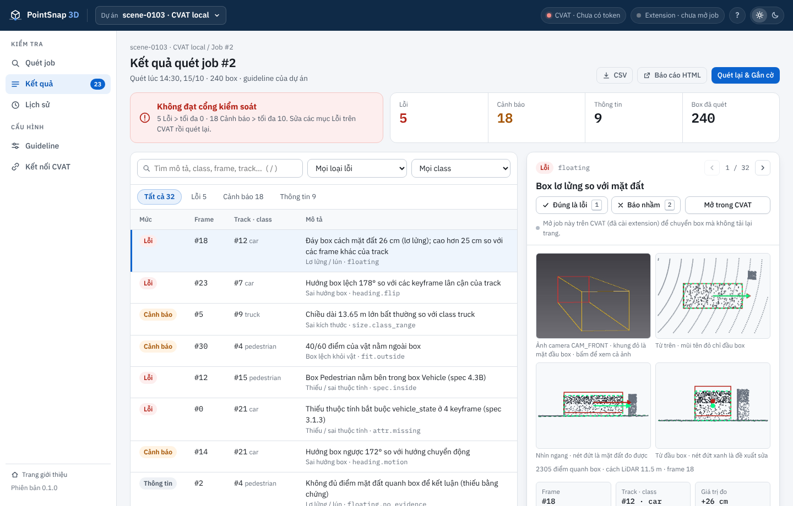

# PointSnap 3D

**Phát hiện và cảnh báo sớm lỗi nhãn 3D cuboid trên CVAT** — trước khi nộp, không phải sau khi bị trả về.

[](https://github.com/AI20K-Build-Phase-Cohort-4A/P-029/actions/workflows/test.yml)
· Python 3.11 · CVAT 2.77 · nuScenes · Giải quyết [P-010](../../problem-backlog.md#p-010), [P-011](../../problem-backlog.md#p-011)

<p align="center">
  
</p>

PointSnap đọc job qua REST API của CVAT, đối chiếu từng box với **point cloud LiDAR**, **các frame khác của track**,
**ảnh camera** và **spec gán nhãn**, rồi chỉ ra box nào sai, ở frame nào, sai bao nhiêu — và **gắn cờ thẳng lên box đó
trong CVAT**. Annotator lọc box có cờ, sửa, quét lại, qua cổng kiểm tra rồi mới nộp.

> **Tool đề xuất, con người quyết định.** PointSnap chỉ ghi thuộc tính `pointsnap_error`; không đổi vị trí, kích thước,
> class của box nào và không tạo box mới.

---

## Bắt được gì

| Nhóm | Luật | Đo gì | Ví dụ thông báo |
|---|---|---|---|
| 🟫 **Lơ lửng / lún** | `floating` | Đáy box so với mặt đất ước lượng quanh box, so với các frame khác của track; mặt dốc so với điểm tiếp xúc | *Đáy box cách mặt đất 26 cm (lơ lửng); cao hơn 25 cm so với các frame khác của track* |
| 📏 **Kích thước** | `size.class_range`, `size.in_track` | Ngoài khoảng của class (theo cả thuộc tính); lệch trung vị track | *Chiều dài 7.80 m lớn bất thường so với class car* |
| 🧵 **Track** | `track.jump`, `track.split_id`, `track.id_swap`, `track.reuse_id`, `track.occluded_long`, `track.long_interpolation` | Nhảy vị trí (hệ toàn cục), tách / đổi nhầm ID, quy tắc spec 4.4 | *Tâm box nhảy 2.17 m so với vị trí nội suy (ngưỡng 2.0 m)* |
| 🧭 **Hướng** | `heading.flip`, `heading.motion`, `heading.points` | Lật hướng, ngược chiều chạy, lệch trục cụm điểm | *Hướng box ngược chiều 178° so với hướng chuyển động* |
| 📦 **Box lệch khỏi vật** | `fit.outside`, `fit.loose`, `fit.empty`, `fit.overlap` | Điểm của vật ngoài box, box dư, box rỗng, vẽ trùng | *40/60 điểm của vật nằm ngoài box* |
| 🔍 **Sót đối tượng** | `lidar.missing`, `cam.missing` | Cụm LiDAR cỡ xe / người di chuyển mà không có box; ảnh thấy vật mà không có box | *Cụm điểm cỡ xe di chuyển 15.9 m qua 10 keyframe mà không có box* |
| 📋 **Spec gán nhãn VN** | `attr.*`, `spec.inside`, `spec.rider_double`, `attr.rider_state`, `cam.sparse` | Thuộc tính bắt buộc / hợp lệ / khớp chiều cao, người trong xe, người lái gán hai lần | *Box Pedestrian nằm bên trong box Vehicle (spec 4.3B)* |
| 🛡️ **Box Verifier** | `track.static_shift`, `heading.static`, `cam.mismatch`, `cam.class`, `critic.box` | Vật đứng yên bị xê dịch, box lệch vật trên ảnh camera, Box Critic (model nhóm tự huấn luyện) | *Box Critic: box nghi vẽ sai; gợi ý dời (+0.32, −0.05) m* |

Ba mức: **Lỗi** (phải sửa) · **Cảnh báo** (cần xem) · **Thông tin** (không đủ bằng chứng để kết luận — tool nói rõ thay vì
đoán). Mọi luật bật / tắt và chỉnh ngưỡng được theo **guideline của từng dự án**. Cách từng luật hoạt động, có hình minh họa:
[báo cáo dự án, mục 3](docs/bao-cao-du-an.md#3-thuật-toán).

## Kết quả

Đo bằng lỗi chèn giả trên **5 cảnh nuScenes để kiểm tra** (5 440 box, chưa từng dùng để chỉnh ngưỡng), 10 vòng:

| | |
|---|---|
| Sai class, kích thước sai cả track / một frame ≥ 15%, nhảy ≥ 2 m | **100%** |
| Lơ lửng / lún 20 – 40 cm (box có điểm mặt đất quanh) | **100%** (6/6) |
| Lật / xoay box 60 – 180° · tách ID | **93%** · **89%** |
| Lỗi lớn báo đúng mức Lỗi | **30/30** |
| Báo nhầm trên nhãn sạch (Cảnh báo / Lỗi trên 100 box) | 2,98 / 0,59 — cảnh tinh chỉnh 1,45 / 0,31 (mục tiêu ≤ 2 / ≤ 0,5) |
| Thời gian quét một cảnh ~40 keyframe | **7 – 20 giây** |

Chưa tốt: lỗi nhỏ (xoay 15 – 30°, dời < 1 m, co / phóng box) và báo nhầm lơ lửng / lún ở bờ vỉa, LiDAR thưa. Chi tiết:
[báo cáo, mục 4](docs/bao-cao-du-an.md#4-kết-quả).

## Bắt đầu nhanh

Cần Python 3.11. Cài từ máy trắng (CVAT Docker, dữ liệu nuScenes, extension), từng bước có kiểm tra:
**[CAI-DAT.md](CAI-DAT.md)**.

```bash
cd source-tool/pointsnap-3d
python -m venv .venv
.venv\Scripts\activate            # Linux / macOS: source .venv/bin/activate
pip install -e .
pointsnap ui                      # mở http://127.0.0.1:8765 (trang giới thiệu → Mở PointSnap)
```

Thử ngay **không cần CVAT** (chỉ cần nuScenes v1.0-mini): chèn lỗi giả vào 30% số track rồi quét, in lỗi nào bắt được.

```bash
pointsnap nuscenes --dataroot D:/data/nuscenes scan --scene scene-0103 --inject --rate 0.3 --out out/demo
```

## Cách dùng

### 1. Giao diện web — dùng hằng ngày

`pointsnap ui` mở `http://127.0.0.1:8765`: **trang giới thiệu** dự án (landing của đội, trong [`landing/`](landing/));
bấm **Mở PointSnap** (hoặc Enter) để vào ứng dụng ở `/app`. Lần đầu, màn Kết quả hướng dẫn 3 bước: tạo dự án (URL CVAT,
token) → kết nối CVAT → **Quét job**.

- **Duyệt nhanh**: xem point cloud quanh box (từ trên, nhìn ngang, từ đầu box) và ảnh camera; `J` / `K` chuyển mục,
  `1` = đúng là lỗi, `2` = báo nhầm, `O` mở box trong CVAT, `/` tìm, `?` xem mọi phím tắt. Kết luận vừa tính precision
  xem tay, vừa để PointSnap học cho lần quét sau.
- **Đề xuất sửa 1 lần bấm**: box có đề xuất (Δz, Δyaw, kích thước) thì xem khung nét đứt xanh trên point cloud, bấm
  **Áp dụng lên CVAT…** để xác nhận; mỗi lần ghi có snapshot để **Hoàn tác**, từ chối ghi nếu box vừa bị sửa ở nơi khác.
- **Gắn cờ lên CVAT**: ghi nội dung lỗi vào thuộc tính `pointsnap_error` của box lỗi; cờ tự xóa khi box hết lỗi.
- **Cổng kiểm soát**: ĐẠT / KHÔNG ĐẠT theo tiêu chí của dự án.
- **Guideline**: luật xếp theo nhóm (tìm nhanh, bật / tắt cả nhóm), cổng kiểm soát, ngưỡng lơ lửng, khoảng kích thước
  theo class sửa ngay trong bảng; hoặc dán YAML (ví dụ [`spec-vn.yaml`](pointsnap/guidelines/spec-vn.yaml) cho bộ nhãn theo
  spec giao thông VN). Nhóm luật đứt track đang tắt cho toàn hệ thống.

> Link **Mở CVAT** trỏ thẳng tới box bị báo và chỉ đúng với lần quét mới nhất (CVAT tạo lại id khi lưu). Nên đăng nhập
> CVAT trước, nếu không trang đăng nhập làm mất tham số frame.

### 2. Extension trong CVAT — khi đang sửa


Cài một lần (Chrome / Edge → *Load unpacked* → thư mục `extension/`). Mở job trên CVAT là extension **tự lọc box có cờ**;
`.` / `,` nhảy tới frame có lỗi kế tiếp / trước **không tải lại trang**; rê chuột vào box thấy lỗi và **cách sửa**;
áp dụng đề xuất sửa 1 lần bấm; tab **Danh sách** để quét lại ngay trong CVAT. Web và extension **đồng bộ 2 chiều không
cần F5**: chọn mục trên web thì CVAT nhảy theo; kết luận Đúng / Báo nhầm, sửa và hoàn tác box ở bên nào cũng hiện bên kia
trong vài giây. Hướng dẫn: [extension/README.md](extension/README.md).

<br clear="right">

### 3. Dòng lệnh — CI và script

Đặt `CVAT_URL`, `CVAT_TOKEN`, `NUSCENES_ROOT`, `POINTSNAP_EXPORT_DIR` trong file `.env` (thư mục này) hoặc biến môi trường.

```bash
pointsnap scan --job 12               # báo cáo HTML / CSV vào out/
pointsnap scan --job 12 --flag        # và gắn cờ lên CVAT (mục Lỗi / Cảnh báo)
pointsnap gate --job 12               # mã thoát 0 = ĐẠT, 1 = KHÔNG ĐẠT
pointsnap --config my-guideline.yaml scan --job 12
```

Luồng hằng ngày: gán xong → `scan --flag` → mở CVAT, lọc box có cờ, sửa → `scan` lại → `gate` → ĐẠT thì nộp.

> CVAT không khóa job khi có người mở: chỉ gắn cờ khi không ai đang sửa job đó.

## Cấu trúc

```
pointsnap-3d/
├── pointsnap/
│   ├── adapters/        đọc CVAT (REST API) và nuScenes
│   ├── core/            mô hình dữ liệu, hình học, mặt đất, cấu hình, bộ quét
│   ├── detectors/       các luật: floating, size, track, heading, fit, missing, camera, attributes, static
│   ├── vision/          model ảnh (Mask R-CNN, Grounding DINO + SAM 2.1)
│   ├── critic.py        Box Critic          learn.py   học từ người duyệt
│   ├── eval/            chèn lỗi giả, đo precision / recall
│   ├── report/          báo cáo HTML / CSV
│   ├── web/             giao diện web (FastAPI + HTML / JS)
│   ├── guidelines/      guideline mẫu (spec-vn)
│   └── config.yaml      ngưỡng mặc định, có chú thích
├── extension/           extension Chrome / Edge cho CVAT (Manifest V3)
├── tests/               pytest (gồm bộ mô phỏng tình huống giao thông)
├── scripts/             huấn luyện Box Critic, đo riêng từng luật, vẽ hình
├── docs/                báo cáo, thiết kế, hướng dẫn, kết quả, hình
└── quan-ly/             bảng việc, giao việc, bàn giao
```

## Tài liệu

| | |
|---|---|
| 📘 [Báo cáo dự án](docs/bao-cao-du-an.md) | Vấn đề, giải pháp, **thuật toán có hình minh họa**, kết quả, giới hạn |
| 🧩 [Kiến trúc hệ thống](docs/architecture-system.md) | Web, extension, CVAT, dữ liệu, luồng quét và model; kèm review UX 14/10 |
| 🛠️ [CAI-DAT.md](CAI-DAT.md) | Cài toàn bộ từ máy trắng |
| 🧠 [Hướng dẫn huấn luyện](docs/huong-dan/huan-luyen-box-critic.md) | Box Critic, học từ người duyệt, quy trình cải tiến model |
| 🔁 [Quy trình phát triển](docs/huong-dan/quy-trinh-phat-trien.md) | Chia dữ liệu, đo, **checklist thêm luật mới**, trước khi mở PR |
| 📐 [Đề xuất đề tài](docs/thiet-ke/de-xuat-de-tai.md) · [CONVENTIONS.md](CONVENTIONS.md) | Thiết kế chi tiết, bảng truy vết spec ↔ luật; hệ tọa độ, mã luật |
| 📊 [Kết quả](docs/ket-qua/) | Số liệu từng giai đoạn, eval thô |
| 📋 [Quản lý](quan-ly/) | [Bảng việc](quan-ly/TASKS.md), [giao việc](quan-ly/giao-viec/), [bàn giao 12/10](quan-ly/ban-giao-12-10.md) |

## Phát triển

```bash
pip install -e ".[dev]"
python -m pytest -q                                   # ~335 test, ~1 phút
cd extension && node --test tests/*.test.js           # test extension
pointsnap eval --scenes tuning --rounds 10 --errors all   # đo báo nhầm và tỉ lệ bắt
```

Mọi thay đổi qua nhánh + PR, không push thẳng `main`; chỉnh ngưỡng chỉ trên 5 cảnh tinh chỉnh. Đầy đủ:
[quy trình phát triển](docs/huong-dan/quy-trinh-phat-trien.md).

## Giới hạn

Đánh giá trên nuScenes (chưa có dữ liệu VN); lơ lửng / lún cần điểm mặt đất quanh box; lỗi nhỏ bắt ít; sót đối tượng tìm lại
66 – 71% vật di chuyển; box `occluded` không kiểm hình học. Đầy đủ: [báo cáo, mục 5](docs/bao-cao-du-an.md#5-giới-hạn).

## Người làm

| Người | Phụ trách |
|---|---|
| Khúc Việt Anh | Môi trường, nuScenes → CVAT, adapter CVAT, CLI, web, extension, Box Verifier, giai đoạn 3 |
| Đặng Văn Huy | Ước lượng mặt đất, bộ phát hiện lơ lửng / kích thước / track, đánh giá |
| Vũ Bảo Khánh | Báo cáo, slide |
| Nhữ Đình Chiến | Test quy trình trên CVAT, video demo |
| Nguyễn Văn Hân | Xem tay cảnh báo, bảng chỉ số |

## Cài package và giới hạn review

Cài từ repo với `python -m venv .venv`, rồi `.venv/Scripts/python -m pip install -e ".[dev]"` trên Windows; Linux dùng `.venv/bin/python`. Chạy `python -m pointsnap --help` hoặc `python -m pointsnap ui --no-browser`. Xem [Docker](README-Docker.md), [bảo mật local](docs/local-security.md) và [review08](../../review/2026-10-10/08-report.md) để biết các môi trường đã kiểm tra.

Gate chỉ xét luật đang bật và dữ liệu đủ bằng chứng. Tool không tự sửa hình học box; `diff` và khôi phục nhãn tự động chưa triển khai. Precision xem tay và nghiệm thu extension MV3 còn cần xác minh theo báo cáo review.
