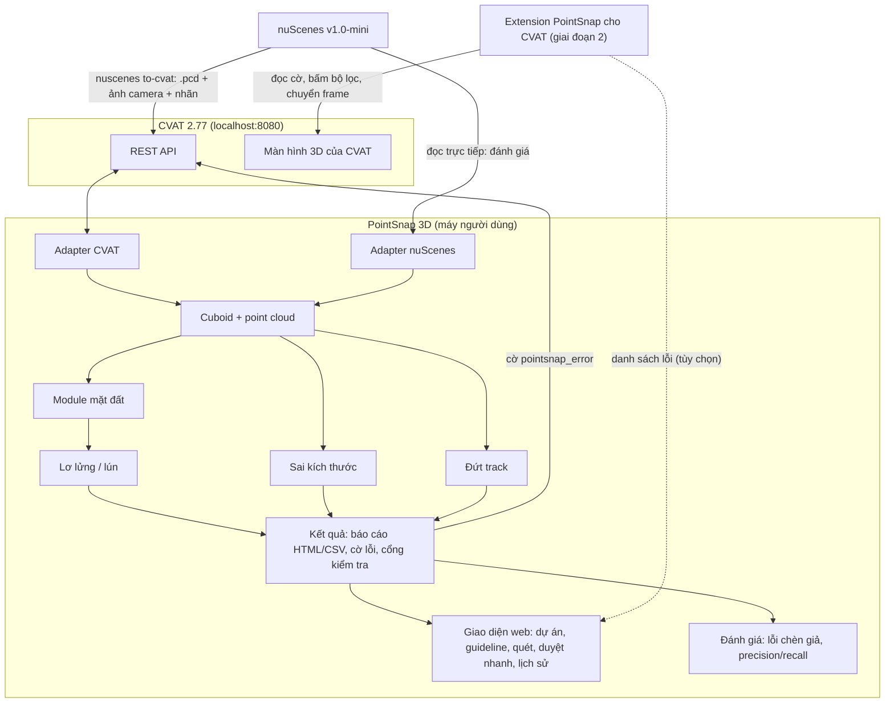
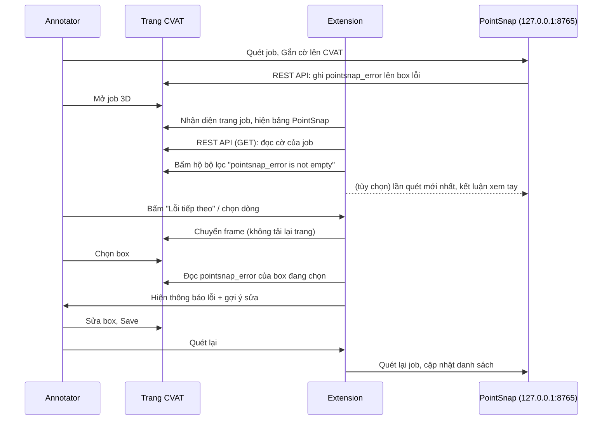

# BẢN ĐỀ XUẤT ĐỀ TÀI CÔNG CỤ HỖ TRỢ GÁN NHÃN

## THÔNG TIN CHUNG

- **Tên đề tài (Tiếng Việt):** **PointSnap 3D: Công cụ phát hiện và cảnh báo sớm lỗi nhãn 3D Cuboid trên CVAT**
- **Tên tiếng Anh:** **PointSnap 3D: Early Error Detection & Warning for 3D LiDAR Cuboid Annotation on CVAT**
- **Tên gọi ngắn gọn:** **PointSnap 3D**
- **Đội thực hiện:** Đội P-029 (Cohort 4A)
- **Thành viên tham gia:**
  - Vũ Bảo Khánh
  - Đặng Văn Huy
  - Nguyễn Văn Hân
  - Nhữ Đình Chiến
  - Khúc Việt Anh
- **Thời gian thực hiện:**
  - **Giai đoạn 1 (06/10 – 09/10/2026, 4 ngày):** phát hiện + cảnh báo trên CVAT, công cụ đánh giá, giao diện web. **Đã xong.**
  - **Giai đoạn 2 (10/10 – 11/10/2026, gia hạn đến cuối tuần):** extension cho CVAT, giảm báo nhầm, sửa lỗi từ đợt test.
  - **Giai đoạn 3 (11/10 – 17/10/2026, gia hạn thêm 1 tuần, nộp 18/10):** bám *Annotation Specification* gán nhãn 3D giao
    thông VN: sai hướng box, box lệch khỏi vật, track và thuộc tính theo spec, mặt đất v2 ([mục 4.7](#47-bám-spec-gán-nhãn-giai-đoạn-3)).
- **Dữ liệu:** **nuScenes v1.0-mini** (bộ dữ liệu công khai) — xem [mục 2.1](#21-dữ-liệu-nuscenes-v10-mini)
- **Môi trường triển khai & kiểm chứng:** CVAT 2.77 Docker chạy local (`localhost:8080`)
- **Liên kết backlog nội bộ:** [P-010](../../problem-backlog.md#p-010), [P-011](../../problem-backlog.md#p-011)
- **Trạng thái:** Mentor đã duyệt hướng đề tài (05/10/2026). **Bản 2 (08/10/2026):** cập nhật theo kết quả giai đoạn 1 và thêm phương án extension cho CVAT ([mục 4.6](#46-extension-pointsnap-cho-cvat-giai-đoạn-2)). Bản 1 xem lịch sử git của file này.

---

## 0. GÓP Ý CỦA MENTOR & ĐIỀU CHỈNH

> *"Đề tài này ổn em nhé, pain point rất thực tế và bám sát đúng công việc annotation 3D các em vừa làm. Metric cũng khá rõ. Anh gợi ý nhóm scope trước vào 2–3 lỗi dễ định lượng như box lơ lửng/lún đất, sai kích thước và đứt track; làm tốt phần detect + cảnh báo trước rồi hãy mở rộng sang auto-correction."* — Mentor, 05/10/2026

| Góp ý | Điều chỉnh |
|---|---|
| Scope vào 2–3 lỗi dễ định lượng | Chỉ tập trung **3 loại lỗi**: **lơ lửng/lún đất**, **sai kích thước**, **đứt track**, mỗi loại có định nghĩa định lượng và ngưỡng rõ ràng (mục 4.1) |
| Làm tốt detect + cảnh báo trước | Cả hai giai đoạn chỉ làm **phát hiện và cảnh báo**: báo cáo, gắn cờ lỗi trên CVAT, cổng kiểm tra, giao diện duyệt lỗi, extension. Đo precision/recall riêng cho từng loại lỗi |
| Rồi mới mở rộng sang auto-correction | Tự sửa vẫn nằm ở [Hướng phát triển](#11-hướng-phát-triển), làm theo lộ trình 4 bước: hoàn thiện phát hiện → gợi ý sửa → sửa một chạm có người duyệt → tự sửa khi độ tin cậy cao. Đến hết giai đoạn 2, tool không sửa box nào |
| — | Giai đoạn 1 rút còn **4 ngày**; **Việt Anh và Huy làm sản phẩm**, **Khánh, Chiến, Hân viết báo cáo và test** (mục 7) |
| — | **08/10:** gia hạn đến cuối tuần → thêm giai đoạn 2 (10–11/10): extension cho CVAT để annotator **duyệt lỗi ngay trong CVAT, không tải lại trang**, giảm báo nhầm, sửa lỗi người test báo |
| — | **10/10:** gia hạn thêm 1 tuần, nhận *Annotation Specification* của dự án → giai đoạn 3: mọi luật mới phải trỏ được tới một điều khoản đo được của spec (mục 4.7); vẫn **chỉ phát hiện và cảnh báo**, không gắn mô hình học máy vào luồng chính |

---

## 1. LÝ DO LÀM TOOL & MỤC TIÊU CỐT LÕI

Trong quá trình gán nhãn 3D Cuboid trên CVAT, nhóm nhận thấy phần lớn thời gian bị lãng phí không nằm ở việc vẽ box mà nằm ở **vòng lặp nộp → bị trả về → sửa → nộp lại**. Ba loại lỗi gặp nhiều nhất và **đo được bằng số** là:

1. **Box lơ lửng hoặc lún đất:** phải xoay, zoom camera 3D để căn đáy box bằng mắt; dễ lệch vài chục cm.
2. **Sai kích thước:** box quá to/nhỏ so với loại xe, hoặc cùng một xe mà mỗi frame một kích thước.
3. **Đứt track:** cùng một đối tượng nhưng track nhảy vị trí bất thường, bị tách thành hai ID, hoặc có đoạn dài chỉ dựa vào nội suy nên box lệch khỏi đối tượng.

Reviewer hiện phải soi thủ công từng frame để tìm các lỗi này.

🎯 **Mục tiêu:** PointSnap 3D **phát hiện và cảnh báo sớm** ba loại lỗi trên trước khi nộp, chỉ ra chính xác box nào sai, ở frame nào, sai bao nhiêu, và **đưa annotator tới đúng chỗ đó trong CVAT nhanh nhất có thể**.

**Nguyên tắc xuyên suốt:** *tool đề xuất, con người quyết định.* Tool chỉ ghi một thuộc tính cờ lỗi. Tool không thay đổi vị trí, kích thước hay class của box nào và **không bao giờ tự tạo box mới**. Extension (giai đoạn 2) chỉ đọc giao diện CVAT và bấm hộ các nút sẵn có (bộ lọc, chuyển frame), không sửa box.

### 1.1. Phạm vi

**Giai đoạn 1 — đã giao (06–09/10):**
- Chuyển cảnh nuScenes vào CVAT (point cloud, nhãn chuẩn dạng track, **ảnh 6 camera** làm ảnh ngữ cảnh) làm môi trường demo; đánh giá chạy trên cả 10 cảnh bằng cách đọc thẳng nuScenes.
- Module ước lượng mặt đất cục bộ; **3 bộ phát hiện**: lơ lửng/lún, sai kích thước (theo class, trong track), đứt track (nhảy vị trí, tách ID, **khoảng nội suy dài**).
- Báo cáo HTML/CSV, **gắn cờ lỗi lên box** để lọc trong CVAT, cổng kiểm tra ĐẠT/KHÔNG ĐẠT; link "Mở CVAT" trỏ thẳng tới đúng box.
- Công cụ đánh giá: bộ lỗi chèn giả, `pointsnap eval` đo precision/recall theo loại lỗi và mức độ.
- **Giao diện web local** (`pointsnap ui`, chỉ chạy trên máy người dùng): dự án + **guideline riêng** từng dự án (bật/tắt luật, ngưỡng, khoảng kích thước, tiêu chí gate), quét nền, kết quả, lịch sử; **duyệt nhanh**: xem point cloud quanh box, J/K chuyển mục, ghi kết luận Đúng / Báo nhầm và tính precision xem tay.
- CI chạy `pytest` cho mọi PR.

**Giai đoạn 2 — cam kết (10–11/10):**
- **Extension "PointSnap cho CVAT"** (Chrome / Edge): tự bật bộ lọc box có cờ, hiện thông báo lỗi khi chọn box, chuyển giữa các lỗi không tải lại trang (mục 4.6).
- Giảm báo nhầm lơ lửng/lún và nâng phát hiện nhảy 4 m để đạt chỉ tiêu mục 8.
- Sửa các lỗi trong bảng tổng hợp của đợt test (`docs/test/tong-hop-loi.md`).

**Giai đoạn 3 — gia hạn (11–17/10):**
- **Sai hướng box** (spec 4.2): lật / xoay ngang giữa hai keyframe, ngược hướng chuyển động, trục box lệch trục cụm điểm.
- **Box lệch khỏi vật** (spec 4.2): box rỗng, điểm của vật nằm ngoài box, box dư, hai box chồng nhau (vẽ trùng).
- **Track theo spec 4.4**: đoạn vắng ngắn là `occluded` chứ không phải `outside`; dùng lại track sau khi kết thúc; occluded quá 6 frame.
- **Thuộc tính theo spec 3.1.3**: thiếu thuộc tính bắt buộc, giá trị ngoài danh sách; kích thước theo class + thuộc tính.
- **Bộ class spec-vn** cho demo (Vehicle, Two-wheels, Pedestrian, Animal, Obstacle) và guideline mẫu theo spec.
- **Mặt đất v2**: gộp lượt quét LiDAR trung gian, bỏ vệt vật đang chạy.

**Ngoài phạm vi (cả ba giai đoạn):**
- Mọi chức năng sửa box: gợi ý sửa, `fix --z`, `fix --size`, `restore`, áp dụng hàng loạt — xem [Hướng phát triển](#11-hướng-phát-triển).
- Sửa mã nguồn hay build lại CVAT; đọc / ghi trạng thái nội bộ của trang CVAT; Issue (CVAT chỉ có cho job 2D), webhook.
- Bộ "lỗi thật" (tự gán nhãn lại một cảnh), lệnh `diff`, phép đo thời gian review có / không có tool ở quy mô đội.
- Đọc point cloud qua API của CVAT (tool đọc từ thư mục nuScenes trên máy).
- Cảnh báo sót đối tượng; Pre-Box, detector 3D (cần mô hình học máy). Giai đoạn 3 đã thêm ngược yaw, box rỗng, chồng lấn, thiếu thuộc tính.
- Tự động duyệt hay tự động nộp job; thay thế reviewer.
- Server dùng chung, đăng nhập nhiều người, cơ sở dữ liệu: giao diện web chỉ chạy local, lưu file trong `~/.pointsnap`.

---

## 2. VẤN ĐỀ THỰC TẾ & DỮ LIỆU

Các số liệu dưới đây là **quan sát nội bộ / ước lượng** từ kinh nghiệm gán nhãn 3D cuboid của nhóm. Nhóm chưa đo lại các số này; kết quả của tool được đánh giá trên bộ lỗi chèn giả (mục 8).

| Lỗi | Thực tế thao tác trên CVAT | Thời gian & thao tác lãng phí (quan sát nội bộ) |
|---|---|---|
| **Lơ lửng / lún đất** ([P-010](../../problem-backlog.md#p-010)) | Không có mặt phẳng tham chiếu; phải xoay và zoom camera để ước lượng bằng mắt | Chỉnh cao độ Z chiếm ~35–40% thời gian tạo box. Lỗi lơ lửng/lún chiếm ~30% ca bị bắt sửa |
| **Sai kích thước** ([P-011](../../problem-backlog.md#p-011)) | Chỉnh l, w, h thủ công từng frame; dễ lệch giữa các frame của cùng một xe | Reviewer phải so kích thước bằng mắt qua nhiều frame |
| **Đứt track** ([P-011](../../problem-backlog.md#p-011)) | Reviewer tự lướt từng frame để thấy track nhảy, tách ID, hoặc box nội suy lệch khỏi đối tượng | ~3–5 phút/frame cho review thủ công nói chung. Rework chiếm ~25–35% thời lượng của đội |

**Vấn đề phát sinh khi dùng thử (giai đoạn 1):** biết lỗi rồi vẫn tốn thời gian **đi tới** lỗi. Mỗi lần bấm link "Mở CVAT", CVAT tải lại cả job 3D (vài giây); job scene-0061 có 43 mục Lỗi / Cảnh báo. Đây là lý do của extension ở giai đoạn 2.

### 2.1. Dữ liệu: nuScenes v1.0-mini

| Mục | Nội dung |
|---|---|
| **Nguồn** | [nuscenes.org/nuscenes](https://www.nuscenes.org/nuscenes) (mục Download), bản dự phòng trên [AWS Open Data](https://registry.opendata.aws/motional-nuscenes/) |
| **Quy mô** | 10 cảnh × ~20 giây, ~4 GB. Chỉ keyframe (2 Hz) có nhãn → khoảng 400 frame có nhãn, trung bình ~45 box mỗi frame |
| **Nội dung dùng** | Point cloud `LIDAR_TOP` (32 tia), ảnh 6 camera, nhãn 3D cuboid có ID track (`instance`), vị trí xe thu (ego pose) từng frame |
| **Giấy phép** | Miễn phí cho mục đích phi thương mại (học tập, nghiên cứu); [điều khoản](https://www.nuscenes.org/terms-of-use) |
| **Công cụ đọc** | Tự đọc các bảng JSON và file `.pcd.bin` (không cần `nuscenes-devkit`) |

**Cách dùng dữ liệu trong dự án:**

1. **Môi trường thử nghiệm:** chuyển keyframe sang `.pcd`, tạo task 3D trên CVAT local kèm ảnh 6 camera, nạp nhãn chuẩn qua API (`pointsnap nuscenes to-cvat --upload`). Nhãn chuẩn đóng vai "bài annotator đã gán xong".
2. **Đáp án (ground truth):** nhãn chuẩn dùng để kiểm chứng module ground, thống kê kích thước theo class, và làm đáp án khi đánh giá.
3. **Chia tập:** **5 cảnh tinh chỉnh** (scene-0061, 0553, 0757, 0916, 1094: thống kê, chỉnh ngưỡng) và **5 cảnh kiểm tra** (scene-0103, 0655, 0796, 1077, 1100: chỉ để báo cáo).
4. **Bộ "lỗi chèn giả":** cố ý làm hỏng nhãn chuẩn theo đúng 3 loại lỗi, nhiều mức độ (mục 8.1).

**Đặc điểm cần lưu ý (đã xử lý, ghi trong `CONVENTIONS.md`):**
- Nhãn nuScenes lưu theo tọa độ toàn cục; đổi về tọa độ LiDAR từng frame. `ego_pose` luôn có z = 0 nên không so độ cao giữa các frame trong hệ toàn cục.
- Kích thước box nuScenes theo thứ tự [w, l, h]; file `.pcd.bin` có 5 giá trị mỗi điểm, không phải PCD chuẩn.
- LiDAR 32 tia thưa ở xa: chỉ khoảng **1/4 số box** có đủ điểm mặt đất để kết luận lơ lửng/lún.
- Keyframe cách nhau 0,5 giây; các ngưỡng theo thời gian tính trên khoảng này.

---

## 3. NGUYÊN TẮC THIẾT KẾ CHUNG

### 3.1. Ghi dữ liệu an toàn

Tool chỉ ghi **một thuộc tính văn bản `pointsnap_error`**, không chạm vào hình học của box.

- Mỗi lần quét lưu **bản chụp toàn bộ nhãn** của job (JSON).
- **Cập nhật theo id** (PATCH `action=update`). CVAT xử lý `update` bằng cách xóa rồi tạo lại shape/track được gửi, nên tool gửi nguyên track với đủ keyframe và **gắn cờ luôn dựa trên một lần quét mới** (không dùng id của lần quét cũ).
- CVAT không khóa job khi có người đang mở: **chỉ gắn cờ khi không ai đang sửa job đó**; người đang mở job phải tải lại trang (F5) sau khi gắn cờ.
- Kết luận xem tay (Đúng / Báo nhầm) lưu trong thư mục lần quét của PointSnap (`reviews.json`), **không ghi lên CVAT**.

### 3.2. Shape hay Track

Nhãn nuScenes có ID track nên được nạp dưới dạng **track** trên CVAT. API chỉ trả về **keyframe nhập tay**; frame giữa hai keyframe được CVAT nội suy. Keyframe `outside=true` nằm ở frame đầu tiên đối tượng vắng mặt. Luật đứt track xét trên chuỗi keyframe và cờ `outside`.

### 3.3. Hệ tọa độ và quy ước hình học

Đã xác minh trên CVAT 2.77 thật và ghi vào `CONVENTIONS.md`: trục lên +z, đơn vị mét, layout `points` của cuboid, yaw radian trong [-π, π), ánh xạ [w, l, h] và quaternion của nuScenes sang CVAT, định dạng link mở thẳng frame và đối tượng (`?frame=<n>&type=track&serverID=<id>`).

### 3.4. Nguồn dữ liệu & hai adapter

Core chỉ làm việc với mô hình dữ liệu chung `Cuboid` và point cloud, qua hai adapter:

- **Adapter CVAT** (đường chính): đọc nhãn qua API, ghi cờ lỗi. Point cloud đọc từ thư mục nuScenes theo `manifest.json` của bản xuất (ánh xạ frame CVAT ↔ file ↔ `sample_token` ↔ vị trí xe thu).
- **Adapter nuScenes**: đọc thẳng thư mục nuScenes; dùng để phát triển song song và chạy đánh giá nhanh trên cả 10 cảnh.

---

## 4. GIẢI PHÁP

Tool gồm **lõi Python** (thuật toán, không phụ thuộc CVAT), **adapter CVAT** (REST API), **giao diện web local** và, ở giai đoạn 2, **extension trình duyệt** chạy trên trang CVAT.



**Quy trình sử dụng:**

```
Annotator gán nhãn trên CVAT
  → PointSnap: Quét job (giao diện web) → xem lỗi, duyệt nhanh, ghi Đúng / Báo nhầm
  → Bấm "Gắn cờ lên CVAT"
  → Mở job trên CVAT: extension tự lọc box có cờ, hiện thông báo lỗi, "Lỗi tiếp theo" nhảy frame
  → Sửa box, Save
  → Quét lại → Cổng kiểm soát ĐẠT → Nộp
```

Dòng lệnh vẫn dùng được cho tự động hóa: `pointsnap scan --job <id> [--flag]`, `pointsnap gate --job <id>`, `pointsnap eval`.

### 4.1. 🔍 Ba bộ phát hiện

Mỗi loại lỗi có **định nghĩa định lượng**, **ngưỡng cấu hình được** trong guideline của từng dự án (mặc định ở `pointsnap/config.yaml`), và **hai mức**: **Lỗi** (gần như chắc chắn sai) và **Cảnh báo** (nên kiểm tra). Thiếu dữ liệu để kết luận thì ghi mức **Thông tin**. Ngưỡng dưới đây là bản đã chốt trên 5 cảnh tinh chỉnh (B7, A10).

#### a) Lơ lửng / lún đất

| Thành phần | Nội dung |
|---|---|
| **Đại lượng đo** | `d = z_đáy_box − z_mặt_đất_cục_bộ`. d > 0 là lơ lửng, d < 0 là lún |
| **Cách đo mặt đất** | Lấy điểm trong **vành đai 0,1–0,8 m** quanh footprint, bỏ điểm thuộc box khác, lọc điểm thấp theo lưới (min-Z), lấy **trung vị**. Không dùng điểm dưới gầm xe |
| **So với chính track** | Nhãn chuẩn cũng lệch mặt đất ước lượng một lượng ổn định theo đoạn đường (bờ vỉa, dốc), nên so `d` của box với **trung vị `d` của các box khác cùng track**: lệch > **12 cm** → Cảnh báo; > **22 cm** và \|d\| > 15 cm → Lỗi. Box lẻ / track ít box: \|d\| > 15 / 30 cm |
| **Mặt đất dốc (C4)** | Box lẻ / track ít box (so tuyệt đối) trên dốc ≥ 5° khớp được mặt phẳng rõ: so đáy box với **điểm tiếp xúc thấp nhất** của mặt phẳng dưới 4 góc đáy (spec 4.2), vì trung vị ở tâm box cao hơn điểm đó tan(dốc) × nửa chiều dài box. Box thuộc track vẫn dùng trung vị (độ dốc đều triệt tiêu khi so với track; mặt phẳng trên LiDAR thật quá nhiễu để dùng cho mọi box) — `docs/kiem-chung-ground.md` mục 4 |
| **Áp dụng cho** | Class tiếp đất: ô tô, xe tải, xe buýt, rơ-moóc, xe công trình, người, xe đạp, xe máy |
| **Chống báo động giả** | Vành đai < 15 điểm mặt đất → "thiếu bằng chứng" (Thông tin), gộp một mục cho mỗi track |
| **Kiểm chứng ground** | Tiêu chí tuyệt đối ban đầu (trung vị \|d\| < 5 cm, 90% < 10 cm) **không đạt** trên nhãn chuẩn (trung vị 7,9 cm, p90 22,2 cm) do LiDAR thưa và chính nhãn chuẩn; sau khi đổi sang so với track, độ lệch trên nhãn sạch còn trung vị 3,4 cm, p90 14,7 cm — `docs/kiem-chung-ground.md` |

#### b) Sai kích thước

| Thành phần | Nội dung |
|---|---|
| **Kiểu 1 — Bất thường theo class** | So l, w, h (trung vị của track) với khoảng [p1, p99] của class, thống kê từ 5 cảnh tinh chỉnh. Ngoài khoảng nới **10%** → Cảnh báo; nới **25%** → Lỗi |
| **Kiểu 2 — Không ổn định trong track** | Track có ≥ 3 keyframe: lệch so với **trung vị của track** > max(10 cm, 5%) → Cảnh báo; > max(30 cm, 15%) → Lỗi |
| **Class ít mẫu** | Class có < 20 đối tượng trong tập tinh chỉnh (bus, trailer, construction_vehicle, truck, motorcycle, bicycle) dùng khoảng nhập tay trong guideline |
| **Chống báo động giả** | Người đi bộ không xét kiểu 2 (tư thế thay đổi); lệch > 30% ghi chú "nghi nhầm ID" |

#### c) Đứt track

| Thành phần | Nội dung |
|---|---|
| **Kiểu 1 — Nhảy vị trí** | Đổi tâm box về tọa độ toàn cục bằng vị trí xe thu. **Bỏ thử từng box**, nội suy vị trí từ các keyframe xung quanh (kể cả qua khoảng vắng mặt), đo độ lệch; ở hai đầu track ngoại suy với dung sai ×1,5. Chỉ báo frame lệch lớn nhất trong cụm. Ngưỡng Cảnh báo / Lỗi: xe 1,0 / 2,0 m; xe đạp, xe máy 0,75 / 1,5 m; người 0,5 / 1,0 m; vật đứng yên 0,3 / 0,6 m |
| **Kiểu 2 — Tách ID** | Track A kết thúc ở frame k và track B **cùng class** bắt đầu trong k+1 … k+3, gần vị trí ngoại suy của A (xe < 2 m, người < 1 m); bỏ qua track kéo tới frame cuối của job |
| **Kiểu 3 — Khoảng nội suy dài** | ≥ 2 frame liên tiếp chỉ có box nội suy trong khi đối tượng dịch chuyển > 1 m → nên thêm keyframe |
| **Chống báo động giả** | Kiểu 2 và kiểu 3 chỉ ở mức Cảnh báo; không có vị trí xe thu thì nhảy vị trí chỉ báo Cảnh báo |

#### d) Sai hướng box (giai đoạn 3)

Spec 4.2: *hướng box trùng với hướng chuyển động chính; vật đứng yên thì theo trục dài nhất*. Hướng box đổi sang hệ toàn
cục bằng pose xe thu trước khi so.

| Luật | Định nghĩa | Ngưỡng Cảnh báo / Lỗi (xe) |
|---|---|---|
| `heading.flip` | Cắt track tại chỗ hướng đổi giữa hai keyframe nhanh hơn tốc độ quay hợp lý (xe 60°/s, xe hai bánh 90°/s, người 180°/s); đoạn dài nhất là chuẩn, mọi box ở đoạn khác bị báo | 45° / 75° (xoay ngang, lật đầu) |
| `heading.motion` | Vật chạy nhanh hơn `min_speed` (xe 2 m/s): hướng box so với hướng di chuyển giữa hai keyframe lân cận; xe lùi chậm không bị xét | 60° / 135° (ngược chiều) |
| `heading.points` | Trục box so với hướng hình chữ nhật khớp cụm điểm LiDAR nhất (khớp hình chữ L, Zhang et al. 2017), rồi so với trung vị của track để bỏ phần lệch do hình dạng vật; chỉ xe 4 bánh dài, ≥ 60 điểm, < 40 m | 15° / 30° |

#### e) Box lệch khỏi vật (giai đoạn 3)

Spec 4.2: *box bao trọn toàn bộ vật thể, không dư thừa quá mức; không gán box khi vật quá ít điểm*. Điểm của vật = điểm
trong box nới max(0,5 m, 25% cạnh), bỏ mặt đất và điểm của box khác, chỉ giữ điểm **nối liền** (loang theo lưới 0,3 m)
với điểm trong / sát box, để cây, tường, cột bên cạnh không bị tính.

| Luật | Định nghĩa | Ngưỡng |
|---|---|---|
| `fit.empty` | Vùng quanh box quét rõ (đo được mặt đất) mà trong box không có điểm nào cao hơn đáy; box `occluded` bỏ qua | Cảnh báo |
| `fit.outside` | Tỉ lệ điểm của vật nằm ngoài box, **so với trung vị các frame khác của track** (người mang đồ, cây sát xe làm tỉ lệ cao đều cả track); cần ≥ 30 điểm ngoài | cao hơn > 50% / > 70% |
| `fit.loose` | Mặt box quay về phía LiDAR, không bị che, cách điểm gần nhất của vật (box gần < 30 m, ≥ 40 điểm) | > 50 cm / > 100 cm |
| `fit.overlap` | Phần chung nhìn từ trên / diện tích box nhỏ hơn, cùng chồng theo chiều cao; trừ cặp class được phép (người sát nhau, xe máy đỗ sát nhau, đầu kéo – rơ-moóc…) | > 20% / > 50% |

#### f) Box Verifier — kiểm box bằng nhiều nguồn và học từ người duyệt (giai đoạn 3, C3)

Bốn lớp, mỗi lớp thêm một nguồn bằng chứng; tool vẫn **chỉ phát hiện, cảnh báo và gợi ý**, không tự sửa box. Số liệu:
[docs/ket-qua-box-verifier.md](docs/ket-qua-box-verifier.md).

| Lớp | Nguồn | Luật | Trạng thái |
|---|---|---|---|
| 1. Hình học theo thời gian | Vị trí / hướng box trong **hệ toàn cục** qua các keyframe | `track.static_shift`, `heading.static`: vật đứng yên (các keyframe khác tụ trong 10 cm) mà một keyframe dịch > 20 cm / xoay > 4° | Xong, mặc định bật |
| 2. Ảnh camera | Chiếu box lên 6 ảnh, so với **mặt nạ vật** của Mask R-CNN (COCO, huấn luyện sẵn) | `cam.mismatch` (Thông tin), `cam.class` (Cảnh báo), `cam.missing` (Thông tin); frame ban đêm bỏ qua | Xong; tự bật khi có PyTorch + GPU |
| 3. Box Critic | Model PointNet học từ box làm nhiễu có đáp án | `critic.box` kèm gợi ý sửa | Có dữ liệu, script / notebook Colab, chỗ cắm; **nhóm tự huấn luyện** ([docs/box-critic.md](docs/box-critic.md)) |
| 4. Học từ kết luận | Kết luận Đúng / Báo nhầm của người duyệt | Độ tin cậy từng mục; tuỳ chọn hạ Cảnh báo kém tin cậy | Xong; cần ≥ 40 kết luận để dùng mô hình |

Lớp 2 đo được nhưng yếu: trên cảnh tinh chỉnh chỉ bắt thêm 4/400 lỗi chèn so với luật LiDAR, báo nhầm tăng 0,24 – 0,75
/ 100 box, nên `cam.mismatch` mặc định là bằng chứng phụ mức Thông tin.

#### Mặt đất v2 (giai đoạn 3)

Gộp 4 lượt quét LiDAR trung gian (20 Hz) trước keyframe vào vành đai đo mặt đất. Vị trí mọi box được nội suy theo thời
điểm từng lượt quét để bỏ điểm của vật (nếu không, vệt thân xe đang chạy bị coi là mặt đất: thử trước khi bỏ, báo nhầm
Lỗi tăng từ 0,32 lên 2,30 / 100 box). Yêu cầu bằng chứng nhân theo số lượt quét vì lượt quét chỉ lặp lại chỗ keyframe đã thấy.

### 4.2. 📋 Báo cáo, cờ lỗi & cổng kiểm tra

- **Báo cáo HTML / CSV** cho mỗi lần quét: ba mức Lỗi / Cảnh báo / Thông tin; mỗi dòng ghi số đo cụ thể (ví dụ *"Đáy box cách mặt đất 15 cm; cao hơn 26 cm so với các frame khác của track"*) kèm link **mở đúng box** trên CVAT.
- **Gắn cờ** `pointsnap_error` lên box có Lỗi / Cảnh báo (ví dụ *"[Lỗi] Đáy box cách mặt đất 15 cm…"*); tự gỡ cờ khi box hết lỗi ở lần quét sau.
- **Cổng kiểm soát:** ĐẠT / KHÔNG ĐẠT kèm lý do. Mặc định: 0 mục Lỗi, ≤ 10 Cảnh báo; chỉnh được theo dự án. CLI trả exit code 0 / 1.
- **Hiệu năng đo được:** quét job scene-0061 (39 frame, 3 333 box, có point cloud) ~3–4 giây trên laptop CPU.

### 4.3. 📏 Công cụ đánh giá

- **Bộ chèn lỗi giả** (mục 8.1) và **`pointsnap eval --scenes tuning|test`**: ghép lỗi chèn với kết quả quét, ra bảng recall / precision theo loại lỗi và mức độ, báo nhầm trên nhãn sạch / 100 box.
- **Xem tay** trong giao diện web (Duyệt nhanh): ghi Đúng / Báo nhầm cho từng mục, tự tính precision xem tay.

### 4.4. Giao diện web (`pointsnap ui`)

Chạy trên máy người dùng (mặc định `127.0.0.1:8765`), không cần server chung.

| Màn | Chức năng |
|---|---|
| **Màn chào** | Logo, nút Bắt đầu; logo động trong lúc tải dự án và kết nối CVAT |
| **Dự án & Kết nối CVAT** | Mỗi dự án có URL CVAT, token (không bao giờ trả ra API), thư mục dữ liệu |
| **Guideline** | Bật / tắt từng luật, ngưỡng, khoảng kích thước theo class (thêm / xóa class), tiêu chí gate; dạng biểu mẫu hoặc YAML, kiểm tra hợp lệ trước khi lưu |
| **Quét job** | Chọn task / job từ CVAT, quét nền có tiến độ, tùy chọn gắn cờ |
| **Kết quả** | Kết luận gate, thẻ số liệu, bảng lọc theo mức / loại / class; **Duyệt nhanh**: point cloud quanh box nhìn từ trên và nhìn ngang, J / K chuyển mục, phím 1 / 2 ghi Đúng / Báo nhầm |
| **Lịch sử** | Các lần quét, biểu đồ số Lỗi / Cảnh báo giảm dần |

Giao diện sáng / tối, tiếng Việt, phong cách phần mềm doanh nghiệp (thiết kế: xanh nước biển, IBM Plex, không biểu tượng màu mè).

### 4.5. 👁️ Đánh dấu "đã duyệt" (cấu hình, không code)

Có thể thêm thuộc tính checkbox `reviewed` vào label spec trên CVAT để reviewer đánh dấu box đã xem; cổng kiểm tra có thể thêm tiêu chí "% box đã duyệt".

### 4.6. Extension PointSnap cho CVAT (giai đoạn 2)

#### Vì sao cần

- CVAT 3D **không có Issue** (danh sách lỗi có nút nhảy tới — chỉ có ở job 2D), và mỗi link mở box đều **tải lại cả job 3D**.
- Cách hiện có không cần code (bộ lọc `pointsnap_error` + kiểu nhảy frame "theo bộ lọc" của CVAT) đúng nhưng **phải tự thao tác nhiều bước** mỗi lần mở job.
- Extension làm hộ các bước đó, để annotator **ở yên trong CVAT** từ lúc mở job tới lúc sửa xong.

#### Nguyên tắc thiết kế

- **Không sửa mã nguồn CVAT, không đọc hay ghi trạng thái nội bộ của trang CVAT.** Extension chỉ **đọc những gì CVAT đang hiển thị** và **bấm hộ các nút sẵn có**, như người dùng tự bấm. Các nút được nhận diện bằng tên lớp ổn định mà bộ test tự động của chính CVAT dùng (`cvat-annotation-header-filters-button`, `cvat-filters-modal-*`, `cvat-player-frame-selector`, `cvat-objects-sidebar-*`).
- **Dữ liệu lỗi đi đường chính thức:** PointSnap ghi cờ `pointsnap_error` lên box qua REST API (mục 4.2). Extension đọc cờ bằng REST API của CVAT (chỉ `GET`, cùng nguồn với trang nên dùng phiên đăng nhập sẵn có), nên E1–E5 chạy được khi PointSnap tắt; PointSnap chỉ cần cho quét lại, gắn cờ và kết luận xem tay.
- **Bộ lọc lần đầu:** extension thêm sẵn mục `pointsnap_error is not empty` vào **lịch sử bộ lọc** của CVAT (localStorage của trang CVAT), như khi người dùng đã tự tạo bộ lọc đó một lần, rồi bấm hộ chọn mục này.
- **Không sửa box**, không gửi dữ liệu ra ngoài máy, không đọc token CVAT.
- **Luôn có đường lui:** không tìm thấy nút cần bấm (CVAT khác phiên bản) thì extension báo rõ và hướng dẫn thao tác tay; vẫn có link "Mở đúng box" (tải lại trang).

#### Chức năng

| # | Chức năng | Cách làm | Cần PointSnap chạy? |
|---|---|---|---|
| E1 | **Nhận diện trang job**, hiện bảng nổi "PointSnap" (thu gọn được) cạnh khung 3D | URL `/tasks/<t>/jobs/<j>` | Không |
| E2 | **Tự bật bộ lọc** chỉ hiện box có `pointsnap_error` | Bấm hộ: Filters → Recently used → mục PointSnap → Submit. Mục này được thêm sẵn vào lịch sử bộ lọc khi trang bắt đầu tải | Không |
| E3 | **Thông báo lỗi khi chọn box**: mức, nội dung, gợi ý sửa | Đọc thuộc tính `pointsnap_error` của đối tượng đang chọn ở khung bên phải của CVAT (khi đang lọc, tự mở DETAILS của box có cờ); gợi ý sửa theo luật (dùng chung bảng với PointSnap, box lún có gợi ý riêng) | Không |
| E4 | **Lỗi tiếp theo / trước** (nút và phím `.` `,` hoặc `]` `[`), không tải lại trang | Gõ số frame vào ô chọn frame của CVAT, chờ thanh trượt frame báo đã chuyển. Không dùng J/K vì `K` là Switch keyframe của CVAT; bộ gõ Telex có thể đổi `[` `]` thành `ư` `ơ` | Không |
| E5 | **Danh sách lỗi** của job (frame, class, luật, mức); bấm dòng → nhảy tới frame | Đọc cờ của job qua REST API của CVAT (`GET /api/jobs/<id>/annotations`); ghép với lần quét mới nhất của PointSnap để hiện kết luận Đúng / Nhầm | Không |
| E6 | **Quét lại / Quét + gắn cờ** ngay từ bảng; ghi **Đúng / Báo nhầm** | Gọi API PointSnap (`GET /api/extension/jobs/<id>`, quét, `reviews`); gắn cờ có bước xác nhận, xong thì nhắc tải lại trang | Có |

#### Luồng sử dụng



#### Kiến trúc

```
extension/                     # Manifest V3, Chrome / Edge
  manifest.json                # quyền: storage, scripting; host: PointSnap 127.0.0.1:8765 (CVAT khác: xin quyền khi thêm)
  background.js                # service worker: gọi API PointSnap (không cần mở CORS); đăng ký content script cho CVAT khác
  options.html / options.js    # URL PointSnap, CVAT khác, tự lọc / tự mở DETAILS / tự làm sáng box
  src/core.js                  # logic thuần: đọc cờ, gợi ý sửa, frame kế tiếp, bộ lọc (có test Node)
  src/cvat-dom.js              # đọc giao diện CVAT, bấm hộ nút (tên lớp ổn định của CVAT)
  src/cvat-api.js, seed.js     # GET nhãn qua REST API của CVAT; thêm bộ lọc vào lịch sử khi trang bắt đầu tải
  src/content.js, panel-css.js # bảng PointSnap trong Shadow DOM, sáng / tối
  README.md                    # cài: chrome://extensions → Developer mode → Load unpacked
```

#### Giới hạn đã biết

- Bộ lọc hiện **mọi box có cờ** trong frame, không tách riêng một box; thường mỗi frame chỉ 1–2 box lỗi.
- Phụ thuộc giao diện CVAT: nâng cấp lớn có thể phải sửa tên nút trong extension (đường lui ở trên).
- Mỗi người cài extension một lần; E6 cần bật PointSnap trên máy.
- CVAT chỉ đọc lịch sử bộ lọc khi dựng trang job: nếu trang dựng xong trước khi extension kịp thêm bộ lọc (lần đầu mở task), bảng nhắc tải lại trang một lần.
- Gắn cờ khi job đang mở thì trang CVAT phải tải lại để thấy cờ mới (giới hạn của CVAT, mục 3.1).

#### Tiêu chí xong (đo trên CVAT 2.77 local, job scene-0061)

- E2: bộ lọc tự bật trong ≤ 2 giây sau khi job tải xong.
- E3: chọn 10 box có cờ → thông báo hiện đúng nội dung `pointsnap_error` cả 10 lần.
- E4 / E5: đi hết các frame có lỗi **không lần nào tải lại trang**; thời gian đi hết 43 mục so với cách mở từng link (báo cáo cả hai số).
- Tắt PointSnap: E1–E4 vẫn chạy; bật lại: E5–E6 chạy.
- Không lỗi console trên trang CVAT; extension không gửi yêu cầu nào ngoài URL CVAT và PointSnap đã cấu hình.

**Kết quả thử 08/10** ([chi tiết](docs/thu-extension.md)), job 2 có 60 cờ ở 35 frame:
- E2: bộ lọc bật sau 0,69–0,76 giây.
- E3: đúng 10/10.
- E4 / E5: 34 lần chuyển, 0 lần sai frame, 0 lần tải lại trang, đi hết job trong 7 giây; mở từng link mất 11–12,7 giây mỗi lần (43 mục ≈ 8,6 phút).
- Tắt PointSnap: E1–E5 vẫn chạy.
- Lỗi console còn lại là của CVAT (404 user-agreements, 503 lambda).

### 4.7. Bám spec gán nhãn (giai đoạn 3)

Mỗi luật kiểm một điều khoản **đo được bằng số** của *Annotation Specification* (spec). Điều khoản cần phán đoán ngữ nghĩa
(người trong xe, vật quá nhỏ để cán qua, phân loại subtype) vẫn do reviewer kiểm.

| Điều khoản spec | Nội dung | Luật PointSnap |
|---|---|---|
| 3.1.3 | Thuộc tính bắt buộc khi object thuộc phạm vi; giá trị theo danh sách | `attr.missing`, `attr.invalid` (`spec:` trong guideline) |
| 3.1.2 | Phân loại chi tiết bằng thuộc tính (`subtype`, `rider_state`, …) | Kích thước tra theo `Class/thuộc tính` (`size.key_attributes`) |
| 4.2 | Box bao trọn vật thể, không dư thừa quá mức | `size.class_range`, `size.in_track`, `fit.outside`, `fit.loose` |
| 4.2 | Hướng box trùng hướng chuyển động; đứng yên theo trục dài | `heading.flip`, `heading.motion`, `heading.points` |
| 4.2 | Đáy box đặt trên mặt tiếp xúc, không cao bất thường | `floating` (mặt đất v2) |
| 4.2 | Không gán box khi vật quá ít điểm | `fit.empty` (+ `sparse_warning_points` khi chốt P-009) |
| 4.3B, 4.3E | Nhóm người / động vật sát nhau: gán từng con, box được phép chồng | `fit.overlap` với `overlap_allowed_pairs` |
| 4.4.1–4.4.2 | Giữ track_id ổn định, không nhảy, không tách | `track.jump`, `track.split_id`, `track.long_interpolation` |
| 4.4.3–4.4.4 | Sau khi kết thúc (outside) không gán tiếp; xuất hiện lại phải là track mới | `track.reuse_id` |
| 4.4.5, CVAT | Che khuất dùng `occluded`, tối đa 6 frame | `track.occluded_long`; box occluded không kiểm hình học |

**Bộ class spec-vn** (`pointsnap nuscenes --taxonomy spec-vn …`): ánh xạ category và thuộc tính nuScenes sang 5 class của
spec (vd `vehicle.bus.rigid` → `Vehicle/subtype=bus`, `vehicle.motorcycle` + `cycle.with_rider` →
`Two-wheels/rider_state=with_rider`, `pedestrian.sitting_lying_down` → `Pedestrian/pose=sitting`). Guideline mẫu
`pointsnap/guidelines/spec-vn.yaml` khai báo thuộc tính bắt buộc, giá trị cho phép, khoảng kích thước theo
`Class/thuộc tính` (khoảng chưa có dữ liệu VN ghi rõ là ước lượng).

**Lưu ý về spec:** 3.1.2 xếp `Stroller` là `vehicle.subtype` nhưng 4.3B nói xe nôi gán là `obstacle`; giá trị `contruction`
viết sai chính tả nhưng giữ nguyên để khớp danh sách của spec. Hai điểm này nên hỏi lại BTC.

---

## 5. KIẾN TRÚC, HIỆU NĂNG & CHI PHÍ

```
pointsnap/
  core/               # thuần Python: Cuboid, hình học, mặt đất, cấu hình, gate. KHÔNG import CVAT
  detectors/          # 3 bộ phát hiện: floating.py, size.py, track.py
  adapters/cvat/      # REST: đọc nhãn, ghi cờ lỗi, bản chụp, manifest point cloud
  adapters/nuscenes/  # đọc thẳng nuScenes (bảng JSON, .pcd.bin, ảnh camera)
  datasets/           # nuScenes → .pcd + task CVAT; chèn lỗi giả
  eval/               # đánh giá trên lỗi chèn giả, chia cảnh tinh chỉnh / kiểm tra
  report/             # báo cáo HTML, CSV
  web/                # FastAPI + HTML/CSS/JS thuần: dự án, guideline, quét nền, duyệt nhanh
  cli/                # pointsnap scan | gate | eval | nuscenes | ui
  config.yaml         # ngưỡng mặc định; mỗi dự án có guideline riêng trong ~/.pointsnap
extension/            # (giai đoạn 2) extension Chrome / Edge cho CVAT
tests/                # pytest: test có đáp án, lỗi chèn giả, API web
```

- **Mô hình dữ liệu cố định:** `Cuboid(center, dims, yaw, label, frame, track_id, source_id, outside, attrs)`; core chỉ nhận và trả đối tượng này, đổi nền tảng chỉ cần viết thêm adapter.
- **Thư viện:** numpy, pyyaml, requests, FastAPI, uvicorn; pytest, httpx khi phát triển. Extension: JavaScript thuần, không thư viện ngoài.
- **Chi phí:** hạ tầng bằng 0 (laptop CPU, mã nguồn mở, dữ liệu công khai). Không cần GPU.
- **Kiểm thử:** test có đáp án (box đặt lệch Z một lượng biết trước…), bộ lỗi chèn giả, vòng ghi – đọc – so sánh với CVAT; **CI GitHub Actions chạy `pytest` cho mọi PR**; nhóm test chạy quy trình kiểm thử chung (`giao-viec/test-va-gop-y.md`).
- **Bảo mật:** token CVAT qua `.env` hoặc lưu riêng từng dự án, API không trả token; giao diện chỉ nghe `127.0.0.1`, không mở CORS; không commit token, dữ liệu nuScenes.
- **Dùng AI agent hỗ trợ viết code** (ghi rõ trong báo cáo): mọi thay đổi qua branch + Pull Request có review, test đi kèm; agent không tự chạy lệnh ghi vào CVAT ngoài phạm vi việc được giao.

---

## 6. MÔI TRƯỜNG TRIỂN KHAI & MỞ RỘNG

**Hiện tại (CVAT Docker local + nuScenes v1.0-mini):** không phụ thuộc dữ liệu nội bộ, có nhãn chuẩn làm đáp án, người khác tái lập được (README + quy trình kiểm thử).

**Khi chuyển sang CVAT và dữ liệu thật của tổ chức:** chỉ cần URL + token; chạy quét không gắn cờ trước; thống kê lại khoảng kích thước theo class trên dữ liệu thật và lưu vào guideline của dự án. Extension dùng được với mọi CVAT cùng phiên bản giao diện, không cần quyền quản trị server. Giới hạn hiện tại: point cloud đọc từ thư mục nuScenes trên máy (đọc qua API CVAT nằm ở hướng phát triển).

---

## 7. KẾ HOẠCH TRIỂN KHAI

### 7.1. Giai đoạn 1 (06–09/10) — kết quả

| Cổng | Điều kiện | Kết quả |
|---|---|---|
| **G0** (06/10) | 1 cảnh nuScenes hiển thị đúng trên CVAT với nhãn chuẩn; chốt hệ tọa độ | ✅ Đạt 06/10 |
| **G1** (07/10) | Kết quả kiểm chứng ground; lơ lửng/lún và kích thước chạy; ghi được cờ lỗi | ✅ Đạt 06/10. Ground không đạt tiêu chí tuyệt đối → đổi sang so với track (mục 4.1a) |
| **G2** (08/10) | Trọn quy trình quét → gắn cờ → lọc trong CVAT → gate; 3 bộ phát hiện chạy trên cả bản mini; có lỗi chèn giả và đánh giá | ✅ Đạt 07/10 (PR #18–#21) |
| **Thêm** | Ảnh 6 camera (A2b), giảm báo nhầm (A10), giao diện web + guideline theo dự án (A11, A13), link mở đúng box (A11b), màn chào + duyệt nhanh (A14), CI | ✅ PR #19, #21, #23, #26–#29 |
| **G3** | Test xong theo quy trình chung, có bảng tổng hợp lỗi và số liệu xem tay | ⏳ Đang thực hiện (Khánh, Chiến, Hân) |

### 7.2. Giai đoạn 2 (10–11/10) — kế hoạch

| Ngày | Việc | Cổng |
|---|---|---|
| **10/10 sáng** | **Spike extension** (S1–S4, mục 10) trên CVAT local: bấm hộ bộ lọc, đọc `pointsnap_error` của box đang chọn, nhảy frame không tải lại. **Huy:** chẩn đoán báo nhầm lơ lửng/lún và các ca nhảy 4 m bị bỏ sót (trên cảnh tinh chỉnh) | **G4 (12h 10/10):** spike đạt → làm bản đầy đủ; không đạt → giữ cách thao tác tay + link mở đúng box, ghi rõ trong báo cáo. ✅ **Đạt sớm 08/10** (mục 10) |
| **10/10 chiều** | **Việt Anh:** extension E1–E4. **Huy:** giảm báo nhầm (thử gộp sweeps LiDAR cho mặt đất, chỉnh luật). Sửa lỗi nặng trong bảng tổng hợp test | |
| **11/10 sáng** | **Việt Anh:** E5–E6, hướng dẫn cài, đo tiêu chí xong (mục 4.6). **Huy:** chạy `pointsnap eval --scenes test` một lần, cập nhật số liệu. **Chiến:** cài và test extension theo README | **G5 (12h 11/10):** extension đạt tiêu chí xong; số liệu đánh giá cuối. Extension ✅ **đạt 08/10** (PR #31, có thêm liên kết với web); số liệu cuối chờ B8 |
| **11/10 chiều** | **Khánh:** cập nhật báo cáo, slide (thêm extension, số liệu cuối). **Chiến:** quay video demo trọn luồng (quét → gắn cờ → extension → sửa → quét lại → ĐẠT). **Hân:** phần kết quả đánh giá + precision xem tay. Merge PR cuối | **Nộp cuối ngày 11/10** |

**Thứ tự cắt nếu trễ:** E6 → E5 (giữ E1–E4 vì chạy chỉ nhờ cờ trên box) → giảm báo nhầm (giữ số liệu A10, ghi rõ chưa đạt). **Không cắt:** sửa lỗi nặng từ đợt test, video demo, báo cáo.

### 7.4. Giai đoạn 3 (11–17/10, nộp 18/10)

Chi tiết từng người: [giao-viec/tuan-gia-han.md](giao-viec/tuan-gia-han.md). Code của C1 (sai hướng, box lệch, mặt đất
v2) và C2 (bám spec) đã xong trong PR giai đoạn 3; tuần này review, test TC-70 – 80, xem tay, chốt số liệu, video, báo cáo.

| Cổng | Khi | Điều kiện |
|---|---|---|
| **G6** | 12/10 | PR giai đoạn 3 merge; task CVAT tạo lại theo spec 4.4 chạy được |
| **G7** | 15/10 | Số liệu cuối trên 5 cảnh kiểm tra, precision xem tay luật mới; báo nhầm tổng ≤ 2 / ≤ 0,5 trên 100 box |
| **G8** | 17/10 | Test xong, video, báo cáo, slide |

### 7.3. Phân công

| Thành viên | Vai trò | Giai đoạn 1 | Giai đoạn 2 |
|---|---|---|---|
| **Khúc Việt Anh** | Sản phẩm — CVAT, giao diện, extension | Dữ liệu, CVAT, adapter, cờ lỗi, `scan` / `gate`, lỗi chèn giả, giao diện web (A1–A14) | Extension (E1–E6), sửa lỗi giao diện / CLI từ đợt test |
| **Đặng Văn Huy** | Sản phẩm — thuật toán | Ground, 3 bộ phát hiện, precision/recall, chốt ngưỡng (B2–B7) | Giảm báo nhầm lơ lửng/lún, nhảy 4 m; review PR |
| **Vũ Bảo Khánh** | Lead · báo cáo | Khung báo cáo, nhật ký tuần, tổng hợp lỗi test | Báo cáo, slide cuối, nộp |
| **Nhữ Đình Chiến** | Test | Test quy trình theo README | Test extension, video demo |
| **Nguyễn Văn Hân** | Test | Xem tay cảnh báo (duyệt nhanh), bảng chỉ số | Phần kết quả đánh giá |

---

## 8. ĐO LƯỜNG & TIÊU CHÍ CHẤP NHẬN

Nhãn chuẩn nuScenes là **đáp án**. Mọi chỉ số báo cáo **riêng cho từng loại lỗi**, trên **5 cảnh kiểm tra**; chỉnh ngưỡng chỉ trên 5 cảnh tinh chỉnh.

### 8.1. Bộ lỗi chèn giả

Chèn vào nhãn chuẩn, khoảng 10% số track mỗi cảnh, mỗi box hoặc track chỉ mang một lỗi, 10 vòng mỗi cảnh.

| Loại lỗi | Cách chèn | Mức độ |
|---|---|---|
| Lơ lửng / lún | Dịch Z của box lên hoặc xuống | 5, 10, 20, 40 cm |
| Kích thước — trong track | Làm lệch l, w, h ở một keyframe của track | 5%, 15%, 30% |
| Kích thước — theo class | Phóng to/thu nhỏ cả track, hoặc gán kích thước của class khác | ×0,6; ×1,5; đổi class |
| Đứt track — nhảy vị trí | Dịch tâm một keyframe | 0,5; 1; 2; 4 m |
| Đứt track — tách ID | Cắt một track thành hai ID | — |
| Đứt track — khoảng nội suy | Xóa các keyframe liên tiếp của đối tượng đang di chuyển | 1, 2, 3 keyframe |

Các mức nhỏ (5–10 cm, 5%, 0,5–1 m, 1 keyframe) nằm dưới hoặc sát ngưỡng Cảnh báo, chỉ báo cáo để biết giới hạn của tool.

### 8.2. Chỉ số và kết quả hiện tại

Kết quả sau A10 trên 5 cảnh kiểm tra (5 440 box): `docs/ket-qua-danh-gia-tu-dong.md`.

| Chỉ số | Mục tiêu | Hiện tại (08/10) |
|---|---|---|
| **Báo nhầm trên nhãn sạch / 100 box** | ≤ 2 Cảnh báo · ≤ 0,5 Lỗi | 3,80 · 0,85 ❌ (chủ yếu lơ lửng/lún) → giai đoạn 2 |
| **Recall lơ lửng/lún ≥ 20 cm** (box có đủ điểm mặt đất) | ≥ 90% | 20 cm: 75% (3/4) · 40 cm: 100% (9/9); trên mọi box chỉ 26% ở 40 cm do thiếu điểm mặt đất |
| **Recall kích thước theo class** | ≥ 90% | 96% ✅ |
| **Recall kích thước trong track ≥ 15%** (thuộc phạm vi) | ≥ 90% | 100% ✅ |
| **Recall nhảy vị trí ≥ 2 m** | ≥ 90% | 2 m: 92% ✅ · 4 m: 88% ❌ → giai đoạn 2 |
| **Recall tách ID** | ≥ 80% | 100% ✅ |
| **Recall khoảng nội suy ≥ 2 keyframe** (vật đang chạy) | ≥ 80% | 100% (6/6) ✅ |
| **Phân mức đúng** (lỗi lớn báo ở mức Lỗi) | ≥ 80% | 84% ✅ |
| **Precision xem tay** | ≥ 70% mỗi loại | ⏳ đợt test (duyệt nhanh tự tính) |
| **Hiệu năng** | < 2 phút / cảnh | ~3–4 giây / job 39 frame ✅ |
| **Thời gian đi hết các lỗi của một job** (extension) | Nhanh hơn mở từng link; không tải lại trang | **7 giây** cho 35 frame lỗi, 0 lần tải lại trang; mở từng link: 11–12,7 giây mỗi lần (≈ 8,6 phút cho 43 mục) ✅ |

**Giai đoạn 3 (10/10, 5 cảnh kiểm tra)** — chi tiết: [docs/ket-qua-giai-doan-3.md](docs/ket-qua-giai-doan-3.md).

| Chỉ số | Mục tiêu | Giai đoạn 3 |
|---|---|---|
| **Báo nhầm trên nhãn sạch / 100 box** | ≤ 2 Cảnh báo · ≤ 0,5 Lỗi | 3,42 · 0,55 (từ 3,80 · 0,85); cảnh tinh chỉnh 1,92 · 0,35 ✅. Lơ lửng / lún còn 2,41 · 0,31 |
| **Recall lật box 180° / xoay 90°** | ≥ 90% | 100% · 100% ✅; báo ở mức Lỗi 93% · 88% |
| **Recall ngược chiều cả track** (xe chạy ≥ 2 m/s) | ≥ 90% | 100% (2/2), ít mẫu |
| **Recall vẽ trùng** | ≥ 80% | 100% (5/5) ✅ |
| **Recall box dời ≥ 0,5 m / co ×0,7** (vật ≥ 30 điểm) | — | 20–33% / 25%: chỉ bắt lệch rõ; lệch nhỏ do `track.jump`, `size.in_track` |
| **Báo nhầm của luật lật hướng / ngược chiều** | — | 0 trên 10 cảnh ✅ |
| **Recall nhảy vị trí 2 m / 4 m** | ≥ 90% | 100% / 100% ✅ |
| **Phân mức đúng** | ≥ 80% | 100% ✅ |
| **Hiệu năng** | < 2 phút / cảnh | 5–35 giây / cảnh ✅ (gộp 4 sweep) |

**Box Verifier (C3, 10/10, 5 cảnh kiểm tra)** — chi tiết: [docs/ket-qua-box-verifier.md](docs/ket-qua-box-verifier.md).

| Chỉ số | Mục tiêu | Giai đoạn 3 → Box Verifier |
|---|---|---|
| **Báo nhầm trên nhãn sạch / 100 box** | ≤ 2 Cảnh báo · ≤ 0,5 Lỗi | 3,42 · 0,55 → 3,67 · 0,57; cảnh tinh chỉnh 1,92 · 0,35 → 1,99 · 0,36 ✅ |
| **Recall box dời 0,3 / 0,5 / 1,0 m** (mọi lỗi chèn) | — | 0% / 14% / 7% → **44% / 36% / 29%** |
| **Recall xoay 15° / 30°** | — | 7% / 9% → **29% / 27%** |
| **Recall nhảy vị trí 0,5 / 1,0 m** | — | 45% / 50% → **55% / 75%** |
| **Recall co / phóng box x0,7 · x1,3** | — | 9% · 0% (chưa cải thiện) |
| **Thêm Box Critic** (model nhóm huấn luyện, `critic.model`) | — | co / phóng 27% · 12%, dời 0,5 m 64%, xoay 30° 55%, nhảy 0,5 m 73%; báo nhầm 3,86 · 0,62 |
| **Phân mức đúng** | ≥ 80% | 100% ✅ |

**Kỳ vọng định tính:** annotator thấy lỗi ngay trong CVAT và đi thẳng tới lỗi trước khi nộp; reviewer không phải soi thủ công 3 loại lỗi; giảm số lần bị trả về. Mức giảm cụ thể báo cáo bằng số liệu đo thực tế.

---

## 9. RỦI RO & BIỆN PHÁP

| Rủi ro | Biện pháp |
|---|---|
| **Báo nhầm lơ lửng/lún còn cao** (LiDAR thưa, bờ vỉa, dốc) | So với trung vị track, "thiếu bằng chứng" khi < 15 điểm; giai đoạn 2 thử gộp sweeps LiDAR; chỉnh trên cảnh tinh chỉnh, báo cáo số thật trên cảnh kiểm tra |
| **Extension phụ thuộc giao diện CVAT** | Chỉ dùng tên lớp ổn định mà test của CVAT dùng; ghim phiên bản CVAT 2.77; spike S1–S4 trước khi làm; đường lui: hướng dẫn thao tác tay + link mở đúng box |
| **Không tự bật được bộ lọc lần đầu** | Hướng dẫn người dùng tạo bộ lọc một lần; từ lần sau dùng "bộ lọc đã dùng gần đây" |
| **Gắn cờ trong lúc có người đang mở job** | Gắn cờ trước khi mở job; extension nhắc tải lại trang sau khi gắn cờ |
| **Id box đổi sau mỗi lần lưu / gắn cờ** | Link và cờ luôn dựa trên lần quét mới nhất; nút "Quét lại và gắn cờ" quét lại trước khi ghi |
| **Nhãn chuẩn nuScenes không hoàn hảo** | Mục không khớp lỗi chèn được xem tay (Đúng / Báo nhầm) trước khi tính báo nhầm |
| Ngưỡng bị overfit | Chỉnh trên 5 cảnh tinh chỉnh, báo cáo trên 5 cảnh kiểm tra; `eval --scenes test` chạy một lần ở cuối |
| Ghi cờ làm hỏng nhãn | Chỉ ghi một thuộc tính, gửi nguyên track, lưu bản chụp mỗi lần quét, test vòng ghi – đọc |
| Kết quả trên nuScenes không đại diện dữ liệu thật | Ngưỡng nằm trong guideline từng dự án, thống kê lại được; ghi rõ giới hạn |
| Lộ token | Token không trả qua API, không commit; giao diện chỉ nghe `127.0.0.1`, không CORS; extension không đọc token |
| Vi phạm giấy phép dữ liệu | Chỉ dùng cho học tập/nghiên cứu; không commit dữ liệu; ghi nguồn nuScenes |

---

## 10. XÁC MINH BẮT BUỘC (SPIKE)

**Giai đoạn 1 — đã xác minh trên CVAT 2.77 thật (`CONVENTIONS.md`):**

| # | Việc | Kết quả |
|---|---|---|
| 1 | Chuyển `LIDAR_TOP` sang `.pcd`, tạo task 3D, hiển thị được | ✅ |
| 2 | Nạp nhãn chuẩn dạng track; box đúng vị trí, kích thước, hướng | ✅ |
| 3 | Layout `points` của cuboid; ánh xạ [w, l, h], quaternion | ✅ |
| 4 | Ghi `pointsnap_error` qua API; lọc theo thuộc tính trong canvas 3D | ✅ (update xóa rồi tạo lại shape/track) |
| 5 | Ánh xạ frame CVAT ↔ `.pcd` ↔ `sample_token` ↔ vị trí xe thu | ✅ qua `manifest.json` |
| 6 | Trục lên, đơn vị, yaw | ✅ |
| 7 | Track qua API: chỉ keyframe nhập tay; biểu diễn `outside` | ✅ |
| 8 | Link mở thẳng frame và đối tượng | ✅ `?frame=&type=track&serverID=` |

**Giai đoạn 2 — spike extension (sáng 10/10, cổng G4):**

| # | Việc cần xác minh | Ảnh hưởng đến | Kết quả (08/10) |
|---|---|---|---|
| S1 | Bấm hộ Filters → bộ lọc đã dùng gần đây → Áp dụng bằng các nút `cvat-annotation-header-filters-button`, `cvat-filters-modal-recently-used-button`, `cvat-filters-modal-submit-button` trên job 3D | E2 | ✅ |
| S2 | Bấm hộ tạo bộ lọc mới `pointsnap_error` *is not empty* lần đầu (hộp tạo bộ lọc) | E2 (bỏ bước thao tác tay) | ✅ đổi cách: thêm sẵn vào lịch sử bộ lọc thay vì bấm trình tạo |
| S3 | Đọc giá trị `pointsnap_error` của đối tượng đang chọn trong khung đối tượng của workspace 3D | E3 | ✅ cần mở DETAILS của box |
| S4 | Gõ số vào `cvat-player-frame-selector` và bấm nút Sau ở kiểu "theo bộ lọc": chuyển frame không tải lại trang | E4, E5 | ✅ chỉ cần gõ số frame; đọc frame thật từ thanh trượt |

---

## 11. HƯỚNG PHÁT TRIỂN

Theo góp ý mentor: hoàn thiện phát hiện trước, rồi mở rộng sang sửa theo 4 bước.

1. **Hoàn thiện phát hiện:** đạt mọi chỉ tiêu mục 8 (báo nhầm ≤ 2 / ≤ 0,5 / 100 box, nhảy 4 m ≥ 90%, precision xem tay ≥ 70%).
2. **Gợi ý sửa (chỉ đọc):** mỗi lỗi kèm giá trị đề xuất "trước → sau": kích thước về trung vị track; vị trí về điểm nội suy; đáy box về mặt đất (chỉ khi đủ điểm mặt đất); gợi ý nối hai ID. Đo tỷ lệ sửa đúng và **tỷ lệ sửa hỏng** trên lỗi chèn giả.
3. **Sửa một chạm có người duyệt:** duyệt trong PointSnap (xem 3D trước / sau) rồi áp dụng hàng loạt lên CVAT qua API; bản chụp để hoàn tác; quét lại tự động sau khi ghi. Extension hiện thêm nút "Áp dụng gợi ý" ngay trong CVAT.
4. **Tự sửa khi độ tin cậy cao:** chỉ cho loại lỗi có tỷ lệ sửa hỏng ≈ 0; bật / tắt theo guideline dự án; đo thời gian review có / không có tool.

**Mở rộng khác:**
- Đọc point cloud qua API của CVAT để dùng với mọi task, không cần thư mục nuScenes; gộp sweeps LiDAR cho mặt đất dày điểm hơn.
- Bộ lỗi thật (tự gán nhãn lại một cảnh) + lệnh `diff`; đo thời gian review thực tế.
- Cảnh báo sót đối tượng và "ý kiến thứ hai" từ mô hình phát hiện 3D huấn luyện sẵn (CenterPoint / PointPillars), chỉ ở mức Thông tin; Pre-Box Generator. (Ngược yaw, box rỗng, chồng lấn, thiếu thuộc tính: xong ở giai đoạn 3.)
- Adapter cho nền tảng và bộ dữ liệu khác (Segments.ai, Label Studio; KITTI, Waymo Open); chạy trên CVAT và dữ liệu thật của tổ chức.
- Webhook tự quét khi job chuyển sang bước review; bảng chất lượng theo annotator.

---

## PHỤ LỤC — NGUỒN THAM KHẢO

- nuScenes – trang tải dữ liệu: https://www.nuscenes.org/nuscenes
- nuScenes – hướng dẫn devkit: https://www.nuscenes.org/tutorials/nuscenes_tutorial.html
- nuScenes – điều khoản sử dụng: https://www.nuscenes.org/terms-of-use
- nuScenes trên AWS Open Data: https://registry.opendata.aws/motional-nuscenes/
- CVAT – 3D object annotation: https://docs.cvat.ai/docs/annotation/manual-annotation/modes/3d-object-annotation/
- CVAT – Annotation with cuboids: https://docs.cvat.ai/docs/annotation/manual-annotation/shapes/annotation-with-cuboids/
- Chrome Extensions – Manifest V3: https://developer.chrome.com/docs/extensions/develop

---

**Kính trình Ban Tổ Chức và mentor xem xét bản cập nhật!**
