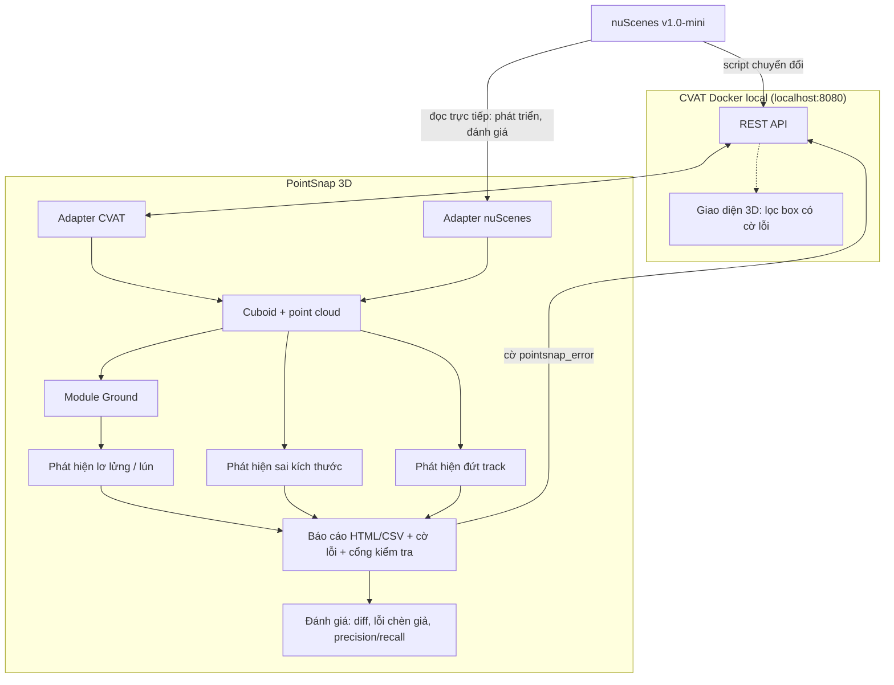

# BẢN ĐỀ XUẤT ĐỀ TÀI CÔNG CỤ HỖ TRỢ GÁN NHÃN

## THÔNG TIN CHUNG

- **Tên đề tài (Tiếng Việt):** **PointSnap 3D: Công cụ phát hiện và cảnh báo sớm lỗi nhãn 3D Cuboid trên CVAT**
- **Tên tiếng Anh:** **PointSnap 3D: Early Error Detection & Warning for 3D LiDAR Cuboid Annotation on CVAT**
- **Tên gọi ngắn gọn:** **PointSnap 3D**
- **Đội thực hiện:** Đội P-029 (Cohort 4A)
- **Thành viên tham gia:**
  - Vũ Bảo Khánh
  - Đặng Văn Huy
  - Nguyễn Văn Hân
  - Nhữ Đình Chiến
  - Khúc Việt Anh
- **Thời gian thực hiện:** **1,5 tuần (05/10/2026 – 15/10/2026)**
- **Dữ liệu:** **nuScenes v1.0-mini** (bộ dữ liệu công khai) — xem [mục 2.1](#21-dữ-liệu-nuscenes-v10-mini)
- **Môi trường triển khai & kiểm chứng:** CVAT Docker chạy local (`localhost:8080`)
- **Liên kết backlog nội bộ:** [P-010](../../problem-backlog.md#p-010), [P-011](../../problem-backlog.md#p-011)
- **Trạng thái:** Đã được mentor duyệt hướng đề tài (05/10/2026). Tài liệu đã điều chỉnh theo góp ý và rút kế hoạch còn 1,5 tuần — xem [mục 0](#0-góp-ý-của-mentor--điều-chỉnh)

---

## 0. GÓP Ý CỦA MENTOR & ĐIỀU CHỈNH

> *"Đề tài này ổn em nhé, pain point rất thực tế và bám sát đúng công việc annotation 3D các em vừa làm. Metric cũng khá rõ. Anh gợi ý nhóm scope trước vào 2–3 lỗi dễ định lượng như box lơ lửng/lún đất, sai kích thước và đứt track; làm tốt phần detect + cảnh báo trước rồi hãy mở rộng sang auto-correction."* — Mentor, 05/10/2026

| Góp ý | Điều chỉnh trong tài liệu |
|---|---|
| Scope vào 2–3 lỗi dễ định lượng | Chỉ tập trung **3 loại lỗi**: **lơ lửng/lún đất**, **sai kích thước**, **đứt track**. Mỗi loại có định nghĩa định lượng và ngưỡng rõ ràng (mục 4.1) |
| Làm tốt detect + cảnh báo trước | Toàn bộ 1,5 tuần dành cho **phát hiện và cảnh báo**: báo cáo, gắn cờ lỗi trên CVAT, cổng kiểm tra. Đo precision/recall riêng cho từng loại lỗi |
| Rồi mới mở rộng sang auto-correction | Tự sửa chuyển toàn bộ sang [Hướng phát triển](#11-hướng-phát-triển). Trong 1,5 tuần tool không sửa box nào |
| — | Rút thời gian từ 3 tuần còn **1,5 tuần**. Các module làm song song ngay từ ngày 1 nhờ mô hình dữ liệu chung, không phải chờ CVAT (mục 3.4, mục 7) |
| — | Nhóm chia **2 người code** (Khúc Việt Anh, Đặng Văn Huy) và **3 tester** (Vũ Bảo Khánh, Nhữ Đình Chiến, Nguyễn Văn Hân); phạm vi cắt gọn tương ứng (mục 1.1, mục 7.1) |

---

## 1. LÝ DO LÀM TOOL & MỤC TIÊU CỐT LÕI

Trong quá trình gán nhãn 3D Cuboid trên CVAT, nhóm nhận thấy phần lớn thời gian bị lãng phí không nằm ở việc vẽ box mà nằm ở **vòng lặp nộp → bị trả về → sửa → nộp lại**. Ba loại lỗi gặp nhiều nhất và **đo được bằng số** là:

1. **Box lơ lửng hoặc lún đất:** phải xoay, zoom camera 3D để căn đáy box bằng mắt; dễ lệch vài chục cm.
2. **Sai kích thước:** box quá to/nhỏ so với loại xe, hoặc cùng một xe mà mỗi frame một kích thước.
3. **Đứt track:** cùng một đối tượng nhưng track nhảy vị trí bất thường, bị tách thành hai ID, hoặc có đoạn dài chỉ dựa vào nội suy nên box lệch khỏi đối tượng.

Reviewer hiện phải soi thủ công từng frame để tìm các lỗi này.

🎯 **Mục tiêu:** PointSnap 3D **phát hiện và cảnh báo sớm** ba loại lỗi trên trước khi nộp, chỉ ra chính xác box nào sai, ở frame nào, sai bao nhiêu, ngay trong CVAT.

**Nguyên tắc xuyên suốt:** *tool đề xuất, con người quyết định.* Tool chỉ ghi một thuộc tính cờ lỗi. Tool không thay đổi vị trí, kích thước hay class của box nào và **không bao giờ tự tạo box mới**.

### 1.1. Phạm vi

**Cam kết (1,5 tuần):**
- Chuyển nuScenes v1.0-mini vào CVAT (point cloud + nhãn chuẩn) làm môi trường thử nghiệm.
- Module ước lượng mặt đất (ground) cục bộ.
- Bộ phát hiện cho **3 loại lỗi**: lơ lửng/lún, sai kích thước, đứt track.
- Báo cáo HTML/CSV có link mở thẳng frame; **gắn cờ lỗi lên box** để lọc ngay trong CVAT; cổng kiểm tra ĐẠT/KHÔNG ĐẠT trước khi nộp.
- Công cụ đánh giá: so sánh phiên bản nhãn, bộ lỗi chèn giả, đo precision/recall theo từng loại lỗi.

**Làm nếu kịp:**
- Luật "khoảng nội suy dài" (kiểu 3 của bộ phát hiện đứt track).

**Ngoài phạm vi (1,5 tuần):**
- Mọi chức năng sửa: `fix --z` (kể cả bản `--dry-run` chỉ xuất kế hoạch), `fix --size`, `restore`, gợi ý sửa đứt track — xem [Hướng phát triển](#11-hướng-phát-triển).
- Trang tổng quan so sánh giữa các lần quét.
- Thêm luật phát hiện: ngược yaw 180°, box rỗng, chồng lấn, thiếu thuộc tính.
- Cảnh báo sót đối tượng, tự sinh box (Pre-Box), detector 3D.
- Sửa mã nguồn / giao diện CVAT; Issue, webhook.
- Tự động duyệt hay tự động nộp job; thay thế reviewer.
- Server, cơ sở dữ liệu hay web app riêng.

---

## 2. VẤN ĐỀ THỰC TẾ & DỮ LIỆU

Các số liệu dưới đây là **quan sát nội bộ / ước lượng** từ kinh nghiệm gán nhãn 3D cuboid của nhóm. Baseline sẽ được **đo lại trên nuScenes ở Ngày 1–2** (mục 10).

| Lỗi | Thực tế thao tác trên CVAT | Thời gian & thao tác lãng phí (quan sát nội bộ) |
|---|---|---|
| **Lơ lửng / lún đất** ([P-010](../../problem-backlog.md#p-010)) | Không có mặt phẳng tham chiếu; phải xoay và zoom camera để ước lượng bằng mắt | Chỉnh cao độ Z chiếm ~35–40% thời gian tạo box. Lỗi lơ lửng/lún chiếm ~30% ca bị bắt sửa |
| **Sai kích thước** ([P-011](../../problem-backlog.md#p-011)) | Chỉnh l, w, h thủ công từng frame; dễ lệch giữa các frame của cùng một xe | Reviewer phải so kích thước bằng mắt qua nhiều frame |
| **Đứt track** ([P-011](../../problem-backlog.md#p-011)) | Reviewer tự lướt từng frame để thấy track nhảy, tách ID, hoặc box nội suy lệch khỏi đối tượng | ~3–5 phút/frame cho review thủ công nói chung. Rework chiếm ~25–35% thời lượng của đội |

### 2.1. Dữ liệu: nuScenes v1.0-mini

| Mục | Nội dung |
|---|---|
| **Nguồn** | [nuscenes.org/nuscenes](https://www.nuscenes.org/nuscenes) (mục Download), bản dự phòng trên [AWS Open Data](https://registry.opendata.aws/motional-nuscenes/) |
| **Quy mô** | 10 cảnh × ~20 giây, ~4 GB. Chỉ keyframe (2 Hz) có nhãn → khoảng 400 frame có nhãn, trung bình ~45 box mỗi frame |
| **Nội dung dùng** | Point cloud `LIDAR_TOP` (32 tia), nhãn 3D cuboid có ID track (`instance`), số điểm LiDAR trong box, vị trí xe thu (ego pose) từng frame |
| **Giấy phép** | Miễn phí cho mục đích phi thương mại (học tập, nghiên cứu). Nhóm sẽ đọc lại [điều khoản](https://www.nuscenes.org/terms-of-use) trước khi dùng |
| **Công cụ đọc** | `nuscenes-devkit` (Python) |

**Cách dùng dữ liệu trong dự án:**

1. **Môi trường thử nghiệm:** chuyển các keyframe sang `.pcd`, tạo task 3D trên CVAT local, nạp nhãn chuẩn qua API.
2. **Đáp án (ground truth):** nhãn chuẩn nuScenes dùng để kiểm chứng module ground, thống kê kích thước theo class, và làm đáp án khi đánh giá.
3. **Chia tập:** **5 cảnh tinh chỉnh** (thống kê và chỉnh ngưỡng) và **5 cảnh kiểm tra** (chỉ dùng để báo cáo kết quả).
4. **Bộ "lỗi thật" (giới hạn):** nhóm tự gán nhãn lại **1 cảnh** thuộc tập kiểm tra (~40 keyframe) trên CVAT ở tốc độ bình thường, **không xem nhãn chuẩn**. Chỉ gán **ô tô và người đi bộ trong bán kính 30 m**; 2 người chia nhau các track, mỗi người tối đa 1 ngày công. So với nhãn chuẩn sẽ ra danh sách lỗi thật theo 3 loại. Mẫu nhỏ nên kết quả trên bộ này chỉ mang tính tham khảo.
5. **Bộ "lỗi chèn giả":** cố ý làm hỏng nhãn chuẩn theo đúng 3 loại lỗi, với nhiều mức độ (mục 8.1). Đây là cơ sở chính để đánh giá.

**Đặc điểm cần lưu ý:**
- Nhãn nuScenes lưu theo **tọa độ toàn cục**; phải đổi về tọa độ LiDAR từng frame (devkit có hàm sẵn).
- Kích thước box nuScenes theo thứ tự **[w, l, h]**; phải chốt khi ánh xạ sang CVAT.
- File `.pcd.bin` của nuScenes có 5 giá trị mỗi điểm và **không phải PCD chuẩn**; phải chuyển đổi.
- LiDAR 32 tia khá thưa ở xa; ground ở xa ít điểm hơn.
- Keyframe cách nhau 0,5 giây; các ngưỡng theo thời gian tính trên khoảng này.

---

## 3. NGUYÊN TẮC THIẾT KẾ CHUNG

### 3.1. Ghi dữ liệu an toàn

Tool chỉ ghi **một thuộc tính văn bản `pointsnap_error`**, không chạm vào hình học của box.

- Trước khi ghi cờ, lưu **bản chụp toàn bộ nhãn** của job (JSON) để có thể khôi phục.
- **Cập nhật từng phần theo id** (PATCH `action=update`), không ghi đè toàn bộ.
- CVAT không khóa job khi có người đang mở, nên **chỉ chạy `--flag` trên job không có ai đang mở**. Sau khi tool ghi, người dùng tải lại trang (F5).

### 3.2. Shape hay Track

Nhãn nuScenes có ID track nên được nạp dưới dạng **track** trên CVAT. Task chỉ chứa keyframe nuScenes (2 Hz), nên nhãn chuẩn có keyframe ở mọi frame. Trong CVAT, frame nằm giữa hai keyframe nhập tay (khi không có cờ `outside`) được **nội suy** chứ không mất box. Luật đứt track xét trên chuỗi keyframe và cờ `outside`; cách API trả về hai thứ này được xác minh ở spike (mục 10).

### 3.3. Hệ tọa độ và quy ước hình học

Phải **xác minh ở Ngày 1–2** và ghi vào `CONVENTIONS.md`:
- Trục "lên", đơn vị, gốc tọa độ của CVAT và của LiDAR nuScenes.
- Layout `points` của cuboid 3D qua API; `position` có phải tâm hình học không; yaw tính bằng radian trong [-π, π].
- Ánh xạ kích thước [w, l, h] và quaternion của nuScenes sang CVAT.

### 3.4. Nguồn dữ liệu & hai adapter

Core chỉ làm việc với mô hình dữ liệu chung `Cuboid` và point cloud, qua hai adapter:

- **Adapter CVAT** (đường chính): đọc nhãn và point cloud qua API, ghi cờ lỗi. Nhờ vậy tool chạy được trên bất kỳ CVAT nào.
- **Adapter nuScenes**: đọc thẳng thư mục nuScenes qua devkit. Dùng để **phát triển song song từ ngày 1** (không phải chờ CVAT) và để chạy đánh giá nhanh.

Có ánh xạ frame ↔ file ↔ `sample_token` ↔ vị trí xe thu. Kết quả của hai adapter được so khớp trên ít nhất 2 cảnh.

---

## 4. GIẢI PHÁP

Tool được xây dựng theo kiến trúc **Python Engine kết nối CVAT REST API**. Lõi thuật toán tách biệt với phần giao tiếp CVAT, để về sau có thể chạy độc lập hoặc tích hợp vào giao diện CVAT.



**Quy trình sử dụng:**

```
Annotator gán nhãn
  → pointsnap scan --job <id> --flag   (báo cáo + gắn cờ lỗi lên box)
  → Mở CVAT, bật bộ lọc box có cờ lỗi, sửa theo chỉ dẫn
  → pointsnap scan lại → pointsnap gate --job <id>   (ĐẠT / KHÔNG ĐẠT)
  → Nộp
```

### 4.1. 🔍 Ba bộ phát hiện

Mỗi loại lỗi có **định nghĩa định lượng**, **ngưỡng cấu hình được** trong `config.yaml`, và **hai mức**: **Lỗi** (gần như chắc chắn sai) và **Cảnh báo** (nên kiểm tra). Trường hợp thiếu dữ liệu để kết luận được ghi ở mức **Thông tin**. Ngưỡng dưới đây là mặc định đề xuất, sẽ chốt lại trên 5 cảnh tinh chỉnh.

#### a) Lơ lửng / lún đất

| Thành phần | Nội dung |
|---|---|
| **Đại lượng đo** | `d = z_đáy_box − z_ground_cục_bộ` (cm). d > 0 là lơ lửng, d < 0 là lún |
| **Cách đo ground** | Tách ground mỗi frame bằng lưới min-Z + RANSAC cục bộ; với mỗi box, lấy điểm ground trong **vành đai** quanh footprint (mở rộng 0,5–1,5 m, loại vùng trong box) và fit mặt phẳng cục bộ. Không dùng điểm dưới gầm xe vì LiDAR không nhìn thấy |
| **Ngưỡng mặc định** | Cảnh báo: \|d\| > 10 cm · Lỗi: \|d\| > 20 cm |
| **Áp dụng cho** | Class tiếp đất: ô tô, xe tải, xe buýt, người, xe đạp, xe máy |
| **Chống báo động giả** | Bỏ qua khi vành đai có quá ít điểm ground (bị che), ghi "thiếu bằng chứng" ở mức Thông tin |
| **Kiểm chứng ground** | So đáy ~200 box chuẩn nuScenes với ground ước lượng: yêu cầu sai số trung vị < 5 cm, 90% box < 10 cm (cổng G1) |

#### b) Sai kích thước

| Thành phần | Nội dung |
|---|---|
| **Kiểu 1 — Bất thường theo class** | So l, w, h với khoảng [p1, p99] của class, thống kê từ nhãn chuẩn của 5 cảnh tinh chỉnh. Cảnh báo nếu ngoài [p1 − 5%, p99 + 5%]; Lỗi nếu ngoài [p1 − 15%, p99 + 15%]. Phần biên cộng thêm giúp box chuẩn không tự bị cảnh báo chỉ vì nằm ở đuôi phân phối |
| **Kiểu 2 — Không ổn định trong track** | Với track vật rắn có ≥ 3 keyframe: độ lệch của mỗi keyframe so với **trung vị của track**. Cảnh báo nếu lệch > max(10 cm, 5%); Lỗi nếu > max(30 cm, 15%) |
| **Class ít mẫu** | Class có dưới 20 instance trong tập tinh chỉnh dùng khoảng kích thước nhập tay trong `config.yaml` thay cho thống kê |
| **Chống báo động giả** | Người đi bộ không xét kiểu 2 (tư thế thay đổi); lệch > 30% ghi chú "nghi nhầm ID" thay vì sai kích thước |

#### c) Đứt track

| Thành phần | Nội dung |
|---|---|
| **Kiểu 1 — Nhảy vị trí** | Đổi tâm box về tọa độ toàn cục bằng vị trí xe thu. Với keyframe k có keyframe ở cả hai phía, tính độ lệch so với vị trí nội suy tuyến tính theo thời gian từ hai keyframe đó: `r_k = ‖p_k − p̂_k‖`. Một cú nhảy cũng làm lệch hai frame bên cạnh, nên chỉ báo frame có `r_k` lớn nhất trong mỗi cụm liên tiếp. Ngưỡng Cảnh báo / Lỗi: xe 1,0 / 2,0 m; xe đạp, xe máy 0,75 / 1,5 m; người 0,5 / 1,0 m. Ở hai đầu track chỉ kiểm tra thô bằng `v_max(class) × Δt`. Không có vị trí xe thu thì chỉ báo ở mức Cảnh báo |
| **Kiểu 2 — Tách ID** | Track A kết thúc ở frame k và một track B **cùng class** bắt đầu trong khoảng k+1 đến k+3, vị trí đầu của B gần vị trí ngoại suy của A (xe < 2 m, người < 1 m) → nghi cùng một đối tượng bị tách thành hai ID |
| **Kiểu 3 — Khoảng nội suy dài** *(làm nếu kịp)* | Track có ≥ N frame liên tiếp chỉ có box nội suy (mặc định N = 2, tức ≥ 1 giây), trong khi đối tượng dịch chuyển > 1 m trong đoạn đó → box nội suy dễ lệch khỏi đối tượng, nên thêm keyframe |
| **Chống báo động giả** | Bỏ qua đối tượng ở rìa tầm cảm biến; kiểu 2 và kiểu 3 chỉ ở mức Cảnh báo |

### 4.2. 📋 Báo cáo, cờ lỗi & cổng kiểm tra

**`pointsnap scan --job <id>`**
- Báo cáo **HTML**: chia ba mức Lỗi / Cảnh báo / Thông tin, nhóm theo track; mỗi dòng ghi số đo cụ thể, ví dụ *"Frame 12, ID 5: đáy box cách mặt đất 15 cm"*, kèm **link mở thẳng frame** trên CVAT.
- **CSV** để thống kê. Mỗi lần quét tự lưu **bản chụp nhãn** (JSON).

**`pointsnap scan --job <id> --flag`** — cảnh báo ngay trong CVAT
- Ghi thuộc tính văn bản `pointsnap_error` lên box có lỗi, ví dụ *"LỖI: lơ lửng 22 cm"*; xóa cờ khi box hết lỗi ở lần quét sau.
- Annotator bật **bộ lọc theo `pointsnap_error`** để chỉ thấy box lỗi trong màn hình 3D.

**`pointsnap gate --job <id>`** — cổng trước khi nộp
- Trả về **ĐẠT** (exit code 0) hoặc **KHÔNG ĐẠT** (exit code 1) kèm lý do.
- Tiêu chí mặc định: 0 mục mức "Lỗi"; số "Cảnh báo" ≤ N (cấu hình được).

**Hiệu năng:** numpy vector hóa, voxel downsample, KD-tree, cache ground theo frame. *Mục tiêu:* dưới 2 phút cho một cảnh; **sẽ đo thực tế**.

### 4.3. 📏 Công cụ đánh giá

- **`pointsnap diff`**: so hai phiên bản nhãn, liệt kê box thêm / xóa / sửa kèm Δ tâm, Δ kích thước, Δ yaw. Với cảnh tự gán, ID track khác nhãn chuẩn nên box được ghép theo **BEV IoU từng frame**; box lệch quá ngưỡng Cảnh báo của loại lỗi tương ứng được tính là **lỗi thật**.
- **Bộ chèn lỗi giả**: tạo lỗi có kiểm soát trên nhãn chuẩn (mục 8.1).
- **Tính precision/recall theo từng loại lỗi và từng mức độ**, xuất bảng kết quả.

### 4.4. 👁️ Đánh dấu "đã duyệt" (cấu hình, không code)

Thêm thuộc tính checkbox `reviewed` vào label spec và bộ lọc "chưa duyệt", để reviewer đi theo hàng đợi lỗi và đánh dấu box đã xem. Cổng kiểm tra có thể thêm tiêu chí "% box đã duyệt".

---

## 5. KIẾN TRÚC, HIỆU NĂNG & CHI PHÍ

```
pointsnap/
  core/               # thuần Python: mô hình Cuboid, hình học, ground, 3 bộ phát hiện. KHÔNG import CVAT
  adapters/cvat/      # cvat-sdk / REST: đọc nhãn, đọc point cloud, ghi cờ lỗi, lưu bản chụp
  adapters/nuscenes/  # đọc thẳng nuScenes qua devkit: phát triển song song, đánh giá nhanh
  datasets/nuscenes/  # chuyển nuScenes → PCD + task CVAT; nạp nhãn chuẩn; chèn lỗi giả
  eval/               # diff, ghép box, precision/recall theo loại lỗi
  report/             # template HTML (jinja2), CSV
  cli/                # pointsnap scan [--flag] | gate | diff | eval
  config.yaml         # ngưỡng theo class và theo loại lỗi, tiêu chí gate, URL; token qua biến môi trường
  CONVENTIONS.md      # quy ước tọa độ, layout points đã chốt ở spike
  tests/              # cảnh tổng hợp, bộ lỗi chèn giả
```

- **Mô hình dữ liệu cố định:** `Cuboid(center, dims, yaw, label, track_id, frame, attrs)`, **chốt trong ngày 05/10** để cả nhóm làm song song. Core chỉ nhận và trả các đối tượng này nên đổi nền tảng hay đổi bộ dữ liệu chỉ cần viết thêm adapter.
- **Thư viện (mã nguồn mở):** numpy, scipy (KD-tree), Open3D hoặc pypcd4, `nuscenes-devkit`, `cvat-sdk` (ghim cùng phiên bản với server), jinja2, pyyaml, pytest.
- **Chi phí:** hạ tầng bằng 0 (laptop CPU, phần mềm mã nguồn mở, dữ liệu công khai). Không cần GPU.
- **Kiểm thử:** tester viết các ca kiểm thử có đáp án (ví dụ box đặt lệch Z một lượng biết trước) và người code khóa chúng bằng pytest; bộ lỗi chèn giả; vòng lặp ghi – đọc – so sánh cho adapter CVAT.
- **Bảo mật:** token qua biến môi trường; không commit token và dữ liệu nuScenes lên repo.
- **Dùng AI agent hỗ trợ viết code** (nếu ban tổ chức cho phép, sẽ ghi rõ trong báo cáo): viết test trước, code chỉ được nhận khi qua test; quy ước dùng chung trong `CONVENTIONS.md`; agent không tự chạy lệnh có ghi vào CVAT.

---

## 6. MÔI TRƯỜNG TRIỂN KHAI & MỞ RỘNG

**Giai đoạn hiện tại (CVAT Docker local + nuScenes v1.0-mini):** không phụ thuộc dữ liệu nội bộ, có nhãn chuẩn làm đáp án, người khác tái lập lại được kết quả.

**Khi chuyển sang CVAT và dữ liệu thật của tổ chức:** kiểm tra quyền token, phiên bản CVAT, chính sách dữ liệu; chạy `--readonly` trước (chỉ `scan`, `gate`, `diff`); thống kê lại ngưỡng kích thước theo class trên dữ liệu thật.

---

## 7. KẾ HOẠCH TRIỂN KHAI 1,5 TUẦN (CÓ CỔNG KIỂM SOÁT)

**Giả định:** 8 ngày làm việc (05–09/10 và 12–14/10); 15/10 là dự phòng và nộp.

**Cách chia việc:** **2 người code** (Việt Anh, Huy) chỉ viết code. **3 tester** (Khánh, Chiến, Hân) nhận mọi việc còn lại: dựng môi trường, dữ liệu, kiểm thử, đánh giá, tài liệu. Mỗi phần code có tester kiểm ngay khi chạy được: Chiến kiểm phía CVAT (phần của Việt Anh), Hân kiểm thuật toán (phần của Huy), Khánh dùng thử như annotator thật.

**Cách rút ngắn:** mô hình `Cuboid` và `config.yaml` chốt ngay ngày 05/10. Module ground và các bộ phát hiện chạy trên adapter nuScenes từ ngày đầu, song song với việc dựng CVAT; khi adapter CVAT xong thì chỉ cần nối vào.

| Thời gian | Nội dung công việc | Cổng kiểm soát |
|---|---|---|
| **05–06/10** | **Việt Anh:** mô hình `Cuboid`, `config.yaml`, khung CLI (chốt trong 05/10); script chuyển nuScenes → PCD, tạo task 3D, nạp nhãn chuẩn dạng track. **Huy:** adapter nuScenes; module ground. **Chiến:** dựng CVAT Docker, tải nuScenes; chạy script chuyển đổi và kiểm bằng mắt box hiển thị đúng; cấu hình `pointsnap_error`, `reviewed`; tạo task trống cho cảnh tự gán; các mục spike kiểm trên giao diện (mục 10). **Hân:** viết ca kiểm thử có đáp án; đặc tả bộ lỗi chèn giả (mục 8.1). **Khánh:** điều phối; hướng dẫn tự gán nhãn; mẫu báo cáo HTML và câu chữ thông báo lỗi; khoảng kích thước cho class ít mẫu | **G0 (06/10):** 1 cảnh hiển thị đúng trên CVAT với nhãn chuẩn; chốt hệ tọa độ và layout `points` |
| **07–08/10** | **Việt Anh:** adapter CVAT (đọc nhãn, point cloud, ghi cờ lỗi, bản chụp); `gate`; báo cáo HTML/CSV theo mẫu của Khánh. **Huy:** kiểm chứng ground ~200 box; bộ phát hiện lơ lửng/lún; bộ phát hiện sai kích thước. **Chiến (07/10) và Khánh (08/10):** tự gán nhãn lại 1 cảnh. **Chiến (08/10):** kiểm ghi cờ lỗi: đúng box, lọc được trong canvas 3D. **Hân:** đối chiếu ground ước lượng bằng mắt; chạy ca kiểm thử cho bộ phát hiện lơ lửng/lún và kích thước | **G1 (08/10):** ground đạt hoặc không đạt ngưỡng kiểm chứng (quyết định luật lơ lửng/lún có mức Lỗi hay chỉ Cảnh báo); bộ phát hiện lơ lửng/lún và kích thước chạy trên nhãn chuẩn 1 cảnh |
| **09/10** | **Việt Anh:** tích hợp end-to-end trên CVAT: `scan --flag` → lọc box có cờ lỗi → `gate`. **Huy:** bộ phát hiện đứt track (nhảy vị trí, tách ID). **Chiến:** kiểm thử toàn quy trình trên CVAT. **Hân:** kiểm ca đứt track. **Khánh:** dùng thử như annotator, góp ý báo cáo và câu chữ | **G2 (09/10):** demo được toàn bộ quy trình trên CVAT với 1 cảnh; 3 bộ phát hiện chạy trên toàn bộ bản mini |
| **12–13/10** | **Đánh giá** (Hân chủ trì). **Việt Anh:** bộ chèn lỗi giả theo đặc tả của Hân; `diff`; sửa lỗi tester báo. **Huy:** script precision/recall; chốt ngưỡng trên 5 cảnh tinh chỉnh; sửa lỗi. **Hân, Chiến:** xem tay từng cảnh báo trên nhãn chuẩn sạch, cảnh tự gán và 5 cảnh kiểm tra đã chèn lỗi (đúng hay báo nhầm); điền bảng chỉ số mục 8; so khớp kết quả hai adapter trên 1 cảnh. **Khánh:** đo thời gian review; bắt đầu README và báo cáo kết quả | **G3 (13/10):** có số liệu cho mọi chỉ số ở mục 8; ngưỡng chốt trong `config.yaml` |
| **14/10** | **Khánh** (chủ trì): README, hướng dẫn sử dụng, video demo, báo cáo kết quả, slide. **Việt Anh, Huy:** đóng gói, dọn code, hướng dẫn cài đặt. **Chiến, Hân:** làm lại toàn bộ quy trình từ đầu theo README trên một máy khác để kiểm tài liệu | — |
| **15/10** | Dự phòng, nộp | — |

**Đường găng:** có hai chuỗi, mỗi người code một chuỗi. Việt Anh: script chuyển đổi → adapter CVAT → tích hợp 09/10. Huy: ground → lơ lửng/lún → kích thước → đứt track. Cả hai người code đều kín lịch, nên **người code không nhận việc gì ngoài code**.

**Thứ tự cắt nếu trễ:** kiểu "khoảng nội suy dài" → đo thời gian review → so khớp hai adapter → `diff` trên cảnh tự gán (khi đó bỏ chỉ số recall trên lỗi thật). **Không cắt:** bộ phát hiện lơ lửng/lún, sai kích thước, nhảy vị trí và tách ID; báo cáo; `scan --flag`; `gate`; đánh giá trên bộ lỗi chèn giả.

### 7.1. Phân công

| Thành viên | Vai trò | Phụ trách | Ước lượng (ngày công) |
|---|---|---|---|
| **Khúc Việt Anh** | Code — phía CVAT | Mô hình `Cuboid`, `config.yaml`, khung CLI, `CONVENTIONS.md`; **script chuyển đổi nuScenes → CVAT**; **adapter CVAT** (đọc nhãn, point cloud, ghi cờ lỗi, bản chụp); `scan --flag`, `gate`; báo cáo HTML/CSV; tích hợp; bộ chèn lỗi giả; `diff` | ~8 |
| **Đặng Văn Huy** | Code — thuật toán | Adapter nuScenes; **module ground** và kiểm chứng ground; thống kê kích thước theo class; **3 bộ phát hiện** (lơ lửng/lún, sai kích thước, đứt track); script precision/recall | ~8 |
| **Nhữ Đình Chiến** | Tester — môi trường & CVAT | Dựng CVAT Docker, tải nuScenes, chạy và kiểm script chuyển đổi; cấu hình label spec (`pointsnap_error`, `reviewed`); các mục spike kiểm trên giao diện; kiểm adapter CVAT và toàn quy trình `scan --flag` → lọc → `gate`; tự gán nhãn lại (1 ngày); so khớp hai adapter | ~6 |
| **Nguyễn Văn Hân** | Tester — thuật toán & đánh giá | Ca kiểm thử có đáp án; đặc tả bộ lỗi chèn giả; đối chiếu ground bằng mắt; kiểm từng bộ phát hiện; chủ trì đánh giá: xem tay từng cảnh báo, điền bảng chỉ số mục 8 | ~6,5 |
| **Vũ Bảo Khánh** | Tester — người dùng & tài liệu | Điều phối, nghiệm thu các cổng G0–G3; mẫu báo cáo HTML và câu chữ thông báo lỗi; khoảng kích thước cho class ít mẫu; dùng thử như annotator; tự gán nhãn lại (1 ngày); đo thời gian review; README, video demo, báo cáo kết quả, slide | ~7 |

Tổng khoảng **35 ngày công trên 40 ngày công thô** (5 người × 8 ngày). Hai người code **kín 100% lịch**: dự phòng duy nhất là ngày 15/10 và thứ tự cắt ở trên. Tester còn dư khoảng 4 ngày công, dùng để kiểm thử sâu hơn và hỗ trợ dữ liệu.

---

## 8. ĐO LƯỜNG & TIÊU CHÍ CHẤP NHẬN

Nhãn chuẩn nuScenes là **đáp án**. Mọi chỉ số được báo cáo **riêng cho từng loại lỗi**, trên **5 cảnh kiểm tra**. Ngưỡng dưới đây là đề xuất, chốt lại sau baseline.

### 8.1. Bộ lỗi chèn giả

Chèn vào nhãn chuẩn của 5 cảnh kiểm tra, khoảng 10% số track mỗi cảnh, mỗi box hoặc track chỉ mang một lỗi.

| Loại lỗi | Cách chèn | Mức độ |
|---|---|---|
| Lơ lửng / lún | Dịch Z của box lên hoặc xuống | 5, 10, 20, 40 cm |
| Kích thước — trong track | Làm lệch l, w, h ở một keyframe của track | 5%, 15%, 30% |
| Kích thước — theo class | Phóng to/thu nhỏ cả track, hoặc gán kích thước của class khác (ví dụ ô tô mang kích thước xe buýt) | ×0,6; ×1,5; đổi class |
| Đứt track — nhảy vị trí | Dịch tâm một keyframe | 0,5; 1; 2; 4 m |
| Đứt track — tách ID | Cắt một track thành hai ID | — |
| Đứt track — khoảng nội suy | Xóa các keyframe liên tiếp của đối tượng đang di chuyển | 1, 2, 3 keyframe |

Các mức nhỏ (5–10 cm, 5%, 0,5–1 m, 1 keyframe) nằm dưới hoặc sát ngưỡng Cảnh báo. Chúng chỉ được báo cáo để biết giới hạn của tool, không tính vào tiêu chí đạt.

### 8.2. Chỉ số

| Chỉ số | Cách đo | Ngưỡng đề xuất |
|---|---|---|
| **Recall trên lỗi chèn giả** | Một lỗi được tính là bắt được khi tool báo đúng box/track đó ở mức **Cảnh báo trở lên** | ≥ 90% cho: lơ lửng/lún ≥ 20 cm; kích thước trong track ≥ 15%; kích thước theo class; nhảy ≥ 2 m. ≥ 80% cho tách ID và khoảng nội suy ≥ 2 keyframe |
| **Phân mức đúng** | Tỷ lệ lỗi chèn mức lớn (Z 40 cm, kích thước 30%, nhảy 4 m) được báo ở mức **Lỗi** | ≥ 80% |
| **Precision** | Trên cảnh đã chèn lỗi và trên cảnh tự gán lại. Mục tool báo mà không khớp lỗi nào được xem thủ công trước khi tính là báo động giả (nhãn chuẩn cũng có thể sai) | ≥ 70% cho mỗi loại lỗi |
| **Báo động giả trên nhãn sạch** | Chạy trên nhãn chuẩn chưa chèn lỗi | Báo cáo số mục / 100 box theo từng mức; mục tiêu ≤ 2 Cảnh báo và ≤ 0,5 Lỗi / 100 box |
| **Recall trên lỗi thật** | Cảnh tự gán so với nhãn chuẩn qua `diff`, lọc theo 3 loại lỗi | Báo cáo con số thực tế; mục tiêu ≥ 70% (mẫu nhỏ, tham khảo) |
| **Độ chính xác của số đo** | Sai số giữa giá trị tool báo (ví dụ "lơ lửng 15 cm") và giá trị thật trên lỗi chèn giả | Sai số trung vị < 5 cm (Z), < 5% (kích thước) |
| **Kiểm chứng ground** | Đáy box chuẩn so với ground ước lượng, ~200 box | Trung vị < 5 cm, 90% < 10 cm |
| **Thời gian review (tham khảo)** | 2 người, mỗi người review 5 frame có báo cáo/cờ lỗi và 5 frame không có, đổi thứ tự; đếm số lỗi tìm được và thời gian | Báo cáo trung vị; ghi rõ là số liệu tham khảo |
| **Hiệu năng** | Thời gian chạy `scan` trên một cảnh và toàn bộ bản mini | Mục tiêu < 2 phút/cảnh |

**Kỳ vọng định tính:** reviewer không còn phải soi thủ công 3 loại lỗi này; annotator thấy lỗi ngay trong CVAT trước khi nộp; giảm số lần bị trả về. Mức giảm cụ thể sẽ báo cáo bằng **số liệu đo thực tế**.

---

## 9. RỦI RO & BIỆN PHÁP

| Rủi ro | Biện pháp |
|---|---|
| **1,5 tuần quá gấp, chỉ có 2 người code** | Người code chỉ làm code; môi trường, dữ liệu, kiểm thử, đánh giá và tài liệu do 3 tester nhận. Mô hình `Cuboid` chốt ngày 05/10; ground và bộ phát hiện làm trên adapter nuScenes song song với việc dựng CVAT. Tự sửa đã chuyển ra ngoài phạm vi; thứ tự cắt định trước (mục 7); dùng AI agent hỗ trợ viết code (mục 5) |
| **Một người code bị kẹt hoặc nghỉ** | Code đẩy lên repo hằng ngày, có test đi kèm; hai người code đọc chéo code của nhau mỗi ngày để có thể tiếp phần của nhau |
| **Chuyển nuScenes vào CVAT chậm** (định dạng `.pcd.bin`, tọa độ toàn cục, thứ tự [w, l, h]) | Làm ngay Ngày 1 (cổng G0), bắt đầu với 1 cảnh; dùng hàm có sẵn của devkit; kiểm tra bằng mắt. Nếu trễ, phát triển và đánh giá vẫn tiếp tục trên adapter nuScenes; CVAT chỉ bắt buộc cho phần `--flag` và demo |
| **Ground không ổn định** (dốc, bờ vỉa, bị che, LiDAR thưa) | Ground cục bộ quanh box; bỏ qua khi thiếu điểm; kiểm chứng bằng nhãn chuẩn ở G1. Nếu không đạt, luật lơ lửng/lún chỉ ở mức Cảnh báo. Hai loại lỗi còn lại không phụ thuộc ground |
| **Nhãn chuẩn nuScenes không hoàn hảo** | Dùng dung sai khi so sánh; cảnh báo trên nhãn chuẩn được kiểm tra thủ công trước khi tính là báo động giả |
| **Bộ lỗi thật nhỏ** | Chỉ dùng làm tham khảo; kết luận chính dựa trên bộ lỗi chèn giả nhiều mức độ |
| **Luật đứt track báo nhầm** (rẽ gấp, phanh, bị che lâu, ra khỏi tầm) | Ngưỡng nhảy tính theo độ lệch so với nội suy, không dùng `v_max × Δt`; chỉ báo frame lệch lớn nhất trong cụm; bỏ qua rìa tầm cảm biến; tách ID và khoảng nội suy chỉ ở mức Cảnh báo |
| Ngưỡng bị overfit | Chỉnh ngưỡng trên 5 cảnh tinh chỉnh, báo cáo trên 5 cảnh kiểm tra |
| Ghi cờ lỗi làm hỏng nhãn | Chỉ ghi một thuộc tính, PATCH theo id, lưu bản chụp trước khi ghi, chỉ chạy trên job không có ai mở |
| Sai hệ tọa độ | Spike Ngày 1–2, test với box đã biết, `CONVENTIONS.md` |
| Kết quả trên nuScenes không đại diện cho dữ liệu thật | Ngưỡng nằm trong `config.yaml`, thống kê lại được; ghi rõ giới hạn trong báo cáo |
| Nâng cấp CVAT làm vỡ tool | Ghim phiên bản CVAT và `cvat-sdk` |
| Vi phạm giấy phép dữ liệu | Chỉ dùng cho học tập/nghiên cứu; không commit dữ liệu; ghi nguồn nuScenes |

---

## 10. XÁC MINH BẮT BUỘC Ở NGÀY 1–2 (SPIKE)

| # | Việc cần xác minh | Ảnh hưởng đến |
|---|---|---|
| 1 | Tải nuScenes v1.0-mini; chuyển keyframe `LIDAR_TOP` sang `.pcd`; tạo task 3D trên CVAT và hiển thị được; tạo thêm task trống cho cảnh tự gán | Toàn bộ dự án |
| 2 | Nạp nhãn chuẩn của 1 cảnh qua API dưới dạng track; box hiển thị đúng vị trí, kích thước, hướng | Adapter, đánh giá |
| 3 | Layout `points` của cuboid 3D qua API; ánh xạ [w, l, h] và quaternion sang CVAT | Cả 3 bộ phát hiện |
| 4 | Ghi thuộc tính `pointsnap_error` lên box qua API; lọc theo thuộc tính này trong canvas 3D | `scan --flag` |
| 5 | Cách lấy point cloud qua API của CVAT; ánh xạ frame ↔ file ↔ `sample_token` ↔ vị trí xe thu | Ground, nhảy vị trí |
| 6 | Đặt box tại điểm đã biết: kiểm tra trục lên, đơn vị, yaw | Mọi công thức hình học |
| 7 | Track qua API trả về những frame nào (chỉ keyframe nhập tay hay cả frame nội suy); cách biểu diễn cờ `outside` | Bộ phát hiện đứt track |
| 8 | Định dạng link mở thẳng frame | Báo cáo |
| 9 | Đo baseline nhỏ: 2 người gán nhãn và review vài frame nuScenes (có thể gộp với việc tự gán nhãn lại) | Mục 8 |

---

## 11. HƯỚNG PHÁT TRIỂN

- **Hỗ trợ sửa (giai đoạn 2), chỉ mở cho loại lỗi có bộ phát hiện đạt ngưỡng ở mục 8:**
  - `fix --z`: đặt `z_tâm = z_ground + h/2`, giữ nguyên h, roll, pitch; chỉ tự sửa khi |Δz| ≤ 0,3 m.
  - `fix --size`: đưa keyframe lệch về trung vị của track, giữ nguyên đáy box và tâm x, y; chỉ khi track có ≥ 3 keyframe và lệch ≤ 30%.
  - Đứt track: gợi ý đánh dấu `outside` hoặc nối hai ID nghi bị tách.
  - Ghi an toàn: backup tự động, `--dry-run` mặc định và chỉ ghi khi có `--apply`, file kế hoạch CSV, PATCH theo id, xác minh sau ghi, `restore`, nhật ký thay đổi JSONL, idempotent. Đo "không làm tệ hơn" bằng IoU với nhãn chuẩn trước và sau sửa.
- **Thêm luật phát hiện:** ngược yaw 180°, box rỗng / quá ít điểm, chồng lấn / trùng lặp, thiếu thuộc tính, dữ liệu hỏng.
- **Cảnh báo sót đối tượng:** tìm cụm điểm giống xe/người chưa có box (chỉ báo cáo).
- **Tự sửa thêm:** sửa ngược yaw, tự nối track bị tách ID (có xác nhận của người dùng).
- **Tích hợp sâu vào CVAT:** tạo Issue cho mỗi lỗi; webhook tự quét khi job chuyển sang "completed"; nếu dùng nội bộ thì tô màu box lỗi trên canvas 3D và **vẽ mặt đất ước lượng ngay trong màn hình 3D** làm mặt tham chiếu khi gán nhãn.
- **Pre-Box Generator:** sinh sẵn box thô (phân cụm + prior kích thước, hoặc detector 3D huấn luyện trên nuScenes).
- **Chạy trên dữ liệu và CVAT thật của tổ chức** (chế độ `--readonly` trước); adapter cho bộ dữ liệu và nền tảng khác (KITTI, Waymo Open…).

---

## PHỤ LỤC — NGUỒN THAM KHẢO

- nuScenes – trang tải dữ liệu: https://www.nuscenes.org/nuscenes
- nuScenes – hướng dẫn devkit: https://www.nuscenes.org/tutorials/nuscenes_tutorial.html
- nuScenes – điều khoản sử dụng: https://www.nuscenes.org/terms-of-use
- nuScenes trên AWS Open Data: https://registry.opendata.aws/motional-nuscenes/
- CVAT – 3D object annotation: https://docs.cvat.ai/docs/annotation/manual-annotation/modes/3d-object-annotation/
- CVAT – Annotation with cuboids: https://docs.cvat.ai/docs/annotation/manual-annotation/shapes/annotation-with-cuboids/

---

**Kính trình Ban Tổ Chức xem xét để nhóm bắt tay vào triển khai!**
