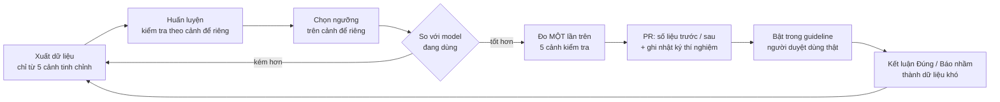

# Hướng dẫn huấn luyện và cải tiến model của PointSnap

PointSnap chủ yếu là **luật hình học có số đo rõ ràng**. Model học máy chỉ thêm **bằng chứng phụ** ở mức Thông tin /
Cảnh báo, tắt được trong guideline, và **không bao giờ tự sửa box** (góp ý của mentor). Tài liệu này hướng dẫn huấn luyện
model nhóm tự làm (Box Critic), học từ kết luận của người duyệt, và quy trình cải tiến để mỗi lần đổi model đều đo được
là tốt hơn.

| Phần | Model | Ai huấn luyện | Bật / tắt |
|---|---|---|---|
| Box Verifier lớp 2 — đối chiếu ảnh camera | Mask R-CNN COCO, hoặc Grounding DINO + SAM 2.1 (`camera.model`) | Dùng sẵn, không huấn luyện | `camera.enabled: false` |
| Box Verifier lớp 3 — **Box Critic** | PointNet nhỏ, ensemble 5 model | **Nhóm** (mục 2 – 6) | `critic.model: ""` |
| Box Verifier lớp 4 — học từ người duyệt | Thống kê Beta + logistic | Tự học từ nút Đúng / Báo nhầm (mục 7) | `learning.adjust_severity` |

Mục lục: [1. Quy trình chuẩn](#1-quy-trình-chuẩn) · [2. Xuất dữ liệu](#2-xuất-dữ-liệu) ·
[3. Huấn luyện trên máy](#3-huấn-luyện-trên-máy) · [4. Huấn luyện trên Colab](#4-huấn-luyện-trên-google-colab-gpu-miễn-phí) ·
[5. Chọn ngưỡng và đo](#5-chọn-ngưỡng-và-đo) · [6. Đưa vào dùng](#6-đưa-vào-dùng) ·
[7. Học từ người duyệt](#7-học-từ-kết-luận-của-người-duyệt-lớp-4) · [8. Bài học](#8-bài-học-đã-rút-ra) ·
[9. Hướng cải tiến](#9-hướng-cải-tiến-theo-thứ-tự-nên-làm) · [10. Hợp đồng model](#10-hợp-đồng-của-model)

---

## 1. Quy trình chuẩn



Ba quy tắc không được phá:

1. **Không xuất dữ liệu, không chỉnh gì trên 5 cảnh kiểm tra** (`scene-0103, 0655, 0796, 1077, 1100`). Cảnh kiểm tra chỉ
   dùng để đo **một lần** cho bản cuối; đo nhiều lần rồi chọn bản tốt nhất là rò số liệu.
2. **Kiểm tra theo cảnh, không theo mẫu.** Một box sinh nhiều mẫu nhiễu; chia ngẫu nhiên thì cùng box nằm ở cả hai tập và
   không thấy model học thuộc (mục 8).
3. **Mọi thay đổi có số trước / sau** trên cùng cảnh, cùng seed, ghi trong mô tả PR và nhật ký thí nghiệm (mục 5.3).

## 2. Xuất dữ liệu

```bash
pointsnap critic-data --scenes tuning --samples-per-box 6 --out data/critic
```

Mỗi box nhãn chuẩn nhìn thấy được (≥ 10 điểm LiDAR) sinh `samples-per-box` mẫu: 35% giữ nguyên, còn lại làm nhiễu ngẫu
nhiên (dời ngang ≤ 0,6 m, nâng / hạ ≤ 0,3 m, co / phóng ≤ 25% từng chiều, xoay ≤ 30°). Điểm LiDAR được lấy quanh **box
đã làm nhiễu** đúng như bộ quét thấy (bỏ mặt đất, điểm của box khác, chỉ giữ điểm nối liền với vật).

File `data/critic/<cảnh>.npz`:

| Mảng | Shape | Ý nghĩa |
|---|---|---|
| `points` | (N, 256, 4) | 256 điểm của vật: x, y, z hệ box đã nhiễu **chia nửa kích thước box**, cờ 1 nếu điểm nằm trong box |
| `meta` | (N, 20) | dài, rộng, cao (m), khoảng cách / 50, log(1 + số điểm), one-hot 15 class (`pointsnap.critic.CLASSES`) |
| `is_error` | (N,) | 1 nếu nhiễu vượt dung sai (dời > 15 cm, Z > 8 cm, kích thước > 6%, hướng > 4°) |
| `target` | (N, 7) | sửa từ box nhiễu về box chuẩn: dx, dy, dz (m, hệ box nhiễu), dl, dw, dh (m), dyaw (rad) |
| `track_id`, `frame` | (N,) | để chia tập theo track, xem lại mẫu |

Đặc trưng do `pointsnap.critic.box_features` tạo, **dùng chung** cho xuất dữ liệu và lúc quét. Đổi đặc trưng thì đổi ở
hàm này và xuất lại dữ liệu, nếu không model nhận đầu vào khác lúc học.

## 3. Huấn luyện trên máy

Script mẫu `scripts/train_critic_example.py`: PointNet nhỏ (~53 nghìn tham số mỗi model), chạy được trên RTX 3050 4 GB
hoặc CPU. Cần PyTorch.

```bash
python scripts/train_critic_example.py --data data/critic --epochs 30 --ensemble 5 --out models/critic.pt
```

| Tham số | Mặc định | Ghi chú |
|---|---|---|
| `--ensemble` | 1 | **Nên dùng 5**: trung bình 5 model khác seed, ổn định hơn hẳn 1 model (mục 8) |
| `--val-scenes` | cảnh cuối theo tên file | cảnh để riêng làm kiểm tra; giữ model có loss kiểm tra thấp nhất |
| `--width`, `--dropout`, `--weight-decay` | 128, 0,3, 1e-3 | đã thử nhiều cấu hình, mặc định là tốt nhất với 4 cảnh |
| `--use-dims` | tắt | cho model thấy kích thước tuyệt đối: **dễ học thuộc**, chỉ bật khi có nhiều dữ liệu |
| `--target-fa` | 0,01 | tỉ lệ box chuẩn bị báo để tính ngưỡng gợi ý |

Script in dòng **"Ngưỡng gợi ý"** (`min_logit_rise`, `error_logit_rise`) tính trên cảnh để riêng — dùng ở mục 5.

## 4. Huấn luyện trên Google Colab (GPU miễn phí)

Colab cho GPU T4 16 GB, đủ cho mạng lớn hơn và nhiều dữ liệu hơn máy cá nhân.

1. Trên máy: `pointsnap critic-data --scenes tuning --samples-per-box 20 --out critic-data`, chép
   `scripts/train_critic_example.py` vào `critic-data/`, nén thành `critic-data.zip`.
2. Tải `critic-data.zip` lên **My Drive** của mình, **không chia sẻ công khai** (giấy phép nuScenes không cho phân phối lại;
   dữ liệu Việt Nam của nhóm cũng vậy).
3. Mở [colab.research.google.com](https://colab.research.google.com) → *File → Upload notebook* →
   `scripts/colab_train_critic.ipynb`; *Runtime → Change runtime type → T4 GPU*; chạy lần lượt các ô.
4. Notebook kiểm tra `critic.pt` đúng hợp đồng (mục 10), lưu vào My Drive. Tải về máy, làm tiếp mục 5.

## 5. Chọn ngưỡng và đo

### 5.1. Ngưỡng

Model lệch đều theo từng vật / cảnh, nên luật `critic.box` **so logit của box với trung vị các frame khác của cùng
track**, giống các luật khác của PointSnap. Ngưỡng chọn sao cho trên **cảnh để riêng** chỉ ~0,5 – 1% box chuẩn bị báo:

| Khóa | Ý nghĩa | v3 (guideline dự án `cvat-local`) |
|---|---|---|
| `min_logit_rise` | logit cao hơn trung vị track quá mức này → Cảnh báo | 5,3 |
| `error_logit_rise` | → Lỗi | 6,7 |
| `min_probability` / `error_probability` | box lẻ không thuộc track: xác suất sai → Cảnh báo / Lỗi | 0,7 / 0,9 |

`pointsnap/config.yaml` vẫn ghi ngưỡng của v2 (4,4 / 6,0) và `model: ""` (tắt); mỗi dự án khai model và ngưỡng của mình
trong guideline. Đổi model thì đổi ngưỡng theo dòng "Ngưỡng gợi ý" của lần huấn luyện đó.

### 5.2. Đo

```bash
# chỉ bật luật critic để thấy riêng đóng góp, rồi bật cả bộ để thấy tổng
pointsnap --config <guideline có critic.model> eval --scenes tuning --rounds 10 --errors all --out out/eval-critic
# khi đã chốt: đo MỘT lần trên cảnh kiểm tra
pointsnap --config <guideline có critic.model> eval --scenes test --rounds 10 --errors all --out out/eval-critic-test
```

Chỉ số cần so với model đang dùng:

- Báo nhầm `critic.box` trên nhãn sạch (Cảnh báo / Lỗi trên 100 box) — **không được tăng**.
- Số lỗi chèn bắt được (dời, co / phóng, xoay, nhảy) — tăng mới đáng đổi.
- Tổng báo nhầm của cả bộ luật — mục tiêu ≤ 2 Cảnh báo / ≤ 0,5 Lỗi trên 100 box.

### 5.3. Nhật ký thí nghiệm

Ghi mỗi lần huấn luyện một dòng (trong mô tả PR hoặc `docs/ket-qua/`), kể cả lần thất bại — để người sau không lặp lại:

| Ngày | Dữ liệu (cảnh, mẫu / box) | Cấu hình | Cảnh để riêng | Bắt được ở 0,5% báo nhầm | Ghi chú |
|---|---|---|---|---|---|
| 10/10 | 4 cảnh tinh chỉnh, 6 | 1 model, có `dims` | ngẫu nhiên theo mẫu | — | học thuộc: 0,8% → 30% báo sai trên cảnh mới |
| 11/10 | 4 cảnh tinh chỉnh, 20 | 1 model, seed 0 | scene-0916 | 26,1% | |
| 11/10 | 4 cảnh tinh chỉnh, 20 | **5 model** | scene-0916 | **31,4%** | bản v3 đang dùng |

## 6. Đưa vào dùng

Trong guideline của dự án (web: tab **Guideline → YAML**; dòng lệnh: file `--config`):

```yaml
critic:
  model: D:/models/critic.pt
  min_points: 20          # chỉ chấm box có ≥ 20 điểm của vật
  min_logit_rise: 5.3
  error_logit_rise: 6.7
  min_probability: 0.7
  error_probability: 0.9
```

Luật `critic.box` báo kèm **gợi ý sửa**, ví dụ *"dời (+0.32, −0.05, +0.00) m, kích thước (…), xoay +3.1°"*. Tool không tự
sửa box. Model **không commit vào git** (dung lượng, giấy phép dữ liệu): để ở ổ chung của nhóm, ghi đường dẫn và ngày
huấn luyện trong mô tả PR.

Kết quả bản v3 (5 model) so với v2 (1 model) trên 5 cảnh kiểm tra, chỉ bật `critic.box`, 30 vòng chèn lỗi:

| | v2 | **v3 (5 model)** |
|---|---|---|
| `critic.box` báo nhầm Cảnh báo / Lỗi trên 100 box | 0,18 / 0,06 | **0,13** / 0,06 |
| Lỗi chèn bắt được (tổng 436) | 64 | **69** |
| Co x0,7 / phóng x1,3 | 13% / 3% | **19% / 6%** |
| Xoay 60° / 90° | 26% / 15% | **29% / 21%** |
| Xoay 15° | 16% | 10% |

## 7. Học từ kết luận của người duyệt (lớp 4)

Người duyệt bấm **Đúng là lỗi** / **Báo nhầm** cho từng mục trên web (màn **Duyệt nhanh**, phím `1` / `2`) hoặc extension.
Kết luận lưu trong `reviews.json` của lần quét. Từ đó PointSnap học hai tầng:

1. **Precision theo luật** (luôn có): phân phối Beta(1 + số Đúng, 1 + số Báo nhầm) — luật ít kết luận thì độ tin cậy gần
   50% và khoảng tin cậy rộng.
2. **Mô hình logistic** (khi có ≥ 40 kết luận, đủ cả hai loại và ≥ 2 nguồn job): ước lượng độ tin cậy theo luật, mức,
   class và độ vượt ngưỡng. Kiểm chéo tối đa 5 fold, giữ toàn bộ một nguồn CVAT/job trong cùng fold. Chỉ dùng logistic
   nếu log-loss tốt hơn thống kê theo luật trên cùng fold. Không so trực tiếp với CV loss cũ từ tập kết luận khác.

```bash
pointsnap learn --project cvat-local      # hoặc nút "Học từ kết luận đã duyệt" ở tab Lịch sử trên web
```

Độ tin cậy dùng để xếp mục (mục chắc chắn lên trước); nếu guideline bật `learning.adjust_severity`, mục Cảnh báo có độ tin
cậy thấp được hạ xuống Thông tin. **Cách thu kết luận tốt:** mỗi luật ≥ 20 mục, có cả Đúng và Báo nhầm, nhiều cảnh / nhiều
người duyệt; đừng chỉ duyệt mục dễ.

Mục **Đúng là lỗi** cũng là **dữ liệu khó** quý nhất cho Box Critic (mục 9).

Kết luận được đọc riêng theo project. Các lần quét cùng nguồn, box, frame, luật và số đo được tính một lần: bản quét
mới nhất là bản tham chiếu, sửa/xóa kết luận có hiệu lực khi học lại. Nếu số đo thay đổi, đây là quan sát khác; tool
không tự chuyển verdict cũ sang quan sát mới. Run cũ thiếu nguồn/ID được giữ riêng, không đoán danh tính.

`learned.json` được ghi qua file tạm rồi thay nguyên vẹn; bản cũ được sao vào `learned-history/` trước khi thay.
Hai tiến trình học cùng project bị khóa bằng `.learn.lock`. Nếu tiến trình chết cứng, xác nhận nó đã dừng rồi xóa lock
để học lại. Có thể khôi phục bằng cách sao bản lịch sử về `learned.json` khi không có tiến trình học; lần học tiếp
không tái sử dụng số phiên bản đã lưu. Xung đột nội dung cùng phiên bản được báo lỗi để giữ mô hình đang dùng.

`adjust_severity` vẫn mặc định tắt, chỉ hạ WARNING khi đủ kết luận và thấp hơn ngưỡng; ERROR luôn giữ nguyên.
Hạ mức có thể làm gate đạt, nên kiểm verdict người duyệt trước khi bật. Độ tin cậy chưa được chứng minh là xác suất
đã hiệu chuẩn cho dữ liệu mới. Model logistic cũ nên được học lại để áp dụng việc tách nguồn ở phiên bản này.

### Ghi chú hợp đồng sau review 13/10/2026

- Critic chỉ cần PyTorch; camera mới cần torchvision. File `.pt` phải từ tác giả tin cậy vì TorchScript là mã thực thi.
- Đầu ra phải là tensor số thực hữu hạn `(B,)` và `(B, 7)` đúng batch; checkpoint sai/hỏng làm lần quét thất bại.
- Critic và static verifier dùng keyframe người nhập, bỏ box occluded/outside, và tách reference theo ID **và class**.
- Điểm sigmoid và logit tương đối chưa phải xác suất lỗi đã hiệu chuẩn. Reference median không phát hiện được lệch
  đều toàn track và có thể mất tác dụng khi đa số reference sai.
- `critic-data` từ chối 5 cảnh held-out và file `.npz` đã tồn tại. Xuất lại vào thư mục mới; seed riêng theo scene
  giúp đổi thứ tự cảnh không đổi mẫu. Empty scene vẫn có đầy đủ shape của tensor rỗng.
- Script huấn luyện giữ tên scene khi tính reference track, bỏ shape ID `-1`. Ngưỡng được in với 6 chữ số có nghĩa
  cùng tỷ lệ báo trên validation đã đo; tỷ lệ mục tiêu không bảo đảm đạt trên validation nhỏ hoặc trên cảnh mới.

### Camera sau review phần 12

- Reference `cam.mismatch` chỉ dùng cùng kênh camera và các manual keyframe khác, một số đo mỗi frame. `cam.class`
  cần số frame độc lập tối thiểu và một nhóm thay thế đủ phiếu; nhiều camera của cùng frame không được tính thành
  nhiều frame. Camera tối, box nội suy và nhóm model không hỗ trợ không tạo bằng chứng sai class/mismatch.
- Cache ảnh có schema mới; ảnh thay đổi, prompt, revision model, backend processor, phiên bản thư viện hoặc thuật toán
  mask thay đổi sẽ đổi khóa. Cache cũ không được tái sử dụng. Cache hỏng được tính lại; ghi mới qua file tạm rồi thay
  nguyên vẹn. Windows sharing/access denial có tối đa 4 lần thử trong khoảng 170 ms, sau đó báo lỗi và giữ file cũ.
- DINO/SAM dùng revision đã pin và safetensors. Grounding DINO dùng processor slow được chọn rõ; SAM2 của Transformers
  5.0 dùng processor fast. Không xem việc import thư viện thành công là trọng số đã sẵn sàng.
- Hybrid mất phần DINO/SAM có thể tiếp tục COCO, đồng thời giảm nhóm hỗ trợ và ghi `camera.no_evidence` mức INFO.
  Gate coi đây là kiểm tra một phần. Model/ảnh/cache không dùng được cũng ghi trạng thái này; kết quả LiDAR vẫn được
  giữ. Khi bổ sung weights sau một fallback, khởi động lại tiến trình để tạo detector mới.
- `camera.enabled: true` yêu cầu runtime và ảnh/pose; thiếu dữ liệu chặn gate. `auto` vẫn tắt camera trên CPU theo
  cấu hình hiện có. Đánh giá model pretrained trên ảnh cố định và precision người duyệt vẫn là bước riêng.

## 8. Bài học đã rút ra

**Học thuộc (10/10).** Model đầu tiên báo sai 0,8% box chuẩn trên cảnh đã học nhưng **30%** trên cảnh mới (AUC 0,97 → 0,88):

| Nguyên nhân | Cách sửa (đã có trong script) |
|---|---|
| Kiểm tra chia ngẫu nhiên theo mẫu: một box sinh 20 mẫu nên có mặt ở cả hai tập | Kiểm tra theo **cảnh** |
| Mẫu giữ nguyên luôn mang đúng kích thước gốc: model nhớ kích thước của ~3 600 box thay vì nhìn điểm | Bỏ 3 cột kích thước tuyệt đối (`--use-dims` để bật lại) |
| Ít dữ liệu (4 – 5 cảnh) | Lật trái / phải, trước / sau, rung điểm; dropout; weight decay 1e-3 |

**Lệch theo vật / cảnh.** Sau khi sửa, trên cảnh để riêng vẫn còn ~20% box chuẩn có xác suất sai > 0,7. Vì vậy so logit với
trung vị track (mục 5.1) thay vì so xác suất tuyệt đối.

**Phụ thuộc seed (11/10).** Cùng cấu hình, đổi seed: bắt được 18,8% hoặc 26,1% mẫu sai. Ensemble 5 model ổn định ở ~31%.
Các cấu hình đã thử trên scene-0916 để riêng (0,5% box chuẩn bị báo):

| Cấu hình | Mẫu sai bắt được |
|---|---|
| 1 model (seed 0) | 26,1% |
| 1 model, width 64, dropout 0,5 | 30,7% |
| 1 model, 12 epoch | 22,5% |
| 1 model, weight decay 1e-2 | 26,0% |
| **5 model (mặc định khác giữ nguyên)** | **31,4%** |
| 5 model, width 64, dropout 0,5 | 31,7% (xác suất thô kém hơn: 29,1%) |
| 5 model, width 32, dropout 0,5 | 22,4% |

## 9. Hướng cải tiến (theo thứ tự nên làm)

1. **Thêm dữ liệu** — đòn bẩy lớn nhất. 4 cảnh là quá ít: thêm cảnh nuScenes trainval (850 cảnh), rồi **dữ liệu Việt Nam
   đã gán** của dự án. Giữ nguyên cách chia: cảnh kiểm tra không bao giờ vào dữ liệu huấn luyện.
2. **Dữ liệu khó từ người duyệt** — mục được đánh *Đúng là lỗi* (lớp 4) là lỗi thật, khác lỗi chèn giả; thêm vào với trọng
   số cao.
3. **Thêm ảnh** — đặc trưng ảnh vùng chiếu (backbone ảnh có sẵn) nối vào `meta`; sửa `box_features` cho cả hai đầu.
4. **Mạng mạnh hơn** — PointNet++ / DGCNN khi có GPU và đủ dữ liệu; với 4 cảnh thì mạng lớn chỉ học thuộc nhanh hơn.
5. **Nhãn sửa tốt hơn** — đầu `delta` hiện chỉ để gợi ý; khi đủ chính xác mới tính tới "sửa một chạm có người duyệt"
   (lộ trình 4 bước ở [đề xuất, mục 11](../thiet-ke/de-xuat-de-tai.md#11-hướng-phát-triển)).

## 10. Hợp đồng của model

PointSnap nạp file **TorchScript** và gọi:

```python
logit, delta = model(points, meta)   # points: float32 (B, 256, 4), meta: float32 (B, 20)
# logit: (B,) — sigmoid(logit) là xác suất box sai
# delta: (B, 7) — dx, dy, dz, dl, dw, dh, dyaw như `target`
```

Model khác kiến trúc vẫn dùng được nếu giữ đúng hợp đồng này. Ensemble 5 model đóng gói thành **một** file TorchScript
(~265 nghìn tham số, chấm 200 box mất ~0,2 s trên CPU).
