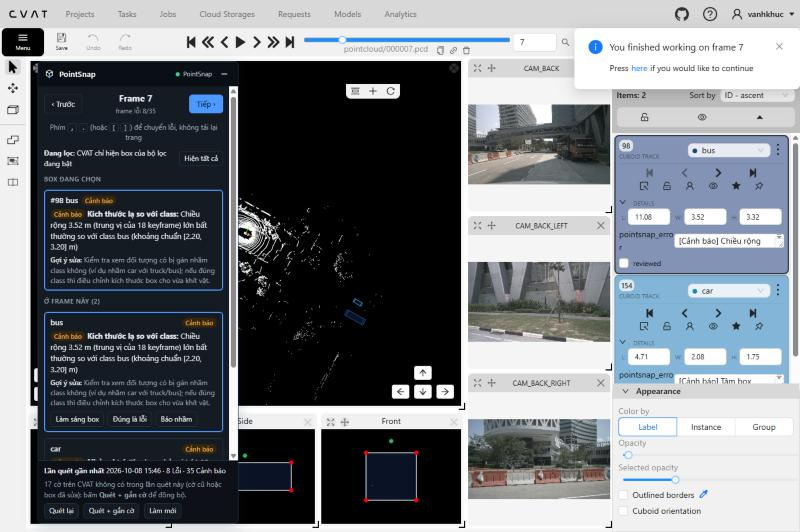
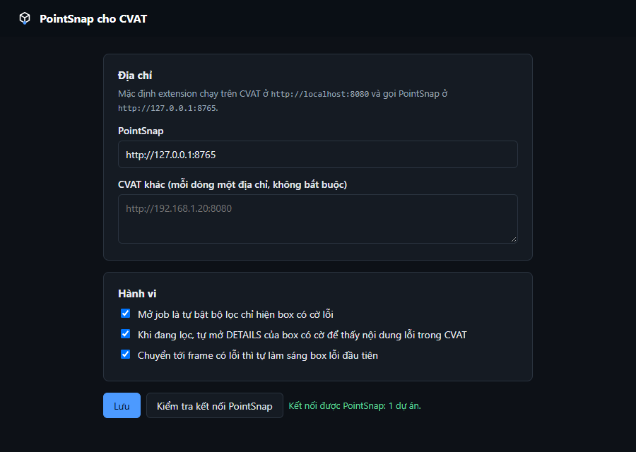

# Kết quả thử extension PointSnap cho CVAT (A15)

Thử ngày 08/10/2026 trên CVAT 2.77 local (Docker), task 2 / job 2 (scene-0061, 39 frame, 219 track).
Lúc thử job có **60 box mang cờ `pointsnap_error` ở 35 frame**. Lần quét mới nhất có 43 mục (8 Lỗi, 35 Cảnh báo). 17 cờ còn lại sót từ lần gắn cờ trước khi chỉnh ngưỡng A10; bảng PointSnap báo số cờ này và nhắc **Quét + gắn cờ** để đồng bộ.

Cách thử:
- Nạp phần content script vào trang CVAT đã đăng nhập trong trình duyệt của Claude, rồi đo bằng script.
- Nạp extension thật vào Edge chạy ẩn (`--load-extension`) để thử service worker và trang Tùy chọn.

## Spike S1–S4 (cổng G4)

| # | Nội dung | Kết quả |
|---|---|---|
| S1 | Bấm hộ Filters → Recently used → mục PointSnap → Submit trên job 3D | **Đạt.** Bộ lọc bật, danh sách bên phải chỉ còn box có cờ (nút Filters có lớp `filters-armed`). |
| S2 | Lần đầu chưa có bộ lọc | **Đạt, đổi cách làm.** Không bấm hộ trình tạo bộ lọc (dễ vỡ). Extension thêm sẵn mục `pointsnap_error is not empty` vào lịch sử bộ lọc của CVAT (`annotationFiltersHistory` trong localStorage) ngay khi trang bắt đầu tải. Đã kiểm bằng chính thư viện bộ lọc của CVAT (`@react-awesome-query-builder` 6): mục này nạp lại đúng thành `is_not_empty` trên mọi nhãn. Nếu CVAT đã dựng trang trước khi mục được thêm, bảng báo "Tải lại trang một lần". |
| S3 | Đọc `pointsnap_error` của box đang chọn | **Đạt.** CVAT chỉ hiện thuộc tính khi khung DETAILS của box đang mở. Khi đang lọc, extension tự mở DETAILS của box có cờ (mỗi box một lần), rồi đọc nội dung. |
| S4 | Gõ số vào ô chọn frame + Enter, chuyển frame không tải lại trang | **Đạt.** Lưu ý: ô số frame đổi ngay khi gõ, trước khi CVAT thật sự chuyển frame. Vì vậy extension đọc frame thật từ thanh trượt frame (`aria-valuenow`) và chờ CVAT tải xong frame mới đi tiếp. Không cần chuyển kiểu nhảy "theo bộ lọc" của CVAT. |

## Tiêu chí xong (đề xuất mục 4.6)

| Tiêu chí | Kết quả |
|---|---|
| E2: bộ lọc tự bật ≤ 2 giây sau khi job tải xong | **Đạt:** 0,69 / 0,72 / 0,75 / 0,76 giây (4 lần đo); một lần 2,8 giây khi CVAT còn đang vẽ point cloud. Riêng bước bấm hộ: mở hộp thoại 0,3 s, chọn mục 0,4 s, Submit 0,6 s, bộ lọc bật 0,74 s. |
| E3: chọn 10 box có cờ, thông báo hiện đúng nội dung cả 10 lần | **Đạt 10/10** (frame 0–7: truck, car, pedestrian, bus). |
| E4 / E5: đi hết các frame có lỗi không lần nào tải lại trang | **Đạt:** 34 lần chuyển, 0 lần sai frame (kiểm cả thanh trượt lẫn tên file `.pcd`), 0 lần tải lại trang. Mỗi lần chuyển khoảng 0,15 giây gồm cả lúc CVAT tải point cloud; đi hết job 7 giây. Bấm dòng trong danh sách nhảy đúng frame. |
| So với mở từng link "Mở đúng box" | Mỗi link tải lại cả job 3D: **11,0–12,7 giây** tới khi khung làm việc sẵn sàng. 43 mục × khoảng 12 giây ≈ **8,6 phút chỉ để chờ tải**, so với **7 giây** khi dùng extension. |
| Tắt PointSnap: E1–E4 vẫn chạy; bật lại: E5–E6 chạy | **Đạt.** Tắt: đầu bảng ghi "PointSnap tắt", chuyển lỗi vẫn chạy. Bật lại và bấm Làm mới: Quét lại, Đúng / Báo nhầm chạy. |
| E6 | **Đạt:** Quét lại có thanh tiến độ; Đúng là lỗi / Báo nhầm lưu vào `reviews.json`, bấm lần nữa thì bỏ; Quét + gắn cờ có bước xác nhận (nhắc Save trước và tải lại trang sau). Không bấm gắn cờ thật trong lần thử. |
| Không lỗi console của extension; chỉ gửi yêu cầu tới CVAT và PointSnap | **Đạt.** Lỗi console còn lại là của CVAT: 404 `/api/user-agreements`, 503 `/api/lambda/functions` (máy không cài phần mô hình AI). |

Extension thật nạp trong Edge:
- Service worker gọi `GET /api/extension/jobs/2` thẳng tới PointSnap (không cần CORS), từ chối đường dẫn ngoài `/api/` và phương thức `DELETE`.
- Trang Tùy chọn kiểm tra kết nối báo "Kết nối được PointSnap: 1 dự án".

## Lỗi tìm thấy khi thử và đã sửa

1. CVAT trả **406** khi gửi header `Accept: application/json`: bỏ header.
2. Câu thông báo lơ lửng / lún thật có dạng "… (lơ lửng); cao hơn … so với các frame khác của track", không nhận ra luật nên gợi ý sửa bị chung chung. Đã nhận theo `(lơ lửng)` / `(lún)`, và box **lún** có gợi ý riêng "Nâng đáy box lên".
3. Đọc frame hiện tại từ ô số frame nên báo nhầm đã chuyển frame khi CVAT chưa chuyển: đổi sang thanh trượt frame, chờ CVAT tải xong, không cho chuyển chồng.
4. Phím: CVAT dùng `K` (Switch keyframe, làm thay đổi nhãn) nên không dùng J/K. Bộ gõ Telex có thể biến `[` `]` thành `ư` `ơ`, nên dùng thêm `,` `.`. Bấm nhiều lần liền thì cộng dồn và đi lần lượt.

## Còn lại

- Chiến cài extension theo [README](../extension/README.md) và thử trên máy khác (Chrome và Edge).
- Lần thử tới bấm **Quét + gắn cờ** thật để đồng bộ 17 cờ cũ, rồi đo lại.
